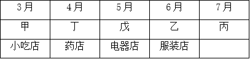

# 分析推理-时间与店铺双向匹配（排除法+确定信息优先）

考点：[[20-考点/判断推理/逻辑判断/分析推理-时间与店铺双向匹配（排除法+确定信息优先）|逻辑判断 / 分析推理-时间与店铺双向匹配（排除法+确定信息优先）]]

**问法模型**：『根据以上信息，可以得出以下哪项？』→ 组合排列题，先由确定信息（最晚、相差3个月）锁定时间轴，再逐项排除验证

## 推理链
1. 第1步：条件(3)『丙与去家用电器打工的人是同乡』说明丙不是去家用电器店的那个人，且『丙开始打工的时间最晚』→丙=7月，锁定唯一时间锚点
2. 第2步：条件(2)乙比甲晚3个月，丙占7月后剩3、4、5、6四个月，其中相差3个月的组合只有(3月,6月)→甲=3月，乙=6月，C项『6月份丁』被排除
3. 第3步：条件(4)『丁比戊开始打工的时间早』，剩4月、5月→丁=4月（药店），戊=5月
4. 第4步：店铺匹配：甲去小吃店，乙=服装店，丁=药店；由条件(3)丙不去家用电器店→戊=家用电器店，即『5月份戊开始到家用电器店打工』，B项成立
5. 第5步：馄饨店与拉面馆都可称作小吃店，甲、丙只能各占其一但无法确定谁去哪家→A『甲到馄饨店』、D『丙到拉面馆』均无法必然得出，排除

**最快解法**：⚡ 确定信息优先+排除法：先锁丙=7月，再由『乙比甲晚3个月』在剩余月份中唯一配对甲=3月、乙=6月，丁戊占4、5月；关键一步是『同乡』隐含丙≠家用电器店，故戊=家用电器店（5月），直接选B

## 易错点
- ⚠ 忽略『丙与去家用电器打工的人是同乡』隐含丙不去家用电器店，导致无法推出戊的店铺
- ⚠ 误以为『小吃店』只能对应馄饨店或拉面馆中的某一家，从而误选A或D；实际上两店均可称小吃店，甲丙归属不定
- ⚠ 时间配对出错：若没先排除丙的7月，可能把甲乙误配为4月与7月

## 母题抽象
> 🧩 当题干出现『多人多属性一一对应+含时间排序条件』时，先从最确定信息（最晚/最早/互斥关系如同乡）定锚点，再用数量关系（相差N个月）做唯一配对，最后注意一词多义（如小吃店）导致的不可确定项，用排除法选必然为真项

**同类特征**：5人5店5月份一一对应、同乡隐含互斥、最晚=7月锚点、相差3个月唯一配对、小吃店可指馄饨店或拉面馆、可以得出以下哪项

## 相关题
- [[10-真题/判断推理/逻辑判断/17097271 分析推理-环湖方位排布与距离对应（顺时针环形定位）|17097271]]（山西 2024，相关度1）
- [[10-真题/判断推理/逻辑判断/1791828 翻译推理-三段论连锁传递（含否定前件谬误辨析）|1791828]]（江苏 2016，相关度1）
- [[10-真题/判断推理/逻辑判断/1791834 分析推理-不等式比较与同项消去（整体与部分的大小比较）|1791834]]（江苏 2016，相关度1）
- [[10-真题/判断推理/逻辑判断/2042362 翻译推理-逆否规则（结合选言命题否定肯定式）|2042362]]（江苏 2017，相关度1）
- [[10-真题/判断推理/逻辑判断/2172760 翻译推理-假言命题逆否规则（只有才=后推前、肯前必肯后、否后必否前）|2172760]]（江苏 2018，相关度1）

---

### 题干
甲、乙、丙、丁、戊5人近期均到一座大型购物美食广场打工。她们打工的商家有家用电器店、服装店、药店、馄饨店、拉面馆，每人各去一家。每人开始打工的时间各不一样，分别是去年的3月、4月、5月、6月、7月。已知：
（1）甲是厨师，她在一家小吃店顺利找到工作；
（2）乙去了服装店，但她开始打工的时间比甲晚3个月；
（3）丙与去家用电器打工的人是同乡，5人中她开始打工的时间最晚；
（4）丁比戊开始打工的时间早，她去的是药店。
根据以上信息，可以得出以下哪项？

### 选项
- A. 3月份甲开始到馄饨店打工
- B. 5月份戊开始到家用电器店打工　✅
- C. 6月份丁开始到药店打工
- D. 7月份丙开始到拉面馆打工

### 官方解析

分析题干：

（1）甲是厨师，在小吃店上班；

（2）乙在服装店，比甲的上班时间晚三个月；

（3）丙与去家用电器打工的人是同乡，她最晚开始打工；

（4）丁在药店，丁打工时间早于戊。

如下图，根据条件（3）可知丙在7月开始打工。根据条件（2）可知，乙比甲晚三个月，剩下3、4、5、6四个月份，那么甲在3月去小吃店上班，乙在6月去服装店上班，排除C项。根据条件（4）可知，丁去打工的时间早于戊，那么丁在4月去药店，又因为丙没有去电器城，那么戊在5月去了电器城。拉面馆和馄饨店都可以称作小吃店，所以甲和丙的上班地点无法确定，排除A、D项。

故正确答案为B。

### 给定材料
（无）
