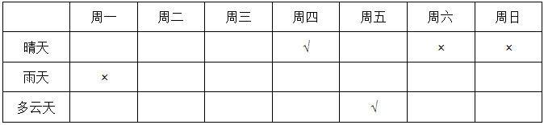

# 分析推理-确定信息+数量约束的列表穷举与举反例验证

考点：[[20-考点/判断推理/逻辑判断/分析推理-确定信息+数量约束的列表穷举与举反例验证|逻辑判断 / 分析推理-确定信息+数量约束的列表穷举与举反例验证]]

**问法模型**：'以下推断错误的是'为选非题→先用确定条件锁定本周必然格局，再逐项验证可推出性，对'不可能'类断言优先构造反例击破

## 推理链
1. 第1步：由条件(1)(3)固定：周四=晴天，周五（明天）=多云
2. 第2步：由条件(4)'明天以后要么是雨天，要么是多云天'，确定周六、周日只能是雨天或多云，不可能晴天
3. 第3步：由条件(5)'这周有三天是晴天'，周四已占1个晴天、周六周日不可能晴天、周五是多云，推出周一至周三中恰有2个晴天
4. 第4步：结合条件(2)'周一没有下雨'，周一只能是晴天或多云，即周一至周三中唯一的非晴天要么是周一（多云），要么是周二/周三（雨天或多云）
5. 第5步：验证A：周一不下雨、周四晴、周五多云，且周二周三中至少有一天晴天，故至少4天必不下雨，最多3天可能下雨，'最多三天带伞'可推出，排除
6. 第6步：验证B：若周六周日天气不同，则两者中恰1个多云，加周五多云、周一至周三至多1个多云，多云最多3天，可推出，排除
7. 第7步：验证C：构造反例'周一多云、周二晴、周三晴、周六周日均为雨天'，满足全部条件且周二=周三=晴天，故'周二和周三不可能相同'不成立，当选
8. 第8步：验证D：若周二是多云天，则周一至周三的两个晴天只能是周一和周三，周一必为晴天，可推出，排除；选非题故选C

**最快解法**：⚡ 列表法+举反例：先填死'周四晴、周五多云、周六日非晴'，推出核心约束'周一至周三恰有两个晴天'；选非题优先攻击'不可能'类选项C，用反例（周一多云、周二周三均晴）一步验证即可锁定答案

## 易错点
- ⚠ 把'明天以后'误解为包含周五，错判周六周日的取值约束范围
- ⚠ 漏推'周一至周三恰有两天晴天'这一核心数量约束，导致各选项无法系统验证
- ⚠ 选非题惯性思维，把'能推出'的A/B/D误当成答案，或忽略'周一没有下雨'允许周一为多云的可能

## 母题抽象
> 🧩 当题干出现'封闭类别（只有几种）+确定日期/位置信息+数量约束（几天是什么）'时，用列表法固定确定项、推出剩余位置的分布范围，再对'一定/不可能'类断言用构造反例或穷举验证

**同类特征**：只有三种天气的封闭类别、今天是周四/明天多云等确定信息、数量约束'有三天是晴天'、'要么…要么…'限定取值范围、问'推断错误的是'（选非题）、'周一没有下雨'的双重限制条件

## 相关题
（暂无）

---

### 题干
根据天气预报，这周只有三种天气，分别是晴天、雨天和多云天。现在已知：
（1）今天是周四，晴天；
（2）周一没有下雨；
（3）明天是多云天；
（4）明天以后要么是雨天，要么是多云天；
（5）这周有三天是晴天。
那么，以下推断错误的是（  ）。

### 选项
- A. 为了避免被雨淋湿，这周最多只有三天需要带雨伞出门
- B. 如果周六和周日天气不相同，这周最多有三天是多云天
- C. 周二和周三天气不可能相同　✅
- D. 如果周二是多云天，则周一是晴天

### 官方解析

由条件（1）（3）（4）可知：周四晴天，周五多云天，周六、周日非晴天。由条件（1）（5）可知：周一非雨天，周一至周三有两天是晴天。根据题干列表：

A项：根据周四晴天，周五多云天，周一至周三有两天是晴天，推出有四天一定不会下雨，所以最多三天需要带伞出门，A选项可以推出，排除；

B项：周六和周日天气不同，所以周六周日有一天是多云天。周一至周三有两天是晴天，所以另外一天可能是多云天。周五是多云天，所以这周最多有三天是多云天，B选项可以推出，排除；

C项：根据周一非雨天，周一至周三有两天是晴天，可知存在周一是多云天，周二和周三都是晴天这种可能，C项错误，当选；

D项：根据周一非雨天，周一至周三有两天是晴天，如果周二是多云天，那么周一、周三一定是晴天，D选项可以推出，排除。

本题为选非题，故正确答案为C。

### 给定材料
（无）
