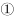
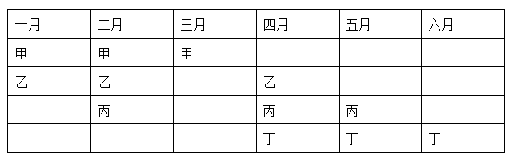

# 分析推理-假设穷举与逐月计数（获奖名额分配-集合交集）

考点：[[20-考点/判断推理/逻辑判断/分析推理-假设穷举与逐月计数（获奖名额分配-集合交集）|逻辑判断 / 分析推理-假设穷举与逐月计数（获奖名额分配/集合交集）]]

**问法模型**：问法为'以下说法一定正确的是'→需穷举题干条件下所有可能情形并逐月计数，取各情形共同成立的必然结论

## 推理链
1. 第1步：6个月内甲乙丙丁每人获奖3次，共4×3=12人次；甲和乙有2个月同时获奖、乙和丙有2个月同时获奖、甲和丁获奖月份完全不同
2. 第2步：甲、丁各占3个月且完全错开，恰好平分6个月→每个月必有且仅有甲、丁之一获奖，不存在无人获奖的月份
3. 第3步：乙的3次中2次落在甲的3个月（与甲同月），剩余1次必落在丁的3个月
4. 第4步：用假设法对丙分类：情形一，丙2次落在甲侧月份且与乙同月、1次落在丁侧月份且不与乙的丁侧月相同（否则乙丙同时获奖达3个月，矛盾）
5. 第5步：情形二，丙1次落在甲侧月份且与乙同月、2次落在丁侧月份且其中1次恰为乙的丁侧月（凑足乙丙同时2个月）
6. 第6步：对两种情形逐月计数：情形一得'3人月2个、2人月2个、1人月2个'；情形二同样得'3人月2个（乙的甲侧月与丁侧月）、2人月2个、1人月2个'
7. 第7步：两种情形共同结论为'只有3个人同时获奖的月份有2个'，逐项对照：A符合，B错（2人月是2个非3个），C错（1人月是2个非1个），D错（2人月=1人月，并非少于）

**最快解法**：⚡ 假设法+表格穷举（官方表格法）：固定甲=某3个月、丁=另外3个月，乙按'甲侧2次+丁侧1次'放置，再对丙仅有的两种放法各列一张月度计数表，取两表计数完全相同的项目即为必然结论

## 易错点
- ⚠ 忽略'甲丁完全不同'隐含的强约束：6个月被甲丁恰好平分，每个月必有人获奖，不存在0人月
- ⚠ 情形讨论不全：只验证丙的一种放法（如丙2次都在甲侧）就匆忙下结论，漏掉丙2次在丁侧的另一情形
- ⚠ 混淆'同时获奖的月份数'与'当月获奖人数'，或给丙安排丁侧月份时误与乙的丁侧月重合，导致乙丙同时获奖变成3个月、与题干矛盾而不自知

## 母题抽象
> 🧩 当题干出现'N个对象在M个时段各出现k次+给定两两同时出现的时段数+某两对象时段完全错开'特征时，用'固定基准+假设穷举列表'法，对剩余对象的每种合法放法逐时段计数，取所有情形共同的计数结论作答

**同类特征**：6个月每人获奖3次、甲乙有2个月同时获奖、乙丙有2个月同时获奖、甲丁获奖月份完全不同、以下说法一定正确的是

## 相关题
（暂无）

---

### 题干
某单位每个月都要对工作人员的工作表现进行考评。去年上半年，该单位的甲、乙、丙、丁4位员工均获得了3次月度优秀奖。已知，甲和乙有2个月同时获奖，乙和丙也有2个月同时获奖，甲和丁获奖的月份完全不同。
以下说法一定正确的是：

### 选项
- A. 只有3个人同时获奖的月份有2个　✅
- B. 只有2个人同时获奖的月份有3个
- C. 只有1个人获奖的月份有1个
- D. 只有2个人同时获奖的月份少于只有1个人获奖的月份

### 官方解析

根据题干条件可知：

6个月内每个人都3次获得月度优秀奖；

甲、乙有2个月同时获奖；

乙、丙有2个月同时获奖；

甲、丁获奖月份完全不同；

由于题目不涉及获奖的月份和先后顺序，因此可以假设甲获奖的月份为一、二、三月，根据，丁获奖月份则为四、五、六月。根据，乙在一、二、三月中有两次获奖，在四、五、六月中有一次获奖。根据，假如丙在一、二、三月获两次奖且与乙同时，在四、五、六月获一次奖，且与乙不同时，如表格所示：

假如丙在一、二、三月获一次奖，且与乙同时，在四、五、六月获两次奖且必须有一次与乙同时，如表格所示：

根据以上两种情况的假设，可判定，无论何种情况只有3个人同时获奖的月份有2个。

故正确答案为A。

### 给定材料
（无）
