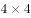
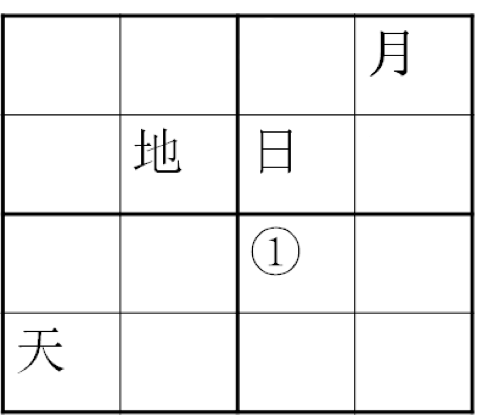

# 分析推理-方格填充（排除法+最大信息交叉点）

考点：[[20-考点/判断推理/逻辑判断/分析推理-方格填充（排除法+最大信息交叉点）|逻辑判断 / 分析推理-方格填充（排除法+最大信息交叉点）]]

**问法模型**：数独式约束（每行/每列/每宫均含天、地、日、月）问指定格①填什么 → 用排除法从已知信息最多的行列交叉格入手，连锁消去定死各格

## 推理链
1. 第1步：提取约束——每个小方格填一个汉字，每行、每列及粗线框成的4个2×2小正方形中均含有天、地、日、月；图中已知：第1行第4列=月，第2行第2列=地、第2行第3列=日，第4行第1列=天，①位于第3行第3列
2. 第2步：找横纵信息最大交叉点A（第2行第1列）：其所在第2行已有地、日，所在第1列已有天，用排除法消去天、地、日，故A只能填月
3. 第3步：第2行已含月（A）、地、日，四字缺一不可，故B（第2行第4列）只能填天
4. 第4步：看右上角粗线框（第1-2行×第3-4列）：已含日（第2行第3列）、天（B）、月（第1行第4列），故C（第1行第3列）只能填地
5. 第5步：第3列已含地（C）、日，故①（第3行第3列）与D（第4行第3列）只能填天或月；D所在第4行已有天（第4行第1列），D≠天，故D=月
6. 第6步：第3列四格只剩天未出现，故①只能填天，与选项B对照相符

**最快解法**：⚡ 排除法+连锁推进：先填第2行第1列交叉点=月 → 第2行第4列=天 → 右上宫第1行第3列=地 → 第3列只剩天/月且第4行已有天，锁定①=天，选B

## 易错点
- ⚠ 只检查行和列，漏掉粗线框2×2宫的约束，导致无法排除或排除错误
- ⚠ 不先找'已知字最多'的行列交叉格，而是盯着①直接硬推，条件不足易卡壳或猜错
- ⚠ 把约束理解成'不重复'即可，忽略'每行每列每宫四个字必须全部出现'这一全含要求

## 母题抽象
> 🧩 当题干出现'每行/每列/每宫均含同一组元素且互不重复'的数独式方格时，用排除法：从已知信息最密集的行列（或行列宫）交叉格入手逐格消去，形成连锁推理直至锁定目标格

**同类特征**：4×4方格矩阵、每行每列及粗线框小正方形均含天、地、日、月、问指定格①填入的汉字、已知字分散但构成行列宫三重约束、交叉点排除可连锁定解

## 相关题
（暂无）

---

### 题干

在下列的正方形矩阵中，每个小方格可填入一个汉字，要求每行每列以及粗线框成的4个小正方形中均含有天、地、日、月4个汉字。

根据上述条件，方格①中应填入的汉字是：

### 选项
- A. 地
- B. 天　✅
- C. 月
- D. 日

### 官方解析

第一步：找到题干中的已知信息

要求每行每列及粗线条的四个小正方形中均含有天、地、日、月四个汉字，找横纵信息最大交叉点，即A和B。那么A处不能填入“天”“地”和“日”字，所以A处只能填入“月”字，所以“B”处填入“天”字。观察图形右上角的小正方形，所以C处只能填入“地”字，又通过第四横行可知，D处不能填“天”，所以，①只能填“天”。

故正确答案为B。

### 给定材料
（无）
