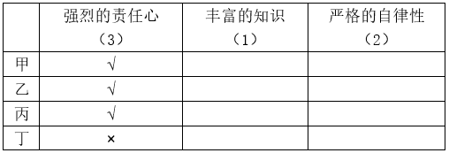
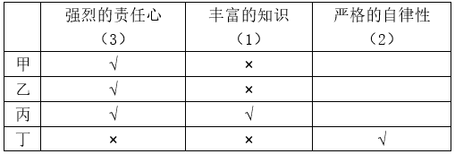
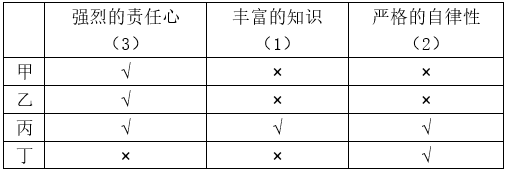

# 分析推理-数量约束+假设反证列表排除（多人多属性组合匹配）

考点：[[20-考点/判断推理/逻辑判断/分析推理-数量约束+假设反证列表排除（多人多属性组合匹配）|逻辑判断 / 分析推理-数量约束+假设反证列表排除（多人多属性组合匹配）]]

**问法模型**：多人多属性、每种属性人数固定且'只有一人完全符合全部条件'→ 用数量约束+假设反证逐层定性，列表锁定唯一全符合者后对照组合选项

## 推理链
1. 第1步：提取数量约束：④'三人具有强烈的责任心、两人具有严格的自律性、一人具有丰富的知识'，①'甲、乙自律性程度相同'、②'乙、丙责任心水平相当'、③'丙、丁并非都具有强烈的责任心'、⑤每人至少符合一条件、⑥仅一人完全符合
2. 第2步：由②乙丙'相当'知责任心同有或同无：若同无，则最多甲丁2人有责任心，与'三人'矛盾→乙丙均有强烈责任心
3. 第3步：由③'丙、丁并非都具有'且丙已有→丁无责任心；责任心缺额1人由甲补足→甲乙丙有责任心、丁无（选项A成立）
4. 第4步：完全符合者须三者兼备，而知识仅1人→拥有知识者即唯一完全合格者；丁无责任心不可能完全合格→丁无知识，结合⑤'至少符合条件之一'→丁必有严格自律性
5. 第5步：由①甲乙自律性相同且自律性共2人：若甲乙都有，加丁共3人与'两人'矛盾→甲乙均无自律性（选项B错误），则自律性2人恰为丙、丁（选项C成立）
6. 第6步：汇总：甲乙仅责任心、丁仅自律性，唯一可能三者兼备者是丙→知识归丙，丙完全符合全部条件（选项D成立），故正确答案为ACD

**最快解法**：⚡ 列表+假设反证（数量定性法）：先由'乙丙同等+责任心共3人'定乙丙有、丁无、甲有责任心；再由'知识1人=完全合格者且丁无责任心'定丁无知识→丁有自律性；由①'甲乙相同+自律性共2人'定甲乙无、丙丁有自律性；知识唯一归丙，丙为完全合格者

## 易错点
- ⚠ '相当/相同'只给'同有或同无'两种可能，必须联立'总人数固定'做反证才能定死，单看①②会陷入僵局
- ⚠ 漏掉'完全合格者须三者兼备'与'知识仅一人'的联动：拥有知识者即完全合格者，故无责任心的丁不可能有知识
- ⚠ 分配自律性时忘记丁已确定有自律性，误判甲乙可有自律性（超过'两人'上限）

## 母题抽象
> 🧩 当题干出现'多人+多属性+每种属性人数固定+两人属性相同/并非都具有+只有一人完全符合'时，先用'相同属性对×总人数'假设反证锁死必有人群，再逐条件排除把每人属性唯一化，最后锁定唯一全符合者

**同类特征**：人数固定的多属性匹配、甲乙自律性程度相同、乙丙责任心水平相当、丙丁并非都具有强烈的责任心、一人具有丰富的知识、只有一人完全符合全部条件

## 相关题
（暂无）

---

### 题干
某次重要考试选拔命题教师，命题教师必须具备三个条件：第一，强烈的责任心；第二，丰富的知识；第三，严格的自律性。现在至少符合条件之一的甲、乙、丙、丁四名优秀教师报名参加。已知：
①甲、乙自律性程度相同。
②乙、丙责任心水平相当。
③丙、丁并非都具有强烈的责任心。
④四个人中三人具有强烈的责任心、两人具有严格的自律性、一人具有丰富的知识。
经过考察，发现其中只有一人完全符合命题教师的全部条件，则以下说法正确的有：

### 选项
- A. 甲乙丙具有强烈的责任心
- B. 甲乙具有严格的自律性
- C. 丙丁具有严格的自律性
- D. 完全符合命题教师全部条件的是丙

### 官方解析

分析题干已知信息：

①甲、乙自律性程度相同。

②乙、丙责任心水平相当。

③丙、丁并非都具有强烈的责任心。

④四个人中三人具有强烈的责任心、两人具有严格的自律性、一人具有丰富的知识。

⑤至少符合条件之一的甲、乙、丙、丁四名优秀教师报名参加。

⑥四个人只有一人完全符合命题教师的全部条件。

题干信息涉及的人和信息较多，可列表（表格数字代表符合该条件的人数）如下：

由条件②乙、丙责任心水平相当，以及符合强烈的责任心的人有三人，可知，乙、丙一定都有强烈的责任心（若乙、丙均无强烈的责任心，则符合强烈的责任心的人只有两人，与题干矛盾）。

再由条件③丙、丁并非都具有强烈的责任心，可知丁没有强烈的责任心，则甲一定有强烈的责任心。如下表所示：

再由条件⑥四个人只有一人完全符合命题教师的全部条件且拥有丰富的知识的教师只有一人，可知拥有丰富知识的人一定不是丁，再由条件⑤甲、乙、丙、丁四名优秀教师至少符合条件之一，可知丁一定有严格的自律性。如下表：

由条件①甲、乙自律性程度相同且拥有严格的自律性的教师只有两人，可知甲、乙一定都没有严格的自律性（如果甲、乙都有严格的自律性，那么丙、丁都没有严格的自律性，这与上述分析丁具有严格的自律性矛盾）。如下表：

故正确答案为ACD。

### 给定材料
（无）
