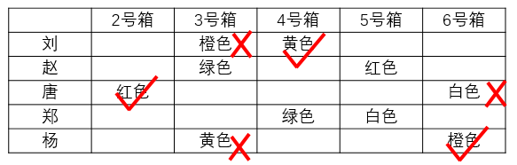

# 分析推理-半真半假匹配（唯一猜测突破口+链式传导）

考点：[[20-考点/判断推理/逻辑判断/分析推理-半真半假匹配（唯一猜测突破口+链式传导）|逻辑判断 / 分析推理-半真半假匹配（唯一猜测突破口+链式传导）]]

**问法模型**：题干给出'每人只猜对一个+每个箱子都有人猜对'双重约束问'由此可推测'→应先找仅被一人猜过的箱子作必真突破口，再沿'一真则同行另假、一假则同列另真'链式推满全局

## 推理链
1. 第1步：按箱整理猜测——箱2仅唐猜'红色'（唯一一条），条件'每个箱子都有一位嘉宾猜对'→箱2=红色必真，故唐'6号=白'错
2. 第2步：箱6的猜测有唐'白色'（已错）与杨'橙色'，该箱必有人猜对→箱6=橙色（杨对），故杨'3号=黄'错
3. 第3步：六个复原面颜色各不相同且箱6=橙色→刘'3号=橙色'错，则刘'4号=黄色'对→箱4=黄色
4. 第4步：箱4=黄色→郑'4号=绿色'错，则郑'5号=白色'对→箱5=白色
5. 第5步：箱5=白色→赵'5号=红色'错，则赵'3号=绿色'对→箱3=绿色；验证五人行均恰一真（1蓝2红3绿4黄5白6橙），约束全部满足
6. 第6步：对照选项——A箱2应为红非绿、B箱4恰为黄色、D箱6应为橙非红，仅C'5号=白色'与推导一致

**最快解法**：⚡ 突破口法+链式传导：秒找'只有一条猜测'的箱子（2号箱仅唐猜红色→必真），随后按'此人另一句即错→另一句所涉箱子的另一位猜测者必真'逐环传导（唐→杨→刘→郑→赵），五行推满后直接对照选项

## 易错点
- ⚠ 忽略'每个箱子都有一位嘉宾猜对'这一列约束，只用'每人恰对一个'无法起步
- ⚠ 未识别箱2只有一条猜测、必为真的突破口信息
- ⚠ 链式传导中断：推出箱6=橙后忘记六色互斥，错失否定刘'3号=橙'的关键环节

## 母题抽象
> 🧩 当题干出现'每人只对一个（半真半假）+每个对象都有人猜对'时，先找只被猜过一次的对象令其必真，再用'一真则同行另假、一假则同列另一真'的链式规则推满全局后对照选项

**同类特征**：每位嘉宾都只猜对一个、每个箱子都有一位嘉宾猜对、六个颜色各不相同、1号箱已开为蓝色、某对象仅有一条猜测、半真半假双约束

## 相关题
（暂无）

---

### 题干
某种魔方有六面，六面全部复原时的颜色分别为红、蓝、黄、白、绿、橙。在某综艺节目现场，有此种魔方6个，每个只复原了一面，且每个魔方复原面的颜色不同。主持人将此6个魔方放入编号为1～6的6个不透明的箱子中，并打开了1号箱子，里面装的是复原面为蓝色的魔方，随后主持人请刘、赵、唐、郑、杨五位嘉宾猜其他箱子里魔方复原面的颜色。五位嘉宾分别作出了如下猜测：
刘：3号箱子中魔方复原面为橙色，4号箱子中魔方复原面为黄色。
赵：3号箱子中魔方复原面为绿色，5号箱子中魔方复原面为红色。
唐：2号箱子中魔方复原面为红色，6号箱子中魔方复原面为白色。
郑：4号箱子中魔方复原面为绿色，5号箱子中魔方复原面为白色。
杨：3号箱子中魔方复原面为黄色，6号箱子中魔方复原面为橙色。
随后主持人一一打开箱子，发现每位嘉宾都只猜对了一个箱子中魔方复原面的颜色，并且每个箱子都有一位嘉宾猜对。
由此可以推测：

### 选项
- A. 2号箱子中魔方复原面为绿色
- B. 4号箱子中魔方复原面不是黄色
- C. 5号箱子中魔方复原面为白色　✅
- D. 6号箱子中魔方复原面为红色

### 官方解析

第一步：分析题干信息。

为方便分析，将题干五位嘉宾的猜测整理成如下表格：

“每位嘉宾都只猜对了一个箱子中魔方复原面的颜色，并且每个箱子都有一位嘉宾猜对”由此可知：上表中每一行有一个颜色是对的、有一个颜色是错的，每一列中有一个颜色是对的，其他颜色是错的。2号箱这一列只有红色，因此这个红色就是对的，如下图：

因此6号箱这一列橙色就是对的，如下图：

因此刘所在一行中，橙色是错的，黄色是对的，如下图：

进而可以推知赵的猜测和郑的猜测，由于2号箱红色是对的，所以5号箱红色是错的，故赵所在一行绿色是对的，郑所在一行绿色是错的，白色是对的，如下图：

第二步：逐一分析选项

A项：2号箱子中魔方复原面为红色，该项错误，排除；

B项：4号箱子中魔方复原面为黄色，该项错误，排除；

C项：5号箱子中魔方复原面为白色，该项正确，当选；

D项：6号箱子中魔方复原面为橙色，该项错误，排除。

故正确答案为C。

### 给定材料
（无）
