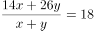
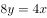

# 数学推断-加权平均（十字交叉法比较权重-人数）

考点：[[20-考点/判断推理/逻辑判断/数学推断-加权平均（十字交叉法比较权重-人数）|逻辑判断 / 数学推断-加权平均（十字交叉法比较权重/人数）]]

**问法模型**：题干给出总体平均数与两组各自平均数，问'由此可见'→用加权平均性质（十字交叉法）判断两组权重（人数）大小

## 推理链
1. 第1步：提取数据：所有参赛者平均每人每天8小时拆装18组；第一小组平均26组；第二小组平均14组
2. 第2步：应用加权平均规则：总体平均数必介于两组平均数之间，且总体平均数更靠近哪一组的平均数，哪一组的权重（人数）就更大
3. 第3步：比较距离：26-18=8（第一组一侧），18-14=4（第二组一侧），18更靠近14，故第二组人数多于第一组；由十字交叉得人数比第一组:第二组=4:8=1:2
4. 第4步：逐项对照：A项由'平均速度'无法推出个体'均优于'，排除；C项'拆装速度达标与否'题干未提及，无中生有；D项'比赛结束后动手能力加强'题干未涉及，无中生有；B项与第3步推导一致，当选

**最快解法**：⚡ 十字交叉法/加权平均性质：总体均值18距第二组均值14仅差4，距第一组均值26差8，平均数偏向谁，谁的人数就多，直接锁定B

## 易错点
- ⚠ 误选A：把两组'平均速度'的差异当成个体动手能力比较，'平均'推不出'均优于'这一全称结论
- ⚠ 不会利用总体平均18的偏向位置，忽略加权平均中权重与距离成反比的关系
- ⚠ 被'制造商认为设计需进一步简化'这一背景句干扰，误以为题干涉及'达标'或'设计问题'而选C

## 母题抽象
> 🧩 当题干同时出现'总体平均数'与'各子集平均数'时，总体平均更靠近谁的均值，谁的权重（人数/数量）就更大，可用十字交叉法求比值；含'均、所有'的绝对化选项多为不可推的陷阱项

**同类特征**：平均每人每天8小时拆装18组、第一小组平均26组、第二小组平均14组、由此可见（推断结论）、制造商结论为背景干扰信息、选项含'均/所有'绝对化表述

## 相关题
（暂无）

---

### 题干
两个小组参加汽车零部件拆装速度测试比赛。所有参赛者平均每人每天8小时可以拆装18组零部件。其中，第一小组的平均速度是每人每天8小时拆装26组零部件；第二小组的平均速度是每人每天8小时拆装14组零部件。通过测试赛，该汽车零部件的制造商认为该零部件的设计需要进一步简化。由此可见：

### 选项
- A. 第一小组的参赛者动手能力均优于第二小组
- B. 第二小组的参赛人员比第一小组的参赛人员多　✅
- C. 所有参赛者的零部件拆装速度均不达标
- D. 所有参赛者的动手能力在比赛结束后都得到加强

### 官方解析

逐一分析选项。

A项：题干中只是提供了两组参赛者的平均速度，并不能推出第一组的动手能力均优于第二小组，排除；

B项：通过第一组与第二组的平均速度可知，设第二组的参赛人数为x，第一组的参赛人数为y，根据题干可以列出式子，得到，人数比为，第二组人数多于第一组，可以推出，当选；

C项：题干中并没有涉及参赛者的零部件拆装速度是否达标的问题，无中生有，排除；

D项：题干中没有涉及比赛结束后的情况，无中生有，排除。

故正确答案为B。

### 给定材料
（无）
