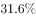

# 加强论证-选非题（不能支持-无关选项辨析）

考点：[[20-考点/判断推理/逻辑判断/加强论证-选非题（不能支持-无关选项辨析）|逻辑判断 / 加强论证-选非题（不能支持/无关选项辨析）]]

**问法模型**：'以下各项如果为真，不能支持上述论述的是'→选非题：逐一检验各选项是否为'氧自由基→机体老化'因果链补充论据，排除加强项，锁定话题无关项

## 推理链
1. 第1步：提取论点——'人体氧化的罪魁祸首不是氧气，而是氧自由基'，论据——'不成对的电子很容易引起化学反应，损害DNA、蛋白质和脂质等重要生物分子……导致机体老化'
2. 第2步：选非题解题模型——能通过补充论据、实验对照、举例说明'氧自由基导致机体老化'的选项为加强项，应排除；与论点因果链无关或削弱的选项当选
3. 第3步：B项'氧自由基抑制剂2-巯基乙胺……使小鼠的平均寿命延长'，属于抑制原因→结果消失的对照实验，反向证明氧自由基导致老化，可加强
4. 第4步：C项'茶多酚可以有效地抑制氧自由基的作用……果蝇寿命明显延长'，同为'抑制氧自由基→寿命延长'的对照实验，可加强
5. 第5步：D项'氧自由基可导致……皮肤失去弹性，细胞老化，出现皱纹'，直接举例说明氧自由基导致细胞老化，正面补充论据，可加强
6. 第6步：A项'氧自由基……可增强机体抗感染及免疫能力'，陈述的是氧自由基对人体的好处，与'氧自由基是否是导致机体老化的罪魁祸首'这一因果论点话题无关，不能支持
7. 第7步：对照选非问法，A项不能加强论述，故为正确答案

**最快解法**：⚡ 话题相关性排除法——所有加强项必须落在'氧自由基→机体老化'因果链上；B（抑制剂延长小鼠寿命）、C（茶多酚抑制后果蝇寿命延长）为反向对照实验，D（皮肤老化实例）为正面举例，均在因果链内排除；唯A谈'增强免疫的好处'，跳出了老化因果链，直接选A

## 易错点
- ⚠ 忽略'不能支持'的选非问法，惯性找加强项而误选B/C/D
- ⚠ A项同样提到'氧自由基'这一关键词，易被表面话题相关性迷惑，误以为在讨论论点而当作加强项；实际其陈述的是好处，与'罪魁祸首'的因果论点无关
- ⚠ B、C项以小鼠、果蝇为实验对象，类比到人体的论证力度较弱，但仍是加强项，勿误判为'不能支持'

## 母题抽象
> 🧩 当题干出现'不能支持/无法加强'的选非问法时，先提炼论点因果链（原因→结果），凡补充论据、举例、对照实验（抑制原因结果消失）均属加强应排除，与因果链话题无关或只谈对象其他属性的选项当选

**同类特征**：人体氧化/机体老化归因、罪魁祸首是氧自由基、不成对电子损害DNA蛋白质脂质、选非问法：不能支持、抑制剂/抗氧化剂对照实验、补充论据式加强

## 相关题
- [[10-真题/判断推理/逻辑判断/11367794 加强论证-选非题（话题一致性+补充论据）|11367794]]（江苏 2025，相关度1）
- [[10-真题/判断推理/逻辑判断/12019778 加强论证-选非题（不能支持，话题一致性与方向性判断）|12019778]]（浙江 2026，相关度1）
- [[10-真题/判断推理/逻辑判断/13432275 加强论证-选非题（补充论据）|13432275]]（深圳市考 2025，相关度1）
- [[10-真题/判断推理/逻辑判断/13504640 加强论证-选非题（补充论据与不明确项辨析）|13504640]]（辽宁 2025，相关度1）
- [[10-真题/判断推理/逻辑判断/16069781 加强论证-选非题（补充论据与无关项辨析）|16069781]]（贵州 2026，相关度1）

---

### 题干
人体跟金属一样，在大自然中会逐渐“氧化”。金属氧化是诸如铁生黄锈、铜生铜绿等。人体氧化的罪魁祸首不是氧气，而是氧自由基，是一种细胞核外含不成对电子的活性基因。这种不成对的电子很容易引起化学反应，损害DNA、蛋白质和脂质等重要生物分子，进而影响细胞膜转运过程，使各组织、器官的功能受损，导致机体老化。
以下各项如果为真，不能支持上述论述的是：

### 选项
- A. 
氧自由基有增强白细胞对细菌的吞噬和抑制细菌增殖的功能，可增强机体抗感染及免疫能力
　✅
- B. 
用氧自由基抑制剂2-巯基乙胺作为食物添加剂，以小鼠作为实验对象，的2-巯基乙胺可以使小鼠的平均寿命延长

- C. 
天然抗氧化剂茶多酚可以有效地抑制氧自由基的作用，食用了含有茶多酚食品的果蝇，其寿命明显延长

- D. 
氧自由基可导致人体胶原蛋白酶和硬弹性蛋白酶释放，使皮肤中的胶原蛋白和硬弹性蛋白产生过度交联并发生降解，导致皮肤失去弹性，细胞老化，出现皱纹

### 官方解析
第一步：找出论点和论据。
论点：人体氧化的罪魁祸首不是氧气，而是氧自由基，是一种细胞核外含不成对电子的活性基因。
论据：这种不成对的电子很容易引起化学反应，损害DNA、蛋白质、脂质等重要生物分子，进而影响细胞膜转运过程，使各组织、器官的功能受损，导致细胞老化。
第二步：逐一分析选项。
A项：指出氧自由基可以增强机体的抗感染能力，强调的是氧自由基对人体的好处，与氧自由基是否是导致人体氧化的罪魁祸首无关，不能加强，当选；
B项：强调使用氧自由基抑制剂后，实验鼠的平均寿命延长，说明氧自由基确实会导致机体老化，补充论据，可以加强，排除；
C项：强调食用可以抑制氧自由基作用的茶多酚后，果蝇的寿命延长，说明氧自由基会导致机体老化，补充论据，可以加强，排除；
D项：说明氧自由基会导致皮肤失去弹性，细胞老化出现皱纹，补充论据，可以加强，排除。
本题为选非题，故正确答案为A。

### 给定材料
（无）
