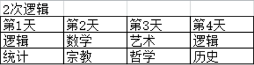
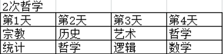

# 分析推理-日程排列（开设次数限定+多重约束）

考点：[[20-考点/判断推理/逻辑判断/分析推理-日程排列（开设次数限定+多重约束）|逻辑判断 / 分析推理-日程排列（开设次数限定+多重约束）]]

**问法模型**：题干以'以下哪门课程不能开设两次'的否定判断式提问→先叠加约束条件做排除锁定'不能'项，再对'能'的选项构造合法排列逐一验证

## 推理链
1. 第1步：提取题干5个条件：(1)艺术至少有一次安排在第3天；(2)数学只能安排在逻辑的次日；(3)第1天或第2天至少有一天为统计；(4)哲学与数学或哲学与艺术安排在同一天；(5)开设2次的课程不在同一天，也不在第3天，其中一次安排在第4天
2. 第2步：确定条件(3)的合理解读：'第1天或第2天至少有一天为统计'意味着统计只能出现在第1天和第2天，不能出现在第3天和第4天
3. 第3步：叠加条件(5)'其中一次安排在第4天'：凡开设2次的课程必须有一天出现在第4天
4. 第4步：两条件结合推出：统计无法出现在第4天，故统计无法满足'开设2次'的全部约束，即统计不能开设两次
5. 第5步：用构造法验证其余三项：哲学可分别与艺术（第3天）、数学同天开设两次，逻辑与历史也均可构造出满足条件(1)(2)(4)(5)的排两次课表
6. 第6步：对照选项：A哲学、B逻辑、D历史均可开设两次，只有C统计不能，故选C

**最快解法**：⚡ 约束叠加排除法：抓住两个硬性条件——条件(5)'开设2次必须有一天在第4天'+条件(3)统计限第1、2天出现，二者直接冲突，秒锁C；再用构造课表快速确认A、B、D可行即可

## 易错点
- ⚠ 对条件(3)产生第二种理解（认为统计除必现于第1或第2天外也可在第3、4天出现），导致统计也能开两次、题目无正确答案
- ⚠ 忽略条件(5)中'其中一次安排在第4天'这一硬性约束，未发现其与条件(3)的冲突
- ⚠ 只锁定C而未构造排列验证A、B、D确实可以开设两次，排除不彻底

## 母题抽象
> 🧩 当题干出现'某元素只允许出现在限定时段/位置'与'开设两次的元素必须占用某固定时段'的双重约束时，先做约束叠加排除锁定被禁项，再用构造法验证其余选项可行；若条件存在歧义理解导致多解，以官方答案反推唯一合理解读

**同类特征**：开设次数限定（能否开两次）、第几天安排的时段约束、多重条件叠加推理、条件表述存在歧义理解、构造合法排列验证、否定式判断提问（'不能'型）

## 相关题
（暂无）

---

### 题干
以下哪门课程不能开设两次？

### 选项
- A. 哲学
- B. 逻辑
- C. 统计　✅
- D. 历史

### 官方解析

第一步：分析题干。

（1）艺术至少有一次安排在第3天

（2）数学只能安排在逻辑的次日

（3）第1天或第2天至少有一天为统计

（4）哲学与数学或哲学与艺术安排在同一天

（5）开设2次的课程不在同一天，也不在第3天，其中一次安排在第4天

第二步：根据题干条件分析选项。

对于条件（3），有两种不同的理解方式。第一种是指统计只能出现在第1天和第2天，不能出现在第3天和第4天。如果按此理解，结合条件（5），出现2次的课程一定要在第4天出现一次，那么可得统计不能上两次课。

其他三项均可出现两次，排列如下：

故正确答案为C。

注：对于条件（3），有些人有第二种理解方式，即统计除了必须出现在第1天或第2天以外，也可以在第3天和第4天出现。如果按照这种理解统计也可以安排两次，如下：

此时没有正确答案，故只能按第一种方式来理解。

若对条件（4）的理解有疑问，详细解析可见第106题备注。

### 给定材料

某学院在开学之初，利用4天时间开设了哲学、逻辑、数学、统计、宗教、历史和艺术7门课程让学生试听。每天上午、下午各一门。除一门课程可以开设两次之外，其他课程均不重复。这4天的课程设置还须满足以下条件：

（1）艺术课程至少有一次安排在第3天；

（2）数学课程只能安排在逻辑课程的次日；

（3）第1天或第2天中至少有一天安排统计课程；

（4）哲学课程与数学课程或艺术课程安排在同一天；

（5）开设两次的课程不能安排在同一天，也不能安排在第3天，其中一次要安排在第4天。

> [!warning] 疑点（官方解析可能有误，待人工复核）
> 官方解析自认条件(3)存在两种理解：若按第二种理解（统计必现于第1或第2天、但也可在第3、4天出现），统计同样可开设两次，题目将无正确答案；官方以'否则无正确答案'为由选定第一种理解，属于以答案反推条件的补救性解释，题干本身表述存在歧义，但按官方口径答案仍为C

<!-- CODEX-ANSWER-REVIEW:BEGIN -->
### 本次独立复核

**复核状态：** `resolved`（答案与解析已核定）

**计分答案：** C（可计分）

**复核解析：**

原条件（3）“第1天或第2天中至少有一天安排统计”既可表示统计只能在前两天，也可表示统计至少出现一次于前两天、但仍可在后两天重复，原题由此无唯一答案。本修订将条件（3）明确为统计只能安排在第1或第2天。条件（5）要求任何重复课程必须有一次在第4天，因此统计不能重复；源解析提供了哲学、逻辑、历史各自重复的可行排法。故唯一不能开设两次的是C统计。

**修订题干：**

【编辑修订版】按下列修订后的课程安排条件，哪门课程不能开设两次？

**修订材料：**

某学院利用4天时间开设哲学、逻辑、数学、统计、宗教、历史和艺术7门课程，每天上午、下午各一门。除一门课程可以开设两次外，其他课程均不重复，并满足：
（1）艺术课程至少有一次安排在第3天；
（2）数学课程只能安排在逻辑课程的次日；
（3）统计课程只能安排在第1天或第2天，不得安排在第3天或第4天；
（4）哲学课程与数学课程或艺术课程安排在同一天；
（5）开设两次的课程不能安排在同一天，也不能安排在第3天，其中一次要安排在第4天。

**相关信息：**

日程安排中的“至少有一次在某天”不等于“只能安排在这些天”。修订版将统计课程可出现的日期范围明确限定。

**题源依据：** [固定版本原题](https://github.com/Mentat-Uran/kaogongzhentizhengliu/blob/84ab93d4b64b61d897bece8a1c0a5bab06b4feb2/10-%E7%9C%9F%E9%A2%98/%E5%88%A4%E6%96%AD%E6%8E%A8%E7%90%86/%E9%80%BB%E8%BE%91%E5%88%A4%E6%96%AD/2133648%20%E5%88%86%E6%9E%90%E6%8E%A8%E7%90%86-%E6%97%A5%E7%A8%8B%E6%8E%92%E5%88%97%EF%BC%88%E5%BC%80%E8%AE%BE%E6%AC%A1%E6%95%B0%E9%99%90%E5%AE%9A%2B%E5%A4%9A%E9%87%8D%E7%BA%A6%E6%9D%9F%EF%BC%89.md)；固定内容 commit `84ab93d4b64b61d897bece8a1c0a5bab06b4feb2`，Markdown blob `2cfc9f3afca413036eba25c0b2f2fd5bb3a86243`。
<!-- CODEX-ANSWER-REVIEW:END -->
