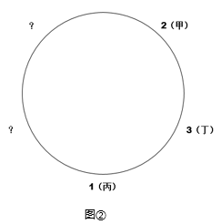
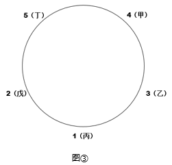

# 分析推理-圆桌位置排序（确定信息锚定+假设排除法）

考点：[[20-考点/判断推理/逻辑判断/分析推理-圆桌位置排序（确定信息锚定+假设排除法）|逻辑判断 / 分析推理-圆桌位置排序（确定信息锚定+假设排除法）]]

**问法模型**：题干给出'某人坐在某编号座椅左/右边第N张'的相对位置条件+一个确定落点（丙坐1号）→ 以确定落点为锚排定圆桌顺序，再对剩余可能位置逐一假设排除

## 推理链
1. 第1步：抓确定信息'丙坐在1号座椅上'作推理起点，结合（3）'丙坐在3号座椅左边第一张'逆推：3号座椅位于1号座椅右边第一张位置，圆桌顺序以1号为锚排定（左右以人面向桌心为准）
2. 第2步：由（1）'甲坐在1号座椅右边第二张座椅上'，右边第一张已被3号占据，故甲只可能在2、4、5号座椅中，排除B（3号）
3. 第3步：假设甲坐2号：由（4）'丁坐在2号座椅左边第一张'得丁坐3号；剩两个位置放4、5号，由（2）'乙坐在5号座椅左边第二张'，无论5号放在哪个位置，乙都只能落在2号或3号，但2号是甲、3号是丁，矛盾，假设不成立
4. 第4步：假设甲坐5号：由（2）乙应坐5号左边第二张即1号座椅，与确定信息'丙坐1号'直接矛盾，假设不成立
5. 第5步：假设甲坐4号：由（2），5号必须在4号右边（否则5号落在1号左边、乙只能坐4号，与'甲坐4号'矛盾），故乙坐3号；再由（4）丁坐2号左边第一张得丁坐5号，戊坐2号，（1）（2）（3）（4）全部自洽
6. 第6步：三种假设中仅'甲坐4号'无矛盾，故甲坐4号座椅，对照选项选C

**最快解法**：⚡ 锚点法+假设排除法：先用确定信息'丙坐1号'锚定圆桌，由（3）（1）迅速锁定甲∈{2,4,5}排除B，再逐一假设甲坐2/5/4号，用（2）（4）验矛盾，唯4号全条件自洽即选C

## 易错点
- ⚠ 圆桌'左右'须以人面向桌心为准，方向定反会使所有条件镜像、假设验证全盘出错
- ⚠ 误以为1~5号按顺序围桌排列，把'编号相邻'错当'位置相邻'（题干明确'未必按序排列'）
- ⚠ 验证假设时只检查5号座椅的一种摆放就下结论，漏验另一摆放导致对甲坐2号的假设误判

## 母题抽象
> 🧩 当题干出现'圆桌+乱序编号+甲在某号左/右边第N张+一个确定落点'的特征时，以确定落点为锚逆推出相邻编号位置，再对剩余可能位置逐一假设、用其余条件验矛盾，唯全条件自洽者即答案

**同类特征**：圆桌五椅乱序编号、左右第N张的相对位置条件、附加确定信息（丙坐1号）、提问某人坐几号、面对桌心定左右、假设排除法

## 相关题
（暂无）

---

### 题干
某次会议讨论期间，甲、乙、丙、丁、戊被安排在一张圆桌前进行讨论，圆桌边放着标有1～5号的五张座椅(未必按序排列)。实际讨论时，甲、乙、丙、丁、戊5人均未按顺序坐在1～5号的座椅上，已知：
（1）甲坐在1号座椅右边第二张座椅上；
（2）乙坐在5号座椅左边第二张座椅上；
（3）丙坐在3号座椅左边第一张座椅上；
（4）丁坐在2号座椅左边第一张座椅上。
如果丙坐在1号座椅上，则可知甲坐的是哪个座椅？

### 选项
- A. 2号
- B. 3号
- C. 4号　✅
- D. 5号

### 官方解析

根据题干，圆桌边放着标有1-5号的五张座椅，注意1-5号并不是按照顺序排列的。

（1）甲坐在1号座椅右边第二张座椅上；

（2）乙坐在5号座椅左边第二张座椅上；

（3）丙坐在3号座椅左边第一张座椅上；

（4）丁坐在2号座椅左边第一张座椅上；

（5）丙坐在1号座椅上。

可从确定信息（5）开始推理，丙坐在1号座椅上，则根据（1）可确定甲的位置（注意：左右是根据就餐人员面对桌子的朝向确定的），根据（3）可确定3号座椅在丙（即1号）右边的第一张座椅上。如图①所示：

则甲只可能坐在2号、4号、5号座椅的其中一个，排除B项。

1、假设甲坐2号座椅，根据（4）可知，丁坐在3号座椅上。如图②所示：

则2个问号处位置有一个是5号座椅；但根据（2）乙坐在5号座椅左边第二张座椅上，即乙的位置是2号或者3号座椅，但是2号和3号已经确定有人坐，不可能是乙坐。故假设不成立。

2、假设甲坐在4号位置，根据条件（2），则4号座椅的右边是5号座椅（如果4号座椅的右边不是5号座椅，5号座椅只能在1号座椅左边，则根据（2），乙坐在4号，这与假设条件“甲坐在4号位置”矛盾，因此4号座椅的右边只能是5号座椅），即乙坐在3号座椅。根据条件（4）可知，丁坐在5号位置，戊坐在2号位置。如图③所示：

假设成立。

3、假设甲坐在5号位置，根据条件（2），乙坐在1号位置，这与题干条件（5）矛盾，故假设不成立。

综上所述，甲坐在4号座椅，即C项。

故正确答案为C。

### 给定材料
（无）
