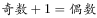
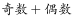
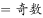
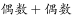
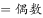
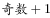
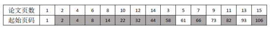
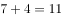

# 分析推理-数学计算类（页码连续编号的前缀和奇偶性）

考点：[[20-考点/判断推理/逻辑判断/分析推理-数学计算类（页码连续编号的前缀和奇偶性）|逻辑判断 / 分析推理-数学计算类（页码连续编号的前缀和奇偶性）]]

**问法模型**：题干给出连续编页码下'每篇文章第一页是偶数页码的最多篇数'的问法 → 建立'前缀和奇偶'模型：某篇首页为偶数页码 ⇔ 排在其前面的论文页数之和为奇数，再按官方解析设定的顺序（1页至15页）逐篇统计。

## 推理链
1. 第1步：提取前提——论文'统一编上页码'即页码连续，第k篇的首页页码=其前面各篇页数之和+1，由于'奇数+1=偶数'，故首页为偶数页码⇔该篇之前所有论文页数之和为奇数。
2. 第2步：按官方解析采用的装订顺序'1页、2页、3页、……、15页'，逐篇计算前缀和：0、1、3、6、10、15、21、28、36、45、55、66、78、91、105。
3. 第3步：套用规则'前缀和为奇数→该篇首页为偶数页码'筛选，前缀和中1、3、15、21、45、55、91、105共8个为奇数。
4. 第4步：对应页数为2页、3页、6页、7页、10页、11页、14页、15页的这8篇论文第一页是偶数页码（规律：页数p满足p≡2或3(mod 4)）。
5. 第5步：与选项对照，8篇对应D项，故正确答案为D。

**最快解法**：⚡ 前缀和奇偶法（模4口诀）：自然顺序装订时，页数为p的论文其前面页数和为p(p-1)/2，仅当p≡2或3(mod 4)时该和为奇数、首页为偶数页码；1~15中符合条件的p为2,3,6,7,10,11,14,15，共8篇，直接选D。

## 易错点
- ⚠ 把'按某种顺序'理解为顺序可任选并求最优——若1页论文打头、后接全部偶数页论文再接奇数页论文，可有11篇首页为偶数页码，超出选项；官方答案8篇仅对应1~15页的自然装订顺序。
- ⚠ 忘记首页页码=前缀和+1，误把'前缀和为偶数'当成首页为偶数页码，方向恰好弄反。
- ⚠ 逐篇计算具体起始页码又慢又易算错，应只跟踪奇偶传递（只有奇数页论文会翻转奇偶性），不必算出数值。

## 母题抽象
> 🧩 当题干出现'多个对象排成一列、统一连续编号、统计各对象起始位置奇偶'的特征时，用'前缀和奇偶'模型：第i个对象满足条件⇔其之前所有量之和的奇偶符合要求，只需跟踪奇偶传递（奇数量才翻转奇偶），无需算出具体页码。

**同类特征**：十五篇论文页数分别为1~15页、按某种顺序装订成册、统一编上页码、每篇文章的第一页是偶数页码、求最多篇数、前缀和奇偶判定

## 相关题
（暂无）

---

### 题干
某机关要编辑论文集，共收录十五篇论文，各篇论文的页数分别是一页，二页，三页······十四页，十五页稿纸。如果将这些论文按某种顺序装订成册，并统一编上页码，则每篇文章的第一页是偶数页码的最多篇数是：

### 选项
- A. 5篇
- B. 6篇
- C. 7篇
- D. 8篇　✅

### 官方解析

由于，所以如果某篇论文前面一共有奇数页论文，则该论文第一页为偶数页码。根据题干“将这些论文按某种顺序装订成册”，若按照1页、2页、3页、……、15页的顺序编排，由于，，则如上表所示，论文页数为2页、3页、6页、7页、10页、11页、14页、15页的这8篇论文之前的总论文页数之和均为奇数，由于，故有8篇论文的第一页为偶数页码。

故正确答案为D。

粉笔说明：

这其实是一道数学题目，而这道题命题人关于“将这些论文按某种顺序装订成册”的表述并不严谨，按照他设置的答案，“某些顺序”其实指的是“1-15”的顺序，否则最正确的解题思路应该如下所示：

要保证每篇文章的第一页是偶数页码的篇数最多，则应该页码1放1页的论文，后面放上全部的偶数页的论文（依次为2页、4页、6页、……、14页），此时有7篇论文第一页为偶数页码。随后只能再放剩余奇数页的论文（3页、5页、7页、……、15页），按照顺序排好以后发现是呈“第一页是奇数偶数”交替的规律，则3页、7页、11页、15页4篇论文第一页也为偶数页码。

所以按某种顺序装订成册，第一页是偶数页码的篇数最多为篇。故本题实际上没有正确答案。

### 给定材料
（无）

> [!warning] 疑点（官方解析可能有误，待人工复核）
> 官方解析默认'某种顺序'指1页、2页、…、15页的自然装订顺序才得出8篇；若顺序可自由选择，按'1页论文放最前→接2,4,…,14页→再接3,5,…,15页'的排法可有11篇首页为偶数页码，不在选项内。粉笔说明已指出该题表述不严谨，本题实意应为'按页数从小到大装订'，此表述漏洞记录在案，但不影响官方答案D。

<!-- CODEX-ANSWER-REVIEW:BEGIN -->
### 本次独立复核

**复核状态：** `resolved`（答案与解析已核定）

**计分答案：** D（可计分）

**复核解析：**

每篇文章的首页页码为偶数，当且仅当此前累计页数为奇数。先排1页论文，其余7篇偶数页论文依次装订：它们的首页都从偶数页开始，贡献7篇；此后排剩下7篇奇数页论文，首页奇偶交替，最多4篇从偶数页开始。合计最多7+4=11篇。若把某篇奇数页论文放在最前，其余偶数页论文可全部排在它之后，仍可使7篇偶数页论文首页为偶数；奇数页论文的首页奇偶交替，最多4篇为偶数。因此最大值为11。原题选项上限只有8，修订D为11后答案D。

**修订选项：**

A. 5篇
B. 6篇
C. 7篇
D. 11篇

**相关信息：**

组合与奇偶性—连续装订文章首页的页码奇偶由此前累计页数决定；偶数页数文章不改变奇偶，奇数页数文章交替奇偶。

**题源依据：** [固定版本原题](https://github.com/Mentat-Uran/kaogongzhentizhengliu/blob/84ab93d4b64b61d897bece8a1c0a5bab06b4feb2/10-%E7%9C%9F%E9%A2%98/%E5%88%A4%E6%96%AD%E6%8E%A8%E7%90%86/%E9%80%BB%E8%BE%91%E5%88%A4%E6%96%AD/2166022%20%E5%88%86%E6%9E%90%E6%8E%A8%E7%90%86-%E6%95%B0%E5%AD%A6%E8%AE%A1%E7%AE%97%E7%B1%BB%EF%BC%88%E9%A1%B5%E7%A0%81%E8%BF%9E%E7%BB%AD%E7%BC%96%E5%8F%B7%E7%9A%84%E5%89%8D%E7%BC%80%E5%92%8C%E5%A5%87%E5%81%B6%E6%80%A7%EF%BC%89.md)；固定内容 commit `84ab93d4b64b61d897bece8a1c0a5bab06b4feb2`，Markdown blob `871046e7c5eb05874ee851874ce420616c8dc776`。
<!-- CODEX-ANSWER-REVIEW:END -->
