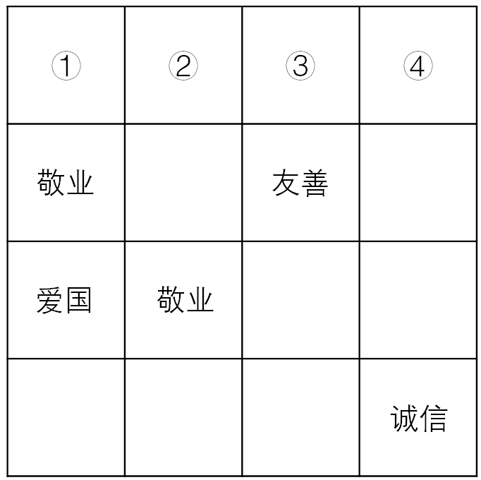

# 分析推理-排除法（方格行列不重复约束）

考点：[[20-考点/判断推理/逻辑判断/分析推理-排除法（方格行列不重复约束）|逻辑判断 / 分析推理-排除法（方格行列不重复约束）]]

**问法模型**：题干给出每行每列四词不重复不遗漏的确定约束，求①②③④处依次填什么 → 用排除法：选项词与目标格所在行/列已出现的词冲突即排除

## 推理链
1. 第1步：从图中提取已知信息——第2行第1列为敬业、第2行第3列为友善、第3行第1列为爱国、第3行第2列为敬业、第4行第4列为诚信；①②③④均在第1行
2. 第2步：所用规则为'每行每列均填入爱国、敬业、诚信、友善4个词，不能重复，也不能遗漏'，即同一格不能与同行同列已有词相同，题干信息确定可用排除法
3. 第3步：①位于第1列，第1列已出现'爱国'（第3行），故①不能是爱国，排除A项；④位于第4列，第4列已出现'诚信'（第4行），故④不能是诚信，排除D项
4. 第4步：第3行已有爱国（第1列）、敬业（第2列），第3列已有友善（第2行），第3行第3列受行、列双重约束不能是爱国、敬业、友善，只能是诚信；则第3行第4列只能是友善
5. 第5步：第4列已出现诚信（第4行）和友善（第3行），故④不能是友善，排除B项
6. 第6步：排除A、B、D后，唯一剩余C项'诚信、友善、爱国、敬业'即为答案，且代入验证第1行与各行各列均不冲突

**最快解法**：⚡ 排除法+行列冲突口诀：'目标格看它所在的行和列，已有词不能再现'——先扫①④所在列排除A、D，再推第三行剩余两格（双重约束定诚信）排除B，锁定C，全程无需填满全表

## 易错点
- ⚠ 只看行不看列（或只看列不看行），漏掉第1列的爱国和第4列的诚信，无法排除A、D
- ⚠ 忽略第三行第三格受'行（爱国、敬业）+列（友善）'双重约束的强制推理，推不出第3行第4列为友善，无法排除B
- ⚠ 误以为要把16格全部填完才能作答，浪费考场时间；实际排除三个选项即可锁定答案

## 母题抽象
> 🧩 当题干出现'方格每行每列填入n个词、不重复不遗漏'的特征时，用排除法：对目标格逐一检查其所在行、列已出现的词，遇冲突即排除选项；对剩余空格用行列双重约束做强制推理，无需完整填表

**同类特征**：4×4方格每行每列四词不重复不遗漏、固定词组：爱国、敬业、诚信、友善、标号①②③④求依次填入的词、题干信息确定、行列双重约束、图片给出部分已知词

## 相关题
（暂无）

---

### 题干

以下是一个44的图形，共有16个小方格，每个小方格中均可填入一个词。要求图形的每行、每列均填入“爱国”“敬业”“诚信”“友善”4个词，不能重复，也不能遗漏。

根据以上信息，依次填入图形中①②③④处的4个词应是：

### 选项
- A. 爱国、敬业、诚信、友善
- B. 诚信、爱国、敬业、友善
- C. 诚信、友善、爱国、敬业　✅
- D. 友善、爱国、敬业、诚信

### 官方解析
题干信息确定，可用排除法解题。
根据方格第一列出现爱国可知，①不能是爱国，排除A项；
根据方格第四列出现诚信可知，④不能是诚信，排除D项；
根据每行每列填入的四个词不能重复可知，第三行的第三列处不能是爱国、敬业和友善，所以只能是诚信，那么第三行的第四列处只能是友善，由于第四列中出现友善，故④不能是友善，故排除B项。
故正确答案为C。

### 给定材料
（无）
