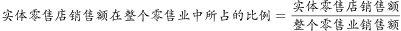
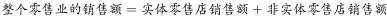

# 原因解释-最不能解释（选非题）

考点：[[20-考点/判断推理/逻辑判断/原因解释-最不能解释（选非题）|逻辑判断 / 原因解释-最不能解释（选非题）]]

**问法模型**：题干呈现'数量增加但销售额占比反而下降'的反差矛盾，问'最不能解释'→选非模型：先锁定矛盾双方的核心话题（销售额占比），排除能弥合矛盾的选项，选出话题偏离或无法在'销售额'层面建立因果联系的选项

## 推理链
1. 第1步：提取矛盾：实体零售店数量由2013年3800家增至2017年4500家（数量增加），但销售额占整个零售业的比例'没有增加，反而有所下降'
2. 第2步：明确解释方向：'占比=实体销售额÷整体销售额'，要解释占比下降，解释项必须落在分子（实体销售额变化）或分母（非实体/整体销售额变化）上；注意'店铺数量'与'销售额'是两个不同维度
3. 第3步：A项：'实体零售店的整体销售额显著下降'→直接削弱分子，占比下降，能解释
4. 第4步：B项：'非实体零售店的整体销售额迅速增加'→分母中非实体部分膨胀，实体占比被挤压缩小，能解释
5. 第5步：C项：'零售业整体销售额大幅提升'→只要实体销售额增速跟不上整体，占比即被稀释下降，能解释
6. 第6步：D项：只陈述'非实体零售店数量的增长速度快于实体零售店'，停留在'数量'维度；店铺数量增减不能推出销售额增减，更推不出实体销售额占比下降，与矛盾核心话题脱节，不能解释，当选

**最快解法**：⚡ 话题定位法（关键词法）：题干矛盾核心词是'销售额（占比）'，快速扫选项——A谈实体销售额、B谈非实体销售额、C谈整体销售额，均命中'销售额'话题；D只谈'数量'增长，话题偏离且数量≠销售额，直接锁定D

## 易错点
- ⚠ 忽略'最不能解释'的选非问法，误把能解释的A/B/C当答案
- ⚠ 被D项'数量增长快'迷惑，误用'店多销量自然多'的直觉推断，犯了'数量≠销售额'的偷换概念错误
- ⚠ 误以为C项与实体店无关而选C，忽略'整体销售额大幅提升会稀释实体占比'的分母解释机制

## 母题抽象
> 🧩 当题干出现'某主体数量/规模上升，但其份额或比例反而下降'的反差时，用'分子分母定位法'：能解释的选项必须作用于分子（该主体自身业绩）或分母（对手/整体业绩）；凡只在'数量'层面作答而矛盾核心在'金额/比例'层面的选项，即为最不能解释项

**同类特征**：最不能解释（选非题）、数量增加vs占比下降的反差、销售额占整个零售业的比例、实体零售店vs非实体零售店、解释项须落在销售额维度、分母稀释效应

## 相关题
- [[10-真题/判断推理/逻辑判断/4673182 解释评价-矛盾解释（选非题）|4673182]]（广东 2022，相关度1）

---

### 题干
某市实体零售店的数量由2013年的3800家，增加到了2017年的4500家。但这几年来，该市实体零售店的销售额在整个零售业中所占的比例并没有增加，反而有所下降。
以下哪项为真，最不能解释上述现象？

### 选项
- A. 这几年来该市实体零售店的整体销售额显著下降
- B. 这几年来该市非实体零售店的整体销售额迅速增加
- C. 这几年来该市零售业的整体销售额有了大幅度的提升
- D. 这几年来该市非实体零售店数量的增长速度快于实体零售店　✅

### 官方解析

第一步：找出题干矛盾。

该市实体零售店的数量增加，但是销售额在整个零售业中所占的比例反而下降。

第二步：逐一分析选项。

A项：。该市实体零售店的整体销售额下降，可以解释实体零售销售额在整个零售业中所占的比例下降，可以解释，排除；

B项：。非实体零售店的整体销售额迅速增加，可能会使非实体零售的销售额占整体的比例增加，也就意味着实体零售店的销售额占整体销售额的比例可能会下降，可以解释，排除；

C项：。现在整体的销售额是增加的，那么可以说明实体店销售额所占的比例是下降的，可以解释，排除；

D项：该市非实体零售店的数量增加的比实体店快，店铺数量的增加并不能说明销售额是增加还是降低，更不能说明实体销售额占整体销售额的比例是否下降，不能解释，当选。

本题为选非题，故正确答案为D。

### 给定材料
（无）
