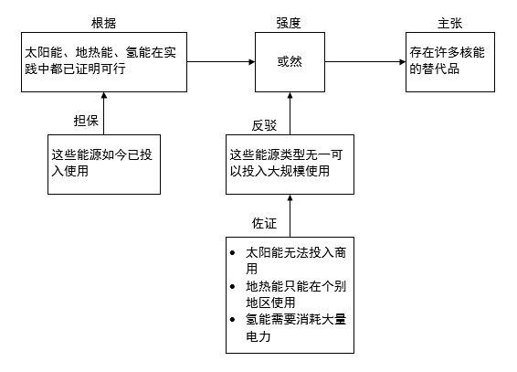

# 论证模型-图尔敏六要素结构图对应（选非题）

考点：[[20-考点/判断推理/逻辑判断/论证模型-图尔敏六要素结构图对应（选非题）|逻辑判断 / 论证模型-图尔敏六要素结构图对应（选非题）]]

**问法模型**：'根据上图，下列说法错误的是'→以图中箭头指向为唯一事实依据，逐项核对选项表述的支持/指向对象与箭头关系是否一致，选出不符项

## 推理链
1. 第1步：读图提取六部分的箭头关系：佐证→反驳、反驳→强度、担保→根据、根据→强度、强度→主张
2. 第2步：解题规则为箭头指向即'支持/指向'对象，低位要素经箭头逐级支持上层要素，最终汇聚于主张
3. 第3步：A项'强度用以评估主张的可靠程度'与图中'或然（强度）→主张'及强度综合下方诸要素的路径一致，排除
4. 第4步：B项称'佐证是支持担保的事实或理由'，但图中佐证（'太阳能无法投入商用；地热能只能在个别地区使用；氢能需要消耗大量电力'）箭头指向反驳（'这些能源类型无一可以投入大规模使用'），指向对象与选项表述不符
5. 第5步：C项'根据及其担保是论证的出发点'与图中'担保→根据→强度→主张'的支持路径一致，排除；D项'反驳旨在削弱对方主张可信度'与图中'反驳→强度→主张'的削弱路径一致，排除
6. 第6步：本题为选非题，与图中箭头指向关系不符的B项即错误说法，当选

**最快解法**：⚡ 箭头追踪法：直接定位图中最下方的佐证框，其箭头指向反驳而非担保，一句话即可锁定B错误，无需逐项详析

## 易错点
- ⚠ 受'佐证（backing）通常支撑担保'的理论印象干扰，忽视本题图形中佐证明确指向反驳，必须以题干图形为准
- ⚠ 忽略'选非'问法，把符合题意的A、C、D误当答案选出
- ⚠ 反驳并非直接指向主张而是先指向强度再指向主张，若只看横向箭头易误判D项的削弱路径

## 母题抽象
> 🧩 当题干以结构图（箭头图）呈现要素间支持关系并问'说法错误的是'时，用'箭头追踪+逐项比对指向对象'的方法，验证每个选项的支持对象与图中箭头是否一致，指向不符者即答案

**同类特征**：图尔敏论证六要素、结构关系图（箭头指向表支持）、选非问法（说法错误的是）、主张/根据/担保/反驳/佐证/强度、以核能替代品实例填充各要素

## 相关题
- [[10-真题/判断推理/定义判断/2376687 多定义辨析-定义间关系（因果-范围）+选非题|2376687]]（吉林 2019，相关度1）

---

### 题干

哲学家史蒂芬·图尔敏认为：一个清晰完整的论证包括六个部分：主张、根据、担保、反驳、佐证和强度。六个部分之间的关系如下：

根据上图，下列说法错误的是：

### 选项
- A. 强度用以评估主张的可靠程度
- B. 佐证是支持担保的事实或理由　✅
- C. 根据及其担保是论证的出发点
- D. 反驳旨在削弱对方主张可信度

### 官方解析
第一步：找出题干关键信息。
题干是以具体例子的形式来展示论证六个部分。
主张：存在许多核能的替代品。
根据：太阳能、地热能、氢能在实践中都已经证明可行。
担保：这些能源如今已经投入使用。
强度：或然。
反驳：这些能源类型无一可以投入大规模使用。
佐证：太阳能无法投入商用；地热能只能在个别地区使用；氢能需要消耗大量电力。
第二步：逐一分析选项。
A项：根据导图可知强度直接指向主张，强度由根据、担保和反驳、佐证综合起来共同决定，用以评估主张的可靠程度，符合题干，排除；
B项：根据导图可知佐证直接指向反驳，佐证是用以支持反驳的事实或理由，而不是支持担保，不符合题干，当选；
C项：根据导图可知担保和根据最终指向的是主张，担保和根据是支持主张的，是论证的出发点，符合题干，排除；
D项：根据导图可知反驳最终指向的是主张，反驳属于削弱主张的，因此可以削弱对方主张可信度，符合题干，排除。
本题为选非题，故正确答案为B。

### 给定材料
（无）
