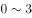
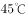

# 解释题-矛盾-反常现象解释

考点：[[20-考点/判断推理/逻辑判断/解释题-矛盾-反常现象解释|逻辑判断 / 解释题-矛盾/反常现象解释]]

**问法模型**：题干呈现'按常识应A却反常出现B'的矛盾，问'哪项最能解释上述发现'→ 采用矛盾双端覆盖模型：答案必须同时兼容矛盾两端且不改变题干前提

## 推理链
1. 第1步：提取题干矛盾两端——'幼儿的体温因阳光照射而上升的幅度比成人小'（幼儿应更耐热）vs '在汽车车厢内，如果温度较高，幼儿很容易发生中暑，而成人几乎很少出现这一现象'甚至待一小时也不中暑（幼儿反而更易中暑）
2. 第2步：明确解释题标准：选项需引入新机制，既不否认'体温上升幅度小'，又能说明'幼儿更易中暑'，且不得改变题干设定的环境条件
3. 第3步：对照A项——只说'年龄越小的孩子抵抗能力越弱'，'抵抗力弱'与'中暑'之间无因果链条，仅涉及矛盾一端且关联牵强，排除
4. 第4步：对照B项——'随着年龄的增长……体温的变化也不再明显'只呼应了题干前半句（成人体温变化明显），完全没有解释幼儿为何易中暑，排除
5. 第5步：对照C项——'成人感到不适时很可能会打开车窗'引入了题干没有的前提，与'在高温环境下待在车厢里一小时也不中暑'的封闭条件冲突，属于改变题干环境，排除
6. 第6步：对照D项——中暑的机制是'丧失了相当于体重一定比例的水分'；幼儿'体重相对应的体表面积更大，能更快地吸收热量'且'汗腺数目与大人相同，水分流失速度更快'——单位体重散热面积大解释了体温上升幅度反而小，单位体重失水快解释了更易中暑，两端同时兼容
7. 第7步：结论：只有D项同时解释矛盾双方且不改变题干前提，当选D

**最快解法**：⚡ 矛盾双端覆盖法：先把矛盾写成'体温升幅小 但 易中暑'，逐项问'是否两端都照顾、是否改动题干条件'——A/B只顾一端，C改前提，D用'失水速度'新机制同时命中两端，秒选D

## 易错点
- ⚠ 只解释矛盾一端即误选：A项'抵抗力弱'、B项'体温变化不明显'都只触碰单端，未建立与'中暑'的完整因果链
- ⚠ 被C项的定量细节迷惑：'车内温度可达更高'看似解释力强，但'成人开窗'擅自改变了'待一小时不中暑'的封闭环境前提
- ⚠ 把'体温上升幅度小'等同于'不易中暑'，忽略中暑的核心机制是失水而非单纯升温

## 母题抽象
> 🧩 当题干出现'某群体按常识指标占优（升幅小），却反常识地结果更差（更易中暑）'时，找引入新机制（不否定原指标）同时解释反常结果的选项；凡只解释单端、或通过改变题干前提来'解释'的选项一律排除

**同类特征**：体温上升幅度比成人小、车厢内高温幼儿易中暑、成人待一小时也不中暑、最能解释上述发现、反常识对比、同一现象两种结果

## 相关题
（暂无）

---

### 题干
一般来说，幼儿的体温因阳光照射而上升的幅度比成人小。可是人们发现，在汽车车厢内，如果温度较高，幼儿很容易发生中暑，而成人几乎很少出现这一现象。甚至在的高温环境下待在车厢里一小时，也不会中暑。
以下哪项如果为真，最能解释上述发现？

### 选项
- A. 
在岁的幼儿中，年龄越小的孩子，抵抗能力越弱

- B. 
随着年龄的增长，人体内的水分占体液总量的比例变小，体温的变化也不再明显

- C. 
车内属于密闭空间，当室外气温达到时，车内温度就能达到，而成人在车内感到不适时很可能会打开车窗

- D. 
中暑多在丧失了相当于体重的水分时发生，幼儿体重相对应的体表面积更大，能更快地吸收热量，由于汗腺数目与大人相同，水分流失速度更快
　✅

### 官方解析
第一步：找出题干矛盾。
一般幼儿的体温因阳光照射上升的幅度比成人小，但高温环境下幼儿很容易中暑而成人却很少中暑。
第二步：逐一分析选项。
A项：说明幼儿抵抗能力弱，但抵抗力弱是否代表容易中暑不知道，不能解释题干矛盾，排除；
B项：随着年龄的增长，体温变化不明显，说明人的体温正常变化和在封闭空间内应当是一样的，不能解释题干矛盾，排除；
C项：成人所处的环境是打开车窗，而题干强调的是在高温环境下待一个小时，与题干环境不一致，不能解释题干矛盾，排除；
D项：由于幼儿体重相对应的体表面积更大，水分流失更快，解释了幼儿体温上升幅度比成人小，但更容易中暑的原因，能够解释题干矛盾，当选。
故正确答案为D。

### 给定材料
（无）
