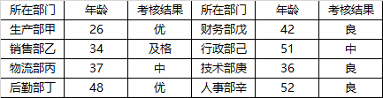

# 日常结论-模态词严谨性（部分样本只能推'可能'不能推'一定'）

考点：[[20-考点/判断推理/逻辑判断/日常结论-模态词严谨性（部分样本只能推'可能'不能推'一定'）|逻辑判断 / 日常结论-模态词严谨性（部分样本只能推'可能'不能推'一定'）]]

**问法模型**：'根据上述信息，下列论断最为准确的是' → 日常结论题，选能从题干严格推出的语气最严谨的结论，带'可能'的弱判断优于带'一定'的强判断

## 推理链
1. 第1步：题干明确'择其一部分内容列表'，表格仅列出甲~辛8名员工的部门、年龄与考核结果，结果类型出现优、及格、中、良四种，且覆盖生产/销售/物流/后勤/财务/行政/技术/人事全部部门、年龄26~52不等
2. 第2步：所用规则为模态判断强度规则——从部分样本推断全体，只能得出'可能'级结论，'一定是''一定不是'的全称必然判断均超出题干信息
3. 第3步：A项由'分处不同年龄段'推'一定是所有的考核结果类型'，相同年龄段结果类型未必相同，必然判断无据，排除；C项由'并非公司的所有人员'推'一定不是所有的考核结果类型'，但其他员工的结果类型完全可能重复已列四类，必然否定同样无据，排除；D项由'涉及了所有的部门'推'一定是所有的考核结果类型'，一个部门可有多人多种结果，部门覆盖≠类型穷尽，排除
4. 第4步：B项仅断言'所列的考核结果可能不是所有的考核结果类型'，即未排除有遗漏类型的可能性，这是部分样本能够支持的最弱也最严谨的判断，故B最为准确，当选

**最快解法**：⚡ 语气强弱排除法：题干是'部分内容'的样本列表，凡断言'一定是/一定不是'的必然选项（A、C、D）一律排除，唯一用'可能'表述的B直接锁定

## 易错点
- ⚠ D项陷阱：误把'涉及所有部门'等同于'穷尽所有结果类型'，忽略部门与考核结果类型并非一一对应（一个部门可出多种结果）
- ⚠ C项陷阱：把'可能不全'偷换强化为'一定不全'，忽视未列人员的结果类型可能与已列类型重复
- ⚠ A项陷阱：误把'不同年龄段'当作结果类型的充分条件，实际年龄段与考核结果类型没有必然对应关系

## 母题抽象
> 🧩 当题干只给出'部分'样本（如'择其一部分内容'）而选项围绕'是否穷尽全部类型'展开时，用模态词强度法：样本信息只支持'可能'级结论，'一定是'与'一定不是'的全称必然判断一律排除

**同类特征**：择其一部分内容列表、部分样本推断全体、考核结果类型是否穷尽、一定是/一定不是/可能不是的模态词差异、涉及了所有的部门、分处不同的年龄段

## 相关题
（暂无）

---

### 题干

某公司公布了公司员工年终考核结果，现择其一部分内容列表如下：

根据上述信息，下列论断最为准确的是

### 选项
- A. 由于所列人员分处不同的年龄段，所以所列的考核结果一定是所有的考核结果类型
- B. 由于所列人员不一定展示所有的考核结果类型，所以所列的考核结果可能不是所有的考核结果类型　✅
- C. 由于所列人员并非公司的所有人员，所以所列的考核结果一定不是所有的考核结果类型
- D. 由于所列人员涉及了所有的部门，所以所列的考核结果一定是所有的考核结果类型

### 官方解析
日常结论题，根据题干信息逐一分析选项。
A项：题干所列人员分处不同的年龄段，但相同年龄段的考核结果类型不一定相同，所以不能推出所列的考核结果一定是所有的考核结果类型，无法推出，排除；
B项：由于所列人员不一定展示所有的考核结果类型，所以所列的考核结果可能不是所有的考核结果类型，强调的是一种可能性，可以推出，当选；
C项：题干所列人员并非公司的所有人员，但其他人员有可能也符合以上这些考核结果类型，因此也有可能列出了所有的考核结果类型，无法推出，排除；
D项：题干所列人员涉及了所有的部门，但一个部门可以有多种考核结果类型，因此不一定就列出了所有的考核结果类型，无法推出，排除。
故正确答案为B。

### 给定材料
（无）
