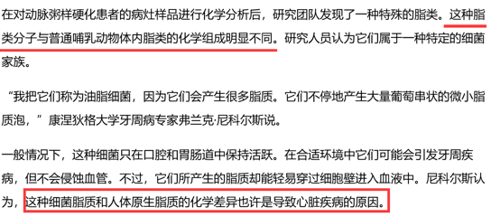

# 论证加强-补充论据-排除法锁定唯一加强项

考点：[[20-考点/判断推理/逻辑判断/论证加强-补充论据-排除法锁定唯一加强项|逻辑判断 / 论证加强-补充论据/排除法锁定唯一加强项]]

**问法模型**：'以下哪项如果为真，最能支持研究者的观点'→先拆论点（口腔疾病与心脏疾病相关）与论据（脂肪分子可能来自口腔细菌），再逐项验证是否同时贴合'口腔细菌脂肪→心脏疾病'话题链条，无关/削弱项全部排除

## 推理链
1. 第1步：提取论点：研究者认为'口腔疾病经常与心脏疾病相关'；题干前提：'心脏疾病与动脉血管中的脂肪栓塞有密切关系'
2. 第2步：提取论据：新研究显示'脂肪分子不仅来自食物，还可能来自口腔中的某种细菌'
3. 第3步：识别论证缺口：从'口腔细菌产生脂肪'到'心脏脂肪栓塞'再到'口腔疾病与心脏疾病相关'，需要确认细菌脂质确为心脏栓塞脂肪的可能来源，缺此桥梁则论证不完整
4. 第4步：B项指出'这种细菌产生的脂类分子与哺乳动物体内脂类的组成成分不同，属于一种特殊的细菌家族'，说明该脂质源自细菌而非人体原生，为'口腔细菌→特殊脂质→脂肪栓塞'补充论据，按官方口径可加强
5. 第5步：A项只说'动脉血管会被脂质堵塞'，仅重复题干背景（心脏与脂肪栓塞的关系），完全未涉及'口腔'，属无关项
6. 第6步：C项说细菌'只在口腔中保持活跃，可能引发牙周疾病'，把细菌活动局限在口腔疾病范围内，切断了'细菌→心脏疾病'的联系，方向为削弱而非加强
7. 第7步：D项说'口腔疾病……容易引起糖尿病的发生'，话题落在糖尿病，未提心脏疾病，属无关项
8. 第8步：结论：ACD均确定不能加强，B为唯一可能加强项，与官方答案一致，选B

**最快解法**：⚡ 排除法+话题一致性：抓论点关键词'口腔疾病—心脏疾病'与论据关键词'口腔细菌—脂肪'，A只谈动脉脂质（无口腔）、C只谈牙周（断开心脏）、D只谈糖尿病（无心脏），三项均偏离论证链条直接排除，锁定唯一涉及'细菌产生脂类'的B

## 易错点
- ⚠ 误选C：看到'细菌只在口腔活跃、引发牙周疾病'以为搭上了口腔与细菌的桥，实则恰恰把细菌与心脏疾病的联系切断了
- ⚠ 误选A：看到'脂质堵塞动脉'与题干背景呼应就当加强，实则只是重复已知论据，对'口腔'只字未提
- ⚠ 在B项上过度纠结：'组成成分不同'本身未直接说明致病机制，加强力度偏弱，考场应先用排除法锁定B而非深究其逻辑强度

## 母题抽象
> 🧩 当论点是'甲与乙相关'而论据只覆盖中间环节（如'乙的成因可能来自甲处'）时，先画出'口腔细菌→脂肪→心脏疾病'链条，再检查每项是否同时推进该链条；若正向选项均不完美，用话题一致性排除无关与反向项，锁定唯一可能加强项

**同类特征**：脂肪分子可能来自口腔细菌、口腔疾病经常与心脏疾病相关、心脏疾病与动脉脂肪栓塞密切相关、最能支持、论证链条存在缺口、选项需按话题一致性排除

## 相关题
- [[10-真题/判断推理/逻辑判断/10204472 加强论证-必要条件加强与力度比较|10204472]]（甘肃 2024，相关度1）
- [[10-真题/判断推理/逻辑判断/10204511 论证-加强论证（支持结论-补充论据）|10204511]]（云南 2024，相关度1）
- [[10-真题/判断推理/逻辑判断/10297087 论证加强-搭桥（建立论据与论点的话题联系）|10297087]]（天津 2025，相关度1）
- [[10-真题/判断推理/逻辑判断/10297362 加强论证-搭桥（论据与论点话题不一致，建立唯一性联系）|10297362]]（浙江 2025，相关度1）
- [[10-真题/判断推理/逻辑判断/12101008 加强论证-补充论据（搭桥建立因果机制）|12101008]]（江苏 2025，相关度1）

---

### 题干
心脏疾病与动脉血管中的脂肪栓塞有密切关系。但一项新研究显示，脂肪分子不仅来自食物，还可能来自口腔中的某种细菌。研究者据此认为口腔疾病经常与心脏疾病相关。
以下哪项如果为真，最能支持上述研究者的观点？

### 选项
- A. 心脏病通常由动脉粥样硬化引发，在这个过程中，动脉血管会被一种名为“脂质”的物质堵塞
- B. 这种细菌产生的脂类分子与哺乳动物体内脂类的组成成分不同，属于一种特殊的细菌家族　✅
- C. 一般情况下，这种细菌只在口腔中保持活跃，在合适环境中它们可能会引发牙周疾病
- D. 口腔疾病引起的细胞因子会破坏胰岛腺，减少人体必要胰岛素的分泌量，容易引起糖尿病的发生

### 官方解析

第一步：找出论点和论据。

论点：口腔疾病经常与心脏疾病相关。

论据：脂肪分子不仅来自食物，还可能来自口腔中的某种细菌。

第二步：逐一分析选项。

A项：心脏病通常由动脉粥样硬化引发，动脉血管会被一种名为“脂质”的物质堵塞，讨论的是心脏病与动脉血管中的脂肪栓塞的关系，与口腔疾病无关，排除；

B项：这种细菌产生了脂类分子说明口腔中的某种细菌确实可以产生脂肪，这解释了论据的“脂肪分子不仅来自食物，还可能来自口腔中的某种细菌”，可以加强，当选。

C项：这种细菌只在口腔中保持活跃，可能会引发牙周疾病，所以与心脏疾病无关。削弱论点，排除；

D项：口腔疾病容易引起糖尿病的发生。没有提到心脏疾病，无关选项，排除。

此题出题人在命制过程中并不严谨，只能通过排除的思维，ACD项是一定不能加强的，所以这道题答案为B。

本题不是很严谨，但我们通过查询原文发现（如下图所示），B项在原文中明确提到了，并且告诉我们这种细菌脂质和人体原生脂质的化学差异也许是导致心脏疾病的原因。出题人题目命制不严谨，同学们无需纠结，本题只要重点学习掌握ACD项为何不能加强即可。

故正确答案为B。

### 给定材料
（无）

> [!warning] 疑点（官方解析可能有误，待人工复核）
> 官方解析自认题目命制不严谨：B项'细菌脂类与哺乳动物体内脂类组成成分不同'只能说明该脂质来源特殊，并未直接建立'口腔疾病→心脏疾病'的因果联系，加强力度有限；官方亦称需查原文补充'细菌脂质与人体原生脂质的化学差异也许是导致心脏疾病的原因'才完整。本笔记按官方口径以排除法锁定B，仅在此记录逻辑瑕疵，不改变答案

<!-- CODEX-ANSWER-REVIEW:BEGIN -->
### 本次独立复核

**复核状态：** `confirmed`（独立复算确认答案）

**计分答案：** B（可计分）

**复核解析：**

题干论点为细菌脂质与人体天然脂质的化学差异可能造成心脏病。B补充了“该差异会在心脏形成相应影响”的关键因果桥梁，直接支持论点；其余选项无关或削弱。

**相关信息：**

题干原图中可读出病因假设与化学差异的连接；补回原图后可排除先前因缺失图文造成的空缺。

**题源依据：** [固定版本原题](https://github.com/Mentat-Uran/kaogongzhentizhengliu/blob/84ab93d4b64b61d897bece8a1c0a5bab06b4feb2/10-%E7%9C%9F%E9%A2%98/%E5%88%A4%E6%96%AD%E6%8E%A8%E7%90%86/%E9%80%BB%E8%BE%91%E5%88%A4%E6%96%AD/2247198%20%E8%AE%BA%E8%AF%81%E5%8A%A0%E5%BC%BA-%E8%A1%A5%E5%85%85%E8%AE%BA%E6%8D%AE-%E6%8E%92%E9%99%A4%E6%B3%95%E9%94%81%E5%AE%9A%E5%94%AF%E4%B8%80%E5%8A%A0%E5%BC%BA%E9%A1%B9.md)；固定内容 commit `84ab93d4b64b61d897bece8a1c0a5bab06b4feb2`，Markdown blob `966a80c01a97d5901c07b43a086aecd039cc1908`。
<!-- CODEX-ANSWER-REVIEW:END -->
