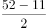
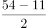

# 分析推理-人员匹配（最大信息法+排除法+年龄奇偶验证）

考点：[[20-考点/判断推理/逻辑判断/分析推理-人员匹配（最大信息法+排除法+年龄奇偶验证）|逻辑判断 / 分析推理-人员匹配（最大信息法+排除法+年龄奇偶验证）]]

**问法模型**：问'谁是谁的妹妹'的人员-人员匹配题 → 从出现次数最多的对象（小曾）入手，用'年龄差≠11即排除、年龄和解非整数即排除'逐项排除锁定配对

## 推理链
1. 第1步：提取条件——三个妹妹都比哥哥小11岁；'小曾比小英大9岁'；'小曾与小丽年龄之和是52岁'；'小孙与小丽年龄之和是54岁'
2. 第2步：确立排他规则——兄妹年龄差必须恰为11岁，年龄差为9岁的小英不可能是小曾的妹妹（排除B）；兄妹年龄差为奇数11岁，则两人年龄之和必为奇数
3. 第3步：从最大信息'小曾'（条件①③④三次出现）验证小丽——若小丽是小曾妹妹，则小曾=(52+11)/2=31.5岁，非整数，排除A，锁定小梅是小曾的妹妹
4. 第4步：同法验证小孙——若小丽是小孙妹妹，则小孙=(54+11)/2=32.5岁，非整数，排除D，锁定小英是小孙的妹妹
5. 第5步：剩余配对唯一——小丽只能是小石的妹妹，与C项'小梅是小曾的妹妹，小丽是小石的妹妹，小英是小孙的妹妹'完全吻合

**最快解法**：⚡ 奇偶排除法：兄妹差11岁（奇数）⇒兄妹年龄之和必为奇数，而52、54均为偶数⇒小丽既非小曾也非小孙的妹妹⇒小丽是小石的妹妹；再由小曾比小英大9岁≠11岁⇒小梅是小曾的妹妹，余下小英是小孙的妹妹，秒选C

## 易错点
- ⚠ 忽略'比自己小11岁'是严格排他条件，误以为9岁差距'更接近'也可能是兄妹
- ⚠ 代入年龄和时误用'哥哥=(和−11)/2'，正确应为'哥哥=(和+11)/2'，或未发现和为偶数时解必非整数的奇偶规律
- ⚠ 未从出现三次的最大信息'小曾'入手，盲目逐一组合浪费时间

## 母题抽象
> 🧩 当题干出现'固定年龄差（如小11岁）+若干两人年龄之和'的匹配条件时，先用'差为奇数则和必为奇数'检验年龄和的奇偶性排除不可能配对，再从信息出现最多的对象入手锁定唯一组合

**同类特征**：人员-人员配对型分析推理、固定年龄差（小11岁）、年龄和条件（52、54）、最大信息集中于小曾（出现3次）、问'谁是谁的妹妹'

## 相关题
（暂无）

---

### 题干
小曾、小孙、小石三个人是好朋友，他们每个人都有一个妹妹，且都比自己小11岁。三个妹妹的名字叫小英、小丽、小梅。已知小曾比小英大9岁，小曾与小丽年龄之和是52岁，小孙与小丽年龄之和是54岁。
由此可知，谁是谁的妹妹？

### 选项
- A. 小梅是小孙的妹妹，小丽是小曾的妹妹，小英是小石的妹妹
- B. 小梅是小石的妹妹，小丽是小孙的妹妹，小英是小曾的妹妹
- C. 小梅是小曾的妹妹，小丽是小石的妹妹，小英是小孙的妹妹　✅
- D. 小梅是小曾的妹妹，小丽是小孙的妹妹，小英是小石的妹妹

### 官方解析

第一步：分析题干。

①小曾、小孙、小石都有一个妹妹，且都比自己小11岁；

②三个妹妹的名字叫小英、小丽、小梅；

③小曾比小英大9岁；

④小曾与小丽年龄之和是52岁；

⑤小孙与小丽年龄之和是54岁。

第二步：结合题干分析选项。

题干中①③④都提到了小曾，从最大信息入手，根据③，小曾比小英大9岁，因此小曾的妹妹不是小英。排除B项。根据②，小曾与小丽的年龄之和为52，①小曾比妹妹大11岁，假设小丽是小曾妹妹，那她年龄应该为，结果不为整数，所以小曾的妹妹也不是小丽，排除A项。

因此小曾的妹妹只能为小梅，根据条件⑤，小孙与小丽年龄之和是54岁，条件①小孙比妹妹大11岁，假设小丽是小孙的妹妹，那她年龄应该为，结果不为整数，所以小孙的妹妹不是小丽，因此小孙的妹妹是小英，排除D项。

故正确答案为C。

### 给定材料
（无）
