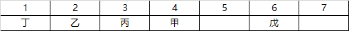

# 综合推理-排序问题（名次位置推算+身份条件连锁排除）

考点：[[20-考点/判断推理/逻辑判断/综合推理-排序问题（名次位置推算+身份条件连锁排除）|逻辑判断 / 综合推理-排序问题（名次位置推算+身份条件连锁排除）]]

**问法模型**：多重排名条件+追加'己和丙之间隔着两人'的间隔限定，问'可以得出'哪项 → 枚举全部可能排列，用身份约束排除矛盾情形，锁定唯一序列后逐项验证

## 推理链
1. 第1步：由条件(1)(2)(3)——甲排名第4、乙丙在甲之前、丁在乙之前——可知前3名只能是'丁乙丙'或'丁丙乙'两种顺序，第4名为甲，己、戊、庚占据第5—7名
2. 第2步：由追加条件'己和丙之间隔着两人'（中间隔2人即位次相差3）：丙若在第2位则己只能排第5位，丙若在第3位则己只能排第6位
3. 第3步：情况一（丁乙丙甲、己第6）：由条件(4)第6名是外国选手则己为外国人，由条件(5)第5名必须是中国选手、第7名也不能是外国选手，而戊是外国人（条件6），故戊只能排第6——与己第6冲突，'与丙隔两人'的位置被戊占据而非己，情况一排除
4. 第4步：情况二（丁丙乙甲、己第5）：同理第5名须中国人（己为中国人即可）、第7名不能是外国人，戊作为外国人只能排第6，庚排第7且须为中国人，无任何矛盾
5. 第5步：锁定唯一排列：丁①、丙②、乙③、甲④、己⑤、戊⑥、庚⑦；回验：戊（外国）前一名己为中国选手、己与丙之间隔乙甲两人，全部条件满足
6. 第6步：对照选项：A项己实为第5而非第7；B项庚实为第7而非第5；C项乙（第3）与庚（第7）之间隔甲、己、戊三人而非两人；D项'乙和庚排名之间隔着三人'正确

**最快解法**：⚡ 排除法+位置钉死：先用'丁在乙前、乙丙在甲（第4）前'锁定前三名仅有丁乙丙/丁丙乙两种；再用'己丙隔两人'把己钉在第5或第6位；由'第6名是外国人→第5名必为中国人→第7名不能是外国人→外国人戊只能占第6'直接排除己排第6的情形，得唯一序列丁丙乙甲己戊庚，乙第3、庚第7之间隔三人，秒选D

## 易错点
- ⚠ 把'隔着两人'误解为名次相差2（实为中间隔2人、位次相差3），导致己的位置定位错误
- ⚠ 忽略条件(4)(5)(6)的连锁推理：第6名外国人→第5名必中国人→第7名不能是外国人→戊只能排第6，漏掉此链会误留'己排第6'的错误情况
- ⚠ 情况一中戊若排第5或第7都会违反'外国选手前一名是中国选手'（两名外国人相邻），未逐条回验条件(5)而误判情况一可行

## 母题抽象
> 🧩 当题干出现'多人排名+若干先后关系+特定名次的身份限制（如国籍）+两人间隔数'时，先用强先后条件锁定局部顺序，再用间隔条件枚举候选位置，最后用身份约束连锁排除矛盾情形，得唯一序列后逐项对照选项

**同类特征**：7人排名且没有并列（隐含全排列）、甲排名第4（锚点位次）、丁在乙前、乙丙在甲前（先后关系链）、第6名是外国选手且外国选手前一名必为中国选手、戊是外国选手（身份锚点）、己和丙排名之间隔着两人（间隔限定）

## 相关题
（暂无）

---

### 题干
近期女子乒乓球世界排名前7名（没有并列）在甲、乙、丙、丁、戊、己和庚（这不是排名顺序）7人中产生。已知：
（1）甲排名第4；
（2）乙和丙的排名在甲之前；
（3）丁的排名在乙之前；
（4）排名第6的是一名外国选手；
（5）在排名中，每一名外国选手的前一名都是中国选手；
（6）戊是一名外国选手。
如果己和丙排名之间隔着两人，则可以得出下列      项。

### 选项
- A. 己排名第7
- B. 庚排名第5
- C. 乙和庚排名之间隔着两人
- D. 乙和庚排名之间隔着三人　✅

### 官方解析

本题为排列组合题目。

第一步：分析题干。

根据条件（1）（2）（3）可知，前四名的排列顺序从前到后为丁乙丙甲或丁丙乙甲。又因为己和丙之间隔两人。故七人排列可能为以下两种情况。

第一种情况：

根据条件（4）可知，排名第六为外国选手， 根据条件（5）可知，外国选手前必为中国选手，所以排名第5的是中国选手，并且排名第7的也不是外国选手，根据条件（6）可知，戊是一名外国选手，所以戊排名第6，此时与丙隔着两个人的是戊，与己和丙排名之间隔着两人不符。故此种情况不正确。

第二种情况：

根据条件（4）可知，排名第六为外国选手， 根据条件（5）可知，外国选手前必为中国选手，所以排名第5的是中国选手，并且排名第7的也不是外国选手，根据条件（6）可知，戊是一名外国选手，所以第6是戊，第7是庚。则七人排名如下：

第二步：逐一分析选项。

A项：己排名第5，选项错误，排除；

B项：庚排名第7，选项错误，排除；

C项：乙和庚之间间隔三人，选项错误，排除，；

D项：乙和庚之间间隔三人，选项正确，当选。

故正确答案为D。

### 给定材料
（无）
