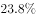

# 论证削弱-对比实验样本不一致（拆桥）

考点：[[20-考点/判断推理/逻辑判断/论证削弱-对比实验样本不一致（拆桥）|逻辑判断 / 论证削弱-对比实验样本不一致（拆桥）]]

**问法模型**：'以下哪项如果为真，最能质疑上述调查结论'→削弱论证题：先分离论点论据，针对'对比数据→总体状况'的论证方式找样本差异类拆桥项

## 推理链
1. 第1步：提取论点——'今年该市公众对食品的安全感有所提高，食品安全的总体状况好于上年'（含两层：公众安全感提高＋总体状况变好）
2. 第2步：提取论据——今年有安全感的受访者比例高于去年（'今年…的受访者在吃的方面有安全感…而去年相应的调查数据分别是…'）
3. 第3步：识别论证方式——由两次调查数据的对比推出总体状况改善，属对比论证，隐含前提是两年受访样本结构可比
4. 第4步：确定削弱方向——指出两年调查对象（样本）不一致，数据差异源于样本构成变化而非真实改善，即拆桥
5. 第5步：逐项对照——A项'有些受访者没有表达态度'不否定已表态者的数据对比，力度不足；B项'政府加大管理力度'反而解释了安全感上升的原因，是加强项；C项'媒体报道假奶粉事件'与总体状况无必然联系，属无关项
6. 第6步：D项指出'今年调查中增加了不少餐饮经营者的样本'，餐饮经营者天然更倾向于认定食品安全，数据升高是样本结构变化所致，切断了'数据上升'到'总体状况好于上年'的桥梁，最能质疑，当选

**最快解法**：⚡ 对比论证削弱口诀'对比先找不同'——题干是今年vs去年的数据对比，直接锁定指出'两年样本不一致'的选项，D项'增加了不少餐饮经营者的样本'秒选

## 易错点
- ⚠ 误选B：看到'政府加大管理力度'以为是削弱调查可信度，实则它解释了安全感上升原因，属加强项
- ⚠ 误选C：被'假奶粉等食品安全事件'的负面信息干扰，但媒体报道与'总体状况'之间无必然联系，属无关项
- ⚠ 忽略论点两层含义：D项不仅解释了数据上升，更否定了由数据推出'总体状况好于上年'的可行性（拆桥），力度强于仅质疑数据本身的A项

## 母题抽象
> 🧩 当题干出现'两次调查/实验数据对比→总体状况变化'的特征时，用'找对比对象差异'的方法削弱，优先验证样本构成、时间条件、对象范围是否一致的选项

**同类特征**：社会调查数据对比、今年vs去年、公众对食品的安全感、总体状况好于上年、最能质疑、对比论证

## 相关题
- [[10-真题/判断推理/逻辑判断/10297354 削弱论证-他因削弱（兼辨析弱拆桥）|10297354]]（浙江 2025，相关度1）
- [[10-真题/判断推理/逻辑判断/16070053 削弱论证-削弱论点（无证据直接质疑）|16070053]]（广西 2026，相关度1）
- [[10-真题/判断推理/逻辑判断/1797386 削弱论证-力度比较（推翻隐含假设＞补充替代依据）|1797386]]（山东 2016，相关度1）
- [[10-真题/判断推理/逻辑判断/2031006 削弱论证-直接否定因果关系（根本原因另有他因，削弱力度比较）|2031006]]（北京 2017，相关度1）
- [[10-真题/判断推理/逻辑判断/2047888 削弱论证-削弱论点（指出技术有害的负面效应）|2047888]]（广东 2017，相关度1）

---

### 题干

食品安全已成为现代社会关注的热点问题。今年针对某市的一项社会调查显示，的受访者在吃的方面有安全感，的受访者没有安全感，而去年相应的调查数据分别是和。调查人员由此断言，今年该市公众对食品的安全感有所提高，食品安全的总体状况好于上年。

以下哪项如果为真，最能质疑上述调查结论？

### 选项
- A. 今年有些受访者没有表达自己对食品安全的态度
- B. 今年该市政府加大了对食品安全工作的管理力度
- C. 该市媒体今年报道了多起假奶粉等食品安全事件
- D. 今年的社会调查中增加了不少餐饮经营者的样本　✅

### 官方解析

第一步:找出论点和论据。

论点:今年该市公众对食品的安全感有所提高，食品安全的总体状况好于去年。

论据:今年的受访者在吃的方面有安全感，的受访者没有安全感，而去年相应的调查数据分别是和。

本题通过对今年和去年受访者对食品有无安全感的数据对比，得出今年该市公众对食品的安全感有所提高，食品安全的总体状况好于上年。论据是一组对比实验，可以通过指出两组对比对象情况不一致进行削弱，即说明今年和去年的受访者存在不同。

第二步:逐一分析选项。

A项：有些受访者没有表达自己的态度，并不能质疑论据中表达态度的受访者数据的真实性，无法削弱，排除；

B项：该市政府加大了食品安全的管理力度，解释了今年食品安全度上升的原因，属加强项，无法削弱，排除；

C项：今年该市媒体报道了多起假奶粉事件，与今年食品安全的总体状况无关，无关项，排除；

D项：今年受访样本中增加了不少餐饮经营者，而餐饮经营者会更加偏向于认定食品是安全的，那么由此得出的数据高于去年显然不能得出食品安全的总体状况，属于拆桥，可以削弱，当选。

故正确答案为D。

### 给定材料
（无）
