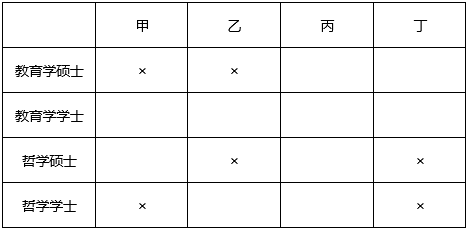

# 分析推理-列表排除法（人物与学位一一对应匹配）

考点：[[20-考点/判断推理/逻辑判断/分析推理-列表排除法（人物与学位一一对应匹配）|逻辑判断 / 分析推理-列表排除法（人物与学位一一对应匹配）]]

**问法模型**：题干为'多对象+多身份+若干否定条件'的一一对应匹配题，问'以下说法正确的是'→采用列表法，由关联条件分类假设，用否定条件逼出矛盾，锁定唯一自洽分配

## 推理链
1. 第1步：提取否定条件限定身份域：甲'不是教育学硕士也不是哲学学士'→甲只能为教育学学士或哲学硕士；乙'只获得了学士学位'→乙只能为教育学学士或哲学学士；丁'不学哲学'→丁只能为教育学硕士或教育学学士
2. 第2步：四人四证一一对应，甲和丙'学习的是同一门学科'意味着甲丙必为同一学科的一硕一学士组合，据此分两类假设：同属教育学或同属哲学
3. 第3步：假设甲丙同属教育学：则甲=教育学学士、丙=教育学硕士；乙为学士只能取哲学学士，丁被迫取哲学硕士，与'丁不学哲学'矛盾，此支排除（即丙不能为教育学硕士）
4. 第4步：假设甲丙同属哲学：则甲=哲学硕士、丙=哲学学士，无否定条件冲突；乙为学士只能取教育学学士，丁取教育学硕士，满足'丁不学哲学'，此支自洽且唯一
5. 第5步：得完整分配：甲=哲学硕士，乙=教育学学士，丙=哲学学士，丁=教育学硕士
6. 第6步：与选项对照：C项'丙是哲学学士'正确；A项甲应为哲学硕士、B项乙应为教育学学士、D项丁应为教育学硕士，A、B、D均排除

**最快解法**：⚡ 列表分类法+矛盾排除：抓'甲和丙同学科'分两支，先代入'同属教育学'→乙=哲学学士、丁=哲学硕士，立即与'丁不学哲学'矛盾→排除；'同属哲学'一支自然成立，丙=哲学学士，答案C

## 易错点
- ⚠ 漏用'乙只获得了学士学位'，导致假设分支中无法逼出乙、丁的强制身份，找不到矛盾
- ⚠ 只验证甲丙身份是否自洽，忘记用'丁不学哲学'检验整支假设（同属教育学分支中丁被迫为哲学硕士的矛盾易被忽略）
- ⚠ 误以为'同一学科'可两人任意同取硕或同取学士，忽视一一对应下甲丙只能构成同学科的'一硕一学士'组合

## 母题抽象
> 🧩 当题干出现'多人与多身份一一对应+多个否定条件+两人关联条件'时，用列表法：从关联条件切入做二分假设，逐支代入其余否定条件，出现矛盾即排除该支，唯一无矛盾分支即为答案

**同类特征**：四人四证一一对应、双重否定限定（不是…也不是…）、甲和丙学习同一门学科、乙只获得学士学位、丁不学哲学、以下说法正确的是

## 相关题
- [[10-真题/资料分析/综合/10204453 综合分析判断（读数比较+增长量比较+年均增长率比较+区间增速比较）|10204453]]（广东 2024，相关度1）
- [[10-真题/资料分析/综合/2172123 综合分析（当期值加总比较+负增长判基期高低+当月值序列判趋势+基期还原超阈值判断）|2172123]]（广州市考 2018，相关度1）
- [[10-真题/资料分析/综合/2393970 综合分析-逐项判断（基期量计算-增速方向比较-混合增长率-两数差值）|2393970]]（青海 2019，相关度1）
- [[10-真题/资料分析/综合/2776088 综合判断·由百分点变化反推上月同比增速方向（降幅收窄-增速加快-上月为下降）|2776088]]（浙江 2021，相关度1）
- [[10-真题/资料分析/综合/2776163 综合分析·逐项判断（比重判断-整体推算-倍数辨析-构成占比加和）|2776163]]（浙江 2021，相关度1）

---

### 题干
某办公室有教育学硕士、教育学学士、哲学硕士、哲学学士各一人。四人中，甲不是教育学硕士也不是哲学学士；甲和丙学习的是同一门学科；乙只获得了学士学位；丁不学哲学。
如果上述表述为真，则以下说法正确的是（    ）。

### 选项
- A. 甲是教育学学士
- B. 乙是哲学学士
- C. 丙是哲学学士　✅
- D. 丁是教育学学士

### 官方解析

本题信息较多，考虑列表法。根据题干可知，甲不是教育学硕士也不是哲学学士，乙只获得了学士学位，丁不学哲学，可得表格信息如下所示。

再根据甲与丙是同一门学科，如果丙是教育学学士，那么甲必须是教育学硕士，与题干条件“甲不是教育学硕士”矛盾，由此可知丙一定不能为教育学学士，同理，丙也不能为哲学硕士。

由以上表格可知，甲只能为哲学硕士，那么丙为哲学学士，则丁为教育学硕士，乙为教育学学士，如下表所示。

故正确答案为C。

### 给定材料
（无）
