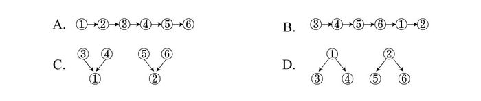
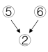

# 论证结构分析（论点与论据的支撑关系图形化）

考点：[[20-考点/判断推理/逻辑判断/论证结构分析（论点与论据的支撑关系图形化）|逻辑判断 / 论证结构分析（论点与论据的支撑关系图形化）]]

**问法模型**：题干要求'用甲乙表示甲支持（或证明）乙'来表示论证基本结构 → 先找出总结性论点，再逐句判定论据归属，按'箭头由论据指向被支持的论点'匹配图形选项

## 推理链
1. 第1步：题干6句围绕'费用'与'服务'两个话题展开，①'更加经济实惠'与②'而且可以享受到更高质量的服务'由'而且'并列连接，是总结性观点（论点）
2. 第2步：由规则'甲乙表示甲支持（或证明）乙'可知，结构图中箭头必须从论据出发、指向被支持的论点
3. 第3步：③'病人住院的平均费用是Y医院的四分之三'（价格低）与④'治愈率是Y医院的两倍左右'（效果好、钱花得值）共同解释①，构成③④→①
4. 第4步：⑤'医疗设备比Y医院更先进'与⑥'病人对服务很少有不满'共同解释②'更高质量的服务'，构成⑤⑥→②
5. 第5步：对照选项，C项图形为③④两箭头指向①、⑤⑥两箭头指向②，与推理完全一致
6. 第6步：D项箭头方向相反（①指向③④、②指向⑤⑥），把论点当成了论据；A、B项均为单链直列结构，无法体现'两组论据分别支撑两个论点'的层次，均排除，故选C

**最快解法**：⚡ 方向口诀法+结构排除：记住'箭头指向被支持者（论点）'，①②是论点，凡箭头从①②出发的D项秒排；再排A、B两个无分支的直链条；仅剩C为'③④→①、⑤⑥→②'的两组支撑结构，直接锁定

## 易错点
- ⚠ 箭头方向弄反：把'甲乙=甲支持乙'误读为乙支持甲，误选D（①②反向指向论据）
- ⚠ 忽略'而且'提示①②为两个并列论点，把6句话当成单一递进链条而误选A或B
- ⚠ 论据归组纠结：纠结④'治愈率'更贴近'服务质量'还是'经济实惠'，需按官方'性价比高→更实惠'的解读归入①组

## 母题抽象
> 🧩 当题干出现'用甲乙表示甲支持（或证明）乙'并给出箭头图形选项时，先用'而且/综上'等标志词锁定并列总结论，再逐句归组论据，按'箭头从论据指向论点'的方向规则匹配图形

**同类特征**：甲乙表示甲支持（或证明）乙、多个序号语句的论证结构、找总结性观点、'而且'引出并列论点、两组论据支撑两个论点、树形箭头图选项辨方向

## 相关题
（暂无）

---

### 题干

有一论证（相关语句用序号表示）如下：

①在X医院接受治疗，比在Y医院更加经济实惠，②而且可以享受到更高质量的服务。③在X医院，病人住院的平均费用是Y医院的四分之三。④X医院病人的治愈率是Y医院的两倍左右。⑤X医院的医疗设备比Y医院更先进。⑥X医院的病人对服务很少有不满。

如果用“甲乙”表示甲支持（或证明）乙，则对上述论证基本结构的表示最为准确的是

### 选项
- A. A
- B. B
- C. C　✅
- D. D

### 官方解析

第一步：找出总结性的观点。

题干6个命题围绕两个话题展开，服务和费用，因此找出总结性的结论如下：

①在X医院接受治疗，比在Y医院更加经济实惠；

②而且可以享受到更高质量的服务；

第二步：分析论证关系。

通过分析题干发现，③“在X医院，病人住院的平均费用是Y医院的四分之三”和④“X医院病人的治愈率是Y医院的两倍左右”都是在解释论点①“在X医院接受治疗，比在Y医院更加经济实惠”，即因为价格低，并且治愈率高，所以X医院更加经济实惠，表示为

；

⑤“X医院的医疗设备比Y医院更先进”和⑥“X医院的病人对服务很少有不满”都是在解释论点②“可以享受到更高质量的服务”，即因为医疗设备更先进，并且病人对服务比较满意，所以X医院可以享受到更高质量的服务，表示为，对应选项C。

故正确答案为C。

### 给定材料
（无）

> [!warning] 疑点（官方解析可能有误，待人工复核）
> 官方解析将④'治愈率是Y医院的两倍'归入支持①'更加经济实惠'，是把'经济实惠'按'性价比高'作扩展解读（治愈率高→钱花得值），而④更自然地指向医疗质量；该归组缺少'性价比'这一 bridging 前提，逻辑上稍显牵强，但结合选项设置（仅C同时满足'论据→论点'方向与两组支撑结构），答案C的判定不受影响

<!-- CODEX-ANSWER-REVIEW:BEGIN -->
### 本次独立复核

**复核状态：** `confirmed`（独立复算确认答案）

**计分答案：** C（可计分）

**复核解析：**

已从源仓库恢复并查看原始选项图：图C表示③、④共同支持①，⑤、⑥共同支持②；两项结论①“更经济实惠”和②“服务质量更高”分别由相应论据组支撑。③平均费用为四分之三直接支持①；④治愈率较高、⑤设备较先进、⑥患者少有不满均支撑②。故结构为C。

**相关信息：**

论证结构图中箭头由论据指向其支持的结论。

**题源依据：** [固定版本原题](https://github.com/Mentat-Uran/kaogongzhentizhengliu/blob/84ab93d4b64b61d897bece8a1c0a5bab06b4feb2/10-%E7%9C%9F%E9%A2%98/%E5%88%A4%E6%96%AD%E6%8E%A8%E7%90%86/%E9%80%BB%E8%BE%91%E5%88%A4%E6%96%AD/2376517%20%E8%AE%BA%E8%AF%81%E7%BB%93%E6%9E%84%E5%88%86%E6%9E%90%EF%BC%88%E8%AE%BA%E7%82%B9%E4%B8%8E%E8%AE%BA%E6%8D%AE%E7%9A%84%E6%94%AF%E6%92%91%E5%85%B3%E7%B3%BB%E5%9B%BE%E5%BD%A2%E5%8C%96%EF%BC%89.md)；固定内容 commit `84ab93d4b64b61d897bece8a1c0a5bab06b4feb2`，Markdown blob `7f5b9e52aa41f2774e341f3d14f5a8aead9d0e9b`。
<!-- CODEX-ANSWER-REVIEW:END -->
