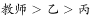

# 分析推理-信息匹配（排除法+确定信息优先）

考点：[[20-考点/判断推理/逻辑判断/分析推理-信息匹配（排除法+确定信息优先）|逻辑判断 / 分析推理-信息匹配（排除法+确定信息优先）]]

**问法模型**：选非题'下列说法错误的是'→ 先完全确定三人的职业对应关系，再逐项核对，选与事实相反的一项

## 推理链
1. 第1步：提取题干条件：(1)甲不是银行职员，(2)乙不是教师，(3)丙不是公务员，(4)教师比乙年龄大，(5)丙年龄最小
2. 第2步：由(4)'教师比乙年龄大'可知乙不是教师（与条件(2)一致）；由(5)丙年龄最小，不可能'比乙年龄大'，故丙也不是教师
3. 第3步：三人中教师只能是甲，且与'甲不是银行职员'相容，确定甲是教师
4. 第4步：丙不是公务员、也非教师，三人职业一一对应，故丙是银行职员
5. 第5步：剩余职业只有公务员，故乙是公务员；年龄排序为丙<乙<甲，与(4)(5)自洽
6. 第6步：逐项对照：A'甲是教师'为真，B'乙是公务员'为真，C'甲不是公务员'为真，D'丙不是银行职员'与事实相反
7. 第7步：本题为选非题，选错误表述，故答案为D

**最快解法**：⚡ 确定信息优先的排除法：先用年龄条件双重排除——'教师比乙大'排除乙是教师，'丙最小'排除丙是教师，唯一锁定甲是教师；再顺推丙是银行职员、乙是公务员，直接选出与结论矛盾的D

## 易错点
- ⚠ 漏用年龄信息：'教师比乙年龄大'+'丙年龄最小'隐含丙不是教师，若只靠三个否定条件会陷入多重假设
- ⚠ 忽略职业一一对应前提，未及时用剩余法收尾，导致绕远做假设
- ⚠ 审题失误：这是选非题，A、B、C均为正确表述，误把正确项当答案

## 母题抽象
> 🧩 当题干给出'职业匹配+年龄/排名比较信息'时，先用比较信息排除不可担任者（如'教师比乙大'排除乙、'丙最小'排除丙），锁定唯一剩余者后用排除法顺推全部匹配，最后按选非/选是要求核对选项

**同类特征**：三人三种职业一一对应、连续否定式条件（甲不是…乙不是…丙不是…）、年龄比较条件（教师比乙年龄大）、年龄极值条件（丙年龄最小）、选非题（说法错误的是）

## 相关题
- [[10-真题/资料分析/综合/10718179 综合分析-选非题（同比双口径比较、跨场加总、极值定位、地区去重计数）|10718179]]（深圳市考 2024，相关度1）
- [[10-真题/资料分析/综合/2377014 综合判断（选非题）——倍数表述辨析＋比重判断＋负增长读数|2377014]]（选调 2019，相关度1）
- [[10-真题/判断推理/科学推理/1758874 物理-做功条件、受力分析与平衡状态、重力势能|1758874]]（上海 2016，相关度1）
- [[10-真题/判断推理/定义判断/18643711 多定义辨析-选非题（数量公式型定义+等式变形推理）|18643711]]（天津 2026，相关度1）
- [[10-真题/判断推理/逻辑判断/2402441 分析推理-匹配类（排除法）|2402441]]（重庆 2018，相关度1）

---

### 题干
有教师、公务员、银行职员三人，其中甲不是银行职员，乙不是教师，丙不是公务员。教师比乙年龄大，丙在三人中年龄最小。
根据上述条件，下列说法错误的是：

### 选项
- A. 甲是教师
- B. 乙是公务员
- C. 甲不是公务员
- D. 丙不是银行职员　✅

### 官方解析

第一步：分析题干。

（1）甲不是银行职员

（2）乙不是教师

（3）丙不是公务员

（4）教师的年龄 乙的年龄

（5）丙年龄最小

第二步：根据题干条件分析选项。

根据条件（4）和（5）可知年龄的排序：，说明甲是教师。根据条件（3）可知，丙不是教师，也不是公务员，说明丙是银行职员，则乙是公务员。因此甲是教师，乙是公务员，丙是银行职员。

本题为选非题，故正确答案为D。

### 给定材料
（无）

> [!warning] 疑点（官方解析可能有误，待人工复核）
> 官方解析中'根据条件（3）可知，丙不是教师'表述有误：条件（3）只能说明丙不是公务员，'丙不是教师'应由条件（4）（5）的年龄关系推出；此为解析文字的标注错误，不影响最终结论'甲教师、乙公务员、丙银行职员'及答案D的正确性

<!-- CODEX-ANSWER-REVIEW:BEGIN -->
### 本次独立复核

**复核状态：** `confirmed`（独立复算确认答案）

**计分答案：** D（可计分）

**复核解析：**

年龄关系为教师比乙年长，丙最小，所以乙不可能是教师；题干也给乙不是教师。三种职业各一人：甲不是银行、乙非教师、丙非公务员。由丙最小且教师年长于乙，甲必须是教师；于是乙是公务员、丙是银行职员。因此D‘丙不是银行职员’为错误说法。

**相关信息：**

职业互异且刚好教师、公务员、银行职员三人各一职。

**题源依据：** [固定版本原题](https://github.com/Mentat-Uran/kaogongzhentizhengliu/blob/84ab93d4b64b61d897bece8a1c0a5bab06b4feb2/10-%E7%9C%9F%E9%A2%98/%E5%88%A4%E6%96%AD%E6%8E%A8%E7%90%86/%E9%80%BB%E8%BE%91%E5%88%A4%E6%96%AD/2376921%20%E5%88%86%E6%9E%90%E6%8E%A8%E7%90%86-%E4%BF%A1%E6%81%AF%E5%8C%B9%E9%85%8D%EF%BC%88%E6%8E%92%E9%99%A4%E6%B3%95%2B%E7%A1%AE%E5%AE%9A%E4%BF%A1%E6%81%AF%E4%BC%98%E5%85%88%EF%BC%89.md)；固定内容 commit `84ab93d4b64b61d897bece8a1c0a5bab06b4feb2`，Markdown blob `c699a3711e78b82cefc62565d1d07841b5ff3b3b`。
<!-- CODEX-ANSWER-REVIEW:END -->
