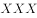
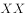

# 分析推理-排序（位置枚举+间隔约束）

考点：[[20-考点/判断推理/逻辑判断/分析推理-排序（位置枚举+间隔约束）|逻辑判断 / 分析推理-排序（位置枚举+间隔约束）]]

**问法模型**：问'以下哪项可能为真'→ 先用间隔条件和端点限制穷举出所有可能的相对顺序模型，再逐项代入验证存在性（找到一个可行排列即为真）

## 推理链
1. 第1步：由条件（2）'乙和丙之间有三人'、条件（3）'丁和戊之间有三人，且丁先朗诵'可知两对各跨5个连续位置；由条件（1）甲要么第1要么第7，其余六人占据连续6个位置
2. 第2步：在6个连续位置内枚举两对'隔3人'的组合，并用条件（4）'丁在乙之前'过滤，得到四人只有三种相对顺序：丁乙戊丙、丁丙戊乙、丙丁乙戊
3. 第3步：把甲放到第1位或第7位展开，共6种具体排列：甲丁乙□□戊丙、甲丁丙□□戊乙、甲丙丁□□乙戊、丁乙□□戊丙甲、丁丙□□戊乙甲、丙丁□□乙戊甲（□为己、庚互换的空位）
4. 第4步：A项：'丁丙□□戊乙甲'（甲第7）和'甲丙丁□□乙戊'（甲第1）两种排列中丙都在第2位，可能为真，当选
5. 第5步：B项：6种排列中乙只出现在第2/3/5/6/7位，第4位不可能，排除
6. 第6步：C项：己、庚只能填入□□空位（第3、4位或第4、5位），空位之前至少已有两人，庚不可能第2位，排除
7. 第7步：D项：6种排列中丁只出现在第1/2/3位，第4位不可能，排除

**最快解法**：⚡ 枚举模型法：先用'隔三人=位置差4'圈定两对跨度，结合甲占两端、丁先于乙，穷举出三大相对顺序（丁乙戊丙/丁丙戊乙/丙丁乙戊），再逐项代入；A项只要写出'丁丙□□戊乙甲'或'甲丙丁□□乙戊'一个反例即可当选，其余三项按乙、庚、丁的可取位置直接排除

## 易错点
- ⚠ 把'之间有三人'误算成位置差3，实际两人相隔3人意味着位置差为4、跨5个位置
- ⚠ 枚举不全导致误排除A：丙第2位需要'甲在第7+丁丙戊乙'或'甲在第1+丙丁乙戊'两类搭配，只枚举甲在一端会漏掉可行排列
- ⚠ 忽略己、庚是未约束的自由元素，只能填剩余两个空位，误以为庚可以放在任何空位

## 母题抽象
> 🧩 当题干出现'若干人排顺序+某两人之间隔固定人数+某人限定在两端+给出先后限制'时，先用间隔条件确定两对跨度并在剩余连续区间内枚举相对顺序模型，再代入端点限制展开全部排列，对'可能为真'选项找一个可行排列即可

**同类特征**：七人排序（表演顺序）、甲要么第一个要么最后一个、乙丙之间有三人、丁戊之间有三人且丁先、丁在乙之前、问'哪项可能为真'

## 相关题
（暂无）

---

### 题干
甲、乙、丙、丁、戊、己、庚七人表演配乐诗朗诵，为确保表演效果，需要安排朗诵顺序。已知：（1）甲要么第一个朗诵，要么最后一个朗诵；（2）乙和丙之间有三人；（3）丁和戊之间有三人，且丁先朗诵；（4）丁在乙之前朗诵。
根据上述条件，以下哪项可能为真？

### 选项
- A. 丙第二个朗诵　✅
- B. 乙第四个朗诵
- C. 庚第二个朗诵
- D. 丁第四个朗诵

### 官方解析

第一步：分析题干。

①要么甲第一个，要么甲最后一个；

②乙 丙（丙 乙）；

③丁 戊；

④丁先于乙。

根据条件②和③可知，每个条件各占5个位置，并且根据条件①甲要么在第1个，要么在第7个可知，除了甲以外一共有6个连着的位置可供其余人选择；丁和戊的前后顺序确定，结合条件④丁先于乙，所以对于这6个连着的位置可能出现的情况有三种：第一种是“丁乙戊丙”；第二种是“丁丙戊乙”；第三种是“丙丁乙戊”，甲可能在这6个位置之前也可能在之后。

第二步：逐一分析选项。

A项：当第二种情况出现且甲在最后一个时，位置为：丁丙戊乙甲，或者当第三种情况出现且甲在第一个时，位置为甲丙丁乙戊，此时丙可以在第二个位置朗诵，可能为真，当选；

B项：题干三种情况中，乙都不可能在第四个位置出现，因此该项不可能为真，排除；

C项：庚只能出现在“ ”中，而题干三种情况中，“  ”前至少存在两个人，因此庚不可能在第二个位置，该项不可能为真，排除；

D项：题干三种情况中，丁只能出现在第一个、第二个或第三个位置，因此丁在第四个朗诵不可能为真，排除。

故正确答案为A。

### 给定材料
（无）
