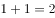
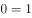
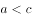

# 多定义判断-选非题（三种蕴涵关系辨析）

考点：[[20-考点/判断推理/逻辑判断/多定义判断-选非题（三种蕴涵关系辨析）|逻辑判断 / 多定义判断-选非题（三种蕴涵关系辨析）]]

**问法模型**：题干并列给出'因果蕴涵/反事实蕴涵/严格蕴涵'三个定义，问'不属于'→多定义选非题，用各定义核心关键词逐项匹配，与三个定义全部对不上的选项即答案

## 推理链
1. 第1步：提取三个定义的核心特征——因果蕴涵强调'因为p是真的，q也是真的'（p真且导致q真）；反事实蕴涵强调'p与事实相反'这一前提；严格蕴涵强调'必然地，p真则q真'（逻辑/数学必然推出）
2. 第2步：方法为多定义关键词匹配法，逐项对照三个定义，选非题找出全部不符合的选项
3. 第3步：A项为'如果（前件公式），那么（后件公式）'，其中前件公式是真的、后件公式是假的——p真而q假，既不满足'因为p真q也真'（因果），前件也非'与事实相反'（反事实），更不满足'必然p真则q真'（严格），三个定义均不符合
4. 第4步：B项为'如果（条件公式）且（条件公式），那么（结论公式）'，条件为真时结论公式必然为真，符合'必然地p真则q真'，属严格蕴涵
5. 第5步：C项'甲从台阶上摔断了腿，那么当时他会感觉疼痛'，摔断腿是p且因p导致疼痛q，符合因果蕴涵
6. 第6步：D项'大气层本就不存在'与事实相反，属于反事实前提，在此前提下推出'地球上将不会有生命'，符合反事实蕴涵
7. 第7步：本题选'不属于'，只有A项不属于任何一种蕴涵关系，故答案为A

**最快解法**：⚡ 关键词法+排除法：先抓三个定义的题眼——'因为'（因果）、'与事实相反'（反事实）、'必然'（严格）；再扫选项：C项'摔断了腿→疼痛'含因果（排除），D项'本就不存在'为典型反事实句式（排除），B项为'且'命题必然推出结论、属严格蕴涵（排除），A项前件公式真而后件公式假，'p真q假'与三个定义全对不上，当选

## 易错点
- ⚠ 选非题惯性思维误选：B/C/D均符合定义，易顺手选成'属于'定义的项而错选
- ⚠ 忽略反事实蕴涵的核心前提'p与事实相反'，把D项误认为普通假设句而纠结
- ⚠ A项以公式呈现，需自行判断公式真假（前件真、后件假）；若不验证真假，易被数学表达式的外形迷惑而误判为严格蕴涵

## 母题抽象
> 🧩 当题干并列给出多个定义且问'不属于/不符合'时，先为每个定义提炼一个专属关键词（如'因为''与事实相反''必然'），再用排除法逐项归位，唯一在所有定义下都找不到归属的选项即为答案

**同类特征**：三个并列定义（多定义判断）、选非问法（'不属于'）、定义关键词：因为/与事实相反/必然地、选项含数学公式需判断真假、典型反事实句式'本就不存在'

## 相关题
- [[10-真题/判断推理/定义判断/2051630 单定义-要件对应（关键词定位+选非比对）|2051630]]（陕西 2017，相关度1）
- [[10-真题/判断推理/定义判断/4652271 单定义-要件比对（选非题）|4652271]]（北京 2022，相关度1）

---

### 题干
设p、q是任意命题。p因果蕴涵q指的是：如果p是真的，那么因为p是真的，q也是真的。p反事实蕴涵q指的是：如果p与事实相反，p是真的，那么q也是真的。p严格蕴涵q指的是：必然地，如果p是真的，那么q也是真的。
根据上述定义，下列不属于上述三种蕴涵关系的是：

### 选项
- A. 
如果，那么 
　✅
- B. 
如果 且，那么

- C. 
如果甲从台阶上摔断了腿，那么当时他会感觉疼痛

- D. 
如果大气层本就不存在，那么地球上将不会有生命

### 官方解析
第一步：找出定义关键词。
p因果蕴涵q：“如果p是真的，那么因为p是真的，q也是真的”；
p反事实蕴涵q：“如果p与事实相反，p是真的，那么q也是真的”；
p严格蕴涵q：“如果p是真的，那么q也是真的”。
第二步：逐一分析选项。
A项：“”是真的，但是“”是假的，不符合以上任何一种定义，不符合定义，当选；
B项：如果“且”为真，那么可以推出“”必然为真，符合“如果p是真的，那么q也是真的”，符合“p严格蕴涵q”，符合定义，排除；
C项：因为甲从台阶上摔断了腿，所以他当时会感觉到疼痛，符合“因为p是真的，q也是真的”，符合“p因果蕴涵q”，符合定义，排除；
D项：大气层本就不存在是“与事实相反的”，如果大气层本就不存在是真的，那么可以推出地球上将不会有生命也是真的，符合“如果p与事实相反，p是真的，那么q也是真的”，符合“p反事实蕴涵q”，符合定义，排除。
本题为选非题，故正确答案为A。

### 给定材料
（无）
