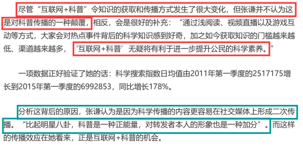

# 削弱论证-直接否定论点（无论据型削弱）

考点：[[20-考点/判断推理/逻辑判断/削弱论证-直接否定论点（无论据型削弱）|逻辑判断 / 削弱论证-直接否定论点（无论据型削弱）]]

**问法模型**：题干只有'研究者认为+观点'而无论据，问'能够质疑研究者观点的有'→采用直接否定论点模型：只需证明'是颠覆'或'素养未提升'之一即可

## 推理链
1. 第1步：提取论点——'互联网+科普'不是对科普传播的一种颠覆，而是显示了公民科学素养的提升；题干前面'浅阅读、视频直播、游戏互动'等只是背景铺垫，不构成论据
2. 第2步：确认本题无论据，削弱只能直接否定论点，可行路径有两条：①证明'互联网+科普'是对科普传播的颠覆；②证明它没有让公民科学素养提升
3. 第3步：A项'公众往往曲解合理的科学解释'——公众连合理科学解释都曲解，说明科学素养并未提升，命中路径②，直接否定论点；B项谈'资讯类媒体是主要渠道'，把话题从'素养是否提升'偷换成'获取渠道'，话题不一致
4. 第4步：C项'转发科普内容为转发者形象加分'——解释了公民转发科普的动机，恰好支持公民通过互联网科普展现素养，实为加强项；D项'用户乐于图文资讯形式'，谈的是获取形式偏好，同样话题不一致
5. 第5步：仅A项与论点核心话题'科学素养'一致且立场相反，故选A

**最快解法**：⚡ 话题一致排除法：锁定论点核心词'科学素养的提升'，快速扫描选项——只有A'公众曲解科学解释'指向素养问题且为负面表述；B(渠道)、D(形式)话题漂移直接排除，C(动机加分)是加强而非削弱，秒选A

## 易错点
- ⚠ C项迷惑性最强：'转发科普为形象加分'看似与素养相关，易误判为削弱，实际它解释了转发动机、支持了'素养提升'的说法，是加强项
- ⚠ B、D项话题偷换：将'科学素养是否提升'偷换成'获取渠道/获取形式是什么'，与论点话题不一致，不能削弱
- ⚠ 忽略论点的双重断言结构：'不是颠覆+是素养提升'，误以为必须同时否定两层才算削弱，其实否定任一层即可

## 母题抽象
> 🧩 当题干出现'研究者/专家认为+纯观点、无 preceding 论据'特征时，用直接否定论点法削弱，优先选与论点核心词（如'素养提升'）话题一致且立场相反的选项，警惕渠道/形式/动机类话题漂移项和'解释动机型'加强项

**同类特征**：'研究者认为'引出唯一论点、题干无论据，只有背景铺垫（浅阅读、视频直播、游戏互动）、论点含双重断言：'不是颠覆，而是素养提升'、问法为'能够质疑研究者观点的有'、选项围绕渠道、动机、形式设置话题漂移干扰

## 相关题
- [[10-真题/判断推理/逻辑判断/2376594 削弱论证-直接否定论点（无论据型削弱）|2376594]]（黑龙江 2019，相关度2）

---

### 题干
如今，基于互联网的新型科普方式层出不穷。浅阅读，视频直播以及游戏互动等方式，使得如今获取科学知识的渠道越来越多，门槛也越来越低，研究者认为，尽管“互联网+科普”令科学知识的获取和传播方式发生了很大变化，但这不是对科普传播的一种颠覆，而是显示了公民科学素养的提升。
以下各项如果为真，能够质疑研究者观点的有（  ）。

### 选项
- A. 在许多科学热点事件的传播过程中，公众往往曲解合理的科学解释　✅
- B. 新闻应用，微博等资讯类媒体是用户了解科学热点事件的主要渠道
- C. 比起明星八卦，在社交媒体转发科普内容更能为转发者本人形象加分
- D. 数据表明，用户普遍乐于通过图文资讯这样轻松愉悦的形式获取知识

### 官方解析

第一步：找出论点和论据。

论点：“互联网+科普”不是对科普传播的一种颠覆，而是显示了公民科学素养的提升。

论据：无。

本题无论据，只能通过直接否论点进行削弱。可以说①“互联网+科普”是对科普传播的一种颠覆，或者②“互联网+科普”没有让公民科学素养的提升。

第二步：逐一分析选项。

A项：该项说的是公众曲解了合理的科学解释，说明“互联网+科普”没有让公民科学素养的提升，直接否定题干论点，当选；

B项：该项说的是用户获取知识的主要渠道是哪些，而论点说的是互联网传播知识是否会让公民科学素养的提升，与论点话题不一致，无法削弱，排除；

C项：该项说的是转发科普内容会使转发者形象加分，解释了为什么公民会通过转发科普内容显示自己的科学素养，不能削弱，排除；

D项：该项说的是用户喜欢用图文资讯的方式获取知识，而论点说的是互联网传播知识是否会让公民科学素养提升，话题不一致，无法削弱，排除。

故正确答案为A。

注：本题通过查询原文，如下图所示，张谦先生提出了观点“互联网+科普”不是对科普传播的一种颠覆，而是显示了公民科学素养的提升。后面的便开始分析提出这个观点的原因，所以在此题中C项是加强项，而非削弱项。

### 给定材料
（无）
