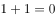
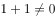
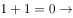
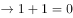
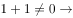
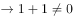

# 翻译推理-逆否命题（逆否等价-同真等价）

考点：[[20-考点/判断推理/逻辑判断/翻译推理-逆否命题（逆否等价-同真等价）|逻辑判断 / 翻译推理-逆否命题（逆否等价/同真等价）]]

**问法模型**：题干以‘以下哪项和专家所说的同真’设问 → 采用逆否等价模型：同真即等价，假言命题唯一等价形式是逆否命题‘否后必否前’。

## 推理链
1. 第1步：题干为假言命题‘如果[P公式]，则时间是静止的’，翻译为 P→静止（P即B、C两项中出现的公式命题）。
2. 第2步：问‘哪项和专家所说的同真’，同真=等价，故只需找题干的逆否命题：非静止→非P，即‘时间是运动的→¬P’（A、D两项中的公式即P的否定¬P）。
3. 第3步：A项‘¬P或者时间是运动的’，按‘否一推一’换算为假言即 P→运动，相当于对题干‘肯前推否后’（运动=对静止的否定），得不出必然结论，排除。
4. 第4步：B项‘如果时间是静止的，则P’，是对题干的‘肯后’，肯后得不出必然结论，排除。
5. 第5步：C项‘P或者时间是运动的’，换算为 ¬P→运动，是对题干的‘否前’，否前得不出必然性结论，排除。
6. 第6步：D项‘如果时间是运动的，则¬P’，即非静止→非P，对题干‘否后必否前’，是逆否命题，与题干同真，当选。

**最快解法**：⚡ 逆否口诀法：‘肯前必肯后，否后必否前，肯后否前无必然’。题干P→静止，否后即‘时间是运动的→非P’，直接锁定D；B是肯后、C是否前、A是肯前推否后，均无必然结论，一票排除。

## 易错点
- ⚠ ‘或’命题不换算直接比对：A、C的‘__或者时间是运动的’必须先按‘否一推一’换算成假言形式（分别为P→运动、¬P→运动），否则极易误选C。
- ⚠ 混淆逆命题与逆否命题：B项‘如果时间是静止的，则P’与题干语序相近，误把‘肯后’当成与题干同真。
- ⚠ 混淆‘同真（等价）’与‘看似可推出’：D是唯一的逆否等价命题，A、C、B分别属于肯前推否后、否前、肯后三种无效形式，需逐一辨析。

## 母题抽象
> 🧩 当题干出现‘如果A，则B’且问‘哪项与之同真/等价’时，直接找逆否命题‘¬B→¬A’；选项若为‘A或B’型须先换算成‘否一推一’的假言形式，凡构成肯后（B→A）、否前（¬A→¬B）、肯前推否后（A→¬B）的选项一律排除。

**同类特征**：假言命题‘如果……则时间是静止的’、问法‘以下哪项和专家所说的同真’（等价命题问法）、选项混排‘或者’命题与假言命题、两个公式命题互为否定（P与¬P分别出现在不同选项中）、考查否一推一、肯后、否前、否后必否前等逆否规则

## 相关题
（暂无）

---

### 题干

某专家说：如果，则时间是静止的。

以下哪项和专家所说的同真？

### 选项
- A. 
或者时间是运动的

- B. 
如果时间是静止的，则

- C. 
或者时间是运动的

- D. 
如果时间是运动的，则
　✅

### 官方解析

第一步：翻译题干。

时间是静止的

第二步：逐一分析选项。

A项：翻译为或者时间是运动的，根据否一推一可知，时间是运动的，属于对题干的肯前推否后，该项无法推出，排除；

B项：翻译为 时间是静止的，是对题干的肯后，肯后得不出必然结论，该项不能推出，排除；

C项：翻译为 或时间是运动的，根据否一推一可知，时间是运动的，是对题干的否前，否前得不出必然性结论，该项无法推出，排除；

D项：翻译为 时间是运动的，是对题干的否后，否后必否前，可以推出，当选。

故正确答案为D。

### 给定材料
（无）
