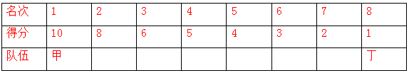
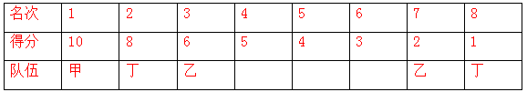

# 分析推理-多条件约束名次匹配与计分排序

考点：[[20-考点/判断推理/逻辑判断/分析推理-多条件约束名次匹配与计分排序|逻辑判断 / 分析推理-多条件约束名次匹配与计分排序]]

**问法模型**：'根据以上条件，可以判断各队总分由高到低的排序'→先由多重约束唯一确定各队名次组合，再按分值表（10/8/6/5/4/3/2/1）计分比较，采用列表+假设排除模型

## 推理链
1. 第1步：由条件（2）'第一名是甲队选手，第八名是丁队选手'，结合（1）乙队'排名都是奇数'、丁队'排名都是偶数'，可知乙只能在3、5、7中取两名，丁在2、4、6、8中取两名且必含8
2. 第2步：由（1）丙队'排名相连'与（3）'丙队两名选手在乙队两名选手之间'，乙若取(3,5)或(5,7)，中间仅剩1个名次放不下相连的两丙，故乙只能为第3、7名
3. 第3步：丁若为(6,8)，两丁之间仅剩第7名，容不下相连两丙，排除；假设丁=(4,8)，则丙=(5,6)，甲只能补第2名，1与2相连违反（1）'甲队一奇一偶但不相连'，故丁=(2,8)
4. 第4步：在甲占第1、乙占3和7、丁占2和8之下，丙相连且同时介于乙、丁之间，只能取(4,5)或(5,6)，对应甲补第6名或第4名
5. 第5步：验证丙=(4,5)、甲=(1,6)时得分：甲13、乙8、丙9、丁9，丙丁同分违反（4）'各队总分各不相同'，排除
6. 第6步：唯一可行组合为甲(1,4)、乙(3,7)、丙(5,6)、丁(2,8)，计分：甲10+5=15、乙6+2=8、丙4+3=7、丁8+1=9，四队总分互不相同，满足全部条件
7. 第7步：总分由高到低为甲>丁>乙>丙，对照选项，与C项一致

**最快解法**：⚡ 假设排除法+列表法：先用'第1名属甲'锁定乙只能取3、5、7，再由丙需相连嵌入排除(3,5)(5,7)得乙=3、7；试丁=4推出甲只能取2与1相连矛盾→锁定丁=2、8；再试丙=4、5出现丙丁同9分违反'总分各不相同'→锁定丙=5、6、甲=1、4；算出15/9/8/7排序即得C

## 易错点
- ⚠ 漏看条件（2）'第一名是甲队选手'对乙队奇数名次的隐性排除，误讨论乙取第1名的组合而浪费时间
- ⚠ 验证丙=(4,5)时忽略条件（4）'各队总分各不相同'这一排他条件，误以为存在多解而无从下手
- ⚠ 计分表记忆出错（如第4名5分、第6名3分记反），导致总分算错、排序选错

## 母题抽象
> 🧩 当题干以'奇偶属性+相连/不相连+介于两者之间'多重约束给名次（座位、序号）定位时，先用固定名次与属性等硬条件缩小候选，再对剩余候选逐一假设验证，并用'各不相同'类排他条件保证唯一解，最后代入数值计算比较

**同类特征**：每队两名选手对应名次、奇偶性约束（乙全奇、丁全偶、甲一奇一偶）、排名相连/不相连、丙队介于乙队与丁队之间、各队总分互不相同、求总分由高到低排序

## 相关题
（暂无）

---

### 题干
某高校举办了一场省级选拔竞赛，有甲、乙、丙、丁四支代表队进入决赛，每支代表队有两名参赛选手，第一名到第八名分别获得10、8、6、5、4、3、2、1分，队伍总分最高者将获得冠军，最后冠军代表学校参赛。比赛的排名情况如下：（1）甲队选手排名是一奇一偶但不相连，乙队选手的排名都是奇数，丙队两名选手的排名相连，丁队选手的排名都是偶数；（2）第一名是甲队选手，第八名是丁队选手：（3）丙队两名选手在乙队两名选手之间，同时也在丁队两名选手之间；（4）各队总分各不相同。
根据以上条件，可以判断各队总分由高到低的排序为：

### 选项
- A. 
甲丙乙丁

- B. 
丁甲乙丙

- C. 
甲丁乙丙
　✅
- D. 
甲乙丁丙

### 官方解析

根据题干条件，可列表为

因丙队两名选手排名相连，乙队选手排名均为奇数，且丙队两名选手在乙队两名选手之间，故乙队两名选手的排名不能为3、5或5、7，只能为3、7；

丙队两名选手同时也在丁队两名选手之间，丁队选手排名都是偶数，其中一个为第8名，另一个不能为第6名（若为第6名，则丙队两名选手不能在丁队之间）即丁队可能在2，也可能在4。

假设丁队在4，根据丙队两名选手同时也在丁队两名选手之间，丙队排名相连，可知丙队在5、6，如下表所示：

此时甲只能在2，与题干条件（1）甲队选手排名是一奇一偶但不相连矛盾，因此丁队在2。如下表所示：

此时丙队排名若为4、5，则甲为6；

此时得分：甲：13，乙：8，丙：9，丁：9，与丙队得分=丁队得分，与题干（4）各队总分各不相同矛盾，因此排名为：丙队排名5、6，则甲队排名第4。

此时甲队得分15分，乙队得分8分，丙队得分7分，丁队得分9分，其排名为：甲＞丁＞乙＞丙。

故正确答案为C。

### 给定材料
（无）
