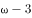

# 削弱论证-拆桥（论据测评结果与论点'聪明'话题不一致，切断推导链条）

考点：[[20-考点/判断推理/逻辑判断/削弱论证-拆桥（论据测评结果与论点'聪明'话题不一致，切断推导链条）|逻辑判断 / 削弱论证-拆桥（论据测评结果与论点'聪明'话题不一致，切断推导链条）]]

**问法模型**：题干问'最能驳斥研究者观点'→ 先定位论点'妊娠期补DHA不能使孩子更聪明'与论据'18个月/4岁测评无差异'，发现话题不一致，优先采用拆桥法削弱论证

## 推理链
1. 第1步：提取论点——'母亲妊娠期补充DHA不能使孩子更聪明'，核心概念是'聪明'（智力）
2. 第2步：提取论据——对比试验：800毫克DHA组与安慰剂组，孩子在18个月大及4岁时'认知、语言及运动评分''认知、从事复杂思维处理、语言及执行功能'检测结果两组间无显著差异
3. 第3步：识别论证漏洞——论据说的是'儿童早期测评无差异'，论点说的是'不聪明'，二者之间隐含前提是'4岁时的测评能可靠代表智力'，论据与论点话题不一致
4. 第4步：确定削弱方向——话题不一致时优先拆桥，即证明'18个月/4岁的检测结果不能代表孩子是否聪明'
5. 第5步：逐项排除——A项'摄入DHA的确切数量难以确定'不涉及对胎儿智力的影响，无关；B项'降低早产、过敏风险'谈论其他收益，与'是否更聪明'无关；D项'出生后补充DHA有益认知'与论点'妊娠期补充'时间阶段不同，话题不一致
6. 第6步：验证C项——'7岁才是能够预测智力的最早年龄，4岁时各种因素对发育的影响尚未充分表现，不能可靠评估'，直接否定'4岁测评→不聪明'的推导，切断论据与论点的联系，拆桥成立
7. 第7步：对比力度——C项直接摧毁论证桥梁，A、B、D均为无关项，故C最能驳斥

**最快解法**：⚡ 拆桥法：看到论据是'某年龄段测评无差异'、论点是'不能更聪明'，话题不一致，直接找否定'测评效度'的选项——C项'4岁不能可靠评估智力'一句话拆桥，秒选

## 易错点
- ⚠ 误选D：被'出生后补充DHA有益认知'吸引，但论点限定'妊娠期补充'，补充阶段不同，话题不一致属无关项，不能削弱
- ⚠ 误选B：误以为'有其他好处'能反驳'不能变聪明'，实际B项说的是降低早产/过敏风险，与智力话题无关
- ⚠ 混淆削弱对象：C项并未否定实验数据本身（不否认两组确实无差异），而是否定'4岁测评能代表智力'这一隐含前提，属拆桥削弱论证而非否定论据真实性

## 母题抽象
> 🧩 当论据是'某年龄段/某指标测评结果无差异'而论点是'某能力（如聪明）有无差异'时，二者话题不一致，优先找'该测评/该年龄不能可靠代表结论所指能力'的选项进行拆桥

**同类特征**：临床试验/对比试验（补充剂组vs安慰剂组）、跟踪评估（18个月、4岁两个时点）、检测结果没有（显著）差异、论点核心词'聪明'与论据核心词'认知/语言/运动评分'不一致、问法为'最能驳斥/削弱'、选项涉及测评年龄效度

## 相关题
（暂无）

---

### 题干

胎儿大脑发育需要一种重要的营养物质脂肪酸即二十二碳六烯酸（DHA)。有人建议，孕妇在孕期服用富含DHA的鱼油补充剂有利于胎儿的大脑发育。临床试验中，两组孕妇每日服用含有800毫克DHA的补充剂或安慰剂。两组孩子在18个月大时，其平均的认知、语言及运动评分之间没有差别。此后，研究人员对这些孩子在4岁时的表现进行了跟踪评估，大多数（)家庭参与了该研究。研究人员发现，对认知、从事复杂思维处理、语言及执行功能（如记忆、推理、解决问题）的检测结果在两组间没有显著差异。研究者认为，母亲妊娠期补充DHA不能使孩子更聪明。

以下哪项如果为真，最能驳斥研究者观点？

### 选项
- A. 胎儿的DHA来自母亲的饮食，但母亲需要摄入的DHA的确切数量目前难以确定
- B. DHA补充剂可能降低早产的风险，也可能降低那些有家族过敏史的孩子患过敏的风险
- C. 7岁才是能够预测智力的最早年龄，4岁时各种因素对发育的影响尚未充分表现，不能可靠评估　✅
- D. 研究证明，孩子出生后补充DHA有益于认知能力发展，该国婴儿出生后常规服用富含DHA的补充剂

### 官方解析

第一步：找出论点和论据。

论点：母亲妊娠期补充DHA不能使孩子更聪明。

论据：临床试验中，两组孕妇每日服用含有800毫克DHA的补充剂或安慰剂。两组孩子在18个月大时，其平均的认知、语言及运动评分之间没有差别。此后，研究人员对这些孩子在4岁时的表现进行了跟踪评估，大多数（）家庭参与了该研究。研究人员发现，对认知、从事复杂思维处理、语言及执行功能（如记忆、推理、解决问题）的检测结果在两组间没有显著差异。

本题通过对比试验的结果，两组孩子在18个月大以及4岁时，平均的认知、语言、运动评分以及认知、从事复杂思维处理、语言及执行功能（如记忆、推理、解决问题）的检测结果没有明显差异，作为论据得出论点母亲妊娠期补充DHA不能使孩子更聪明，两者话题不一致，削弱优先考虑拆桥，即证明18个月大以及4岁这些能力不能代表孩子是否聪明。

第二步：逐一分析选项。

A项：指出母亲需要摄入的DHA数量难以确定，没有涉及摄入DHA后对胎儿的影响，无法削弱，排除；

B项：指出DHA补充剂可能可以降低早产以及有家族过敏史的孩子患过敏的风险，没有涉及对孩子智力的影响，属于无关项，排除；

C项：指出7岁是预测智力的最早年龄，论据中对4岁孩子各种能力的评估无法证明孩子是否聪明，削弱了论据与论点之间的关系，拆桥，削弱论证，当选；

D项：说的是孩子出生后补充DHA有益于认知能力发展，而论点说的是母亲妊娠期补充DHA不能使孩子更聪明，二者话题不一致，属于无关项，排除。

故正确答案为C。

### 给定材料
（无）
