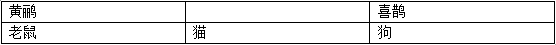

# 分析推理-位置关系（最大信息法+分情况讨论）

考点：[[20-考点/判断推理/逻辑判断/分析推理-位置关系（最大信息法+分情况讨论）|逻辑判断 / 分析推理-位置关系（最大信息法+分情况讨论）]]

**问法模型**：问'下列位置关系正确的是'（求必然成立的结论）→ 从被提及最多的对象入手分情况画图，只选在所有情况下都成立的位置关系，排除仅在某一种情况下成立的选项

## 推理链
1. 第1步：提取四个条件——'老鼠在猫的左边'即猫在老鼠右边、'狗在老鼠右边'、'老鼠正上方有只黄鹂'、'狗的正上方有只喜鹊'。
2. 第2步：老鼠被提及最多，从最大信息'老鼠'入手：猫和狗都在老鼠右边，但猫狗彼此的左右顺序题干未定，需分两种情况画图（一种猫在狗左，一种狗在猫左）。
3. 第3步：利用'正上方'的传导性——黄鹂与老鼠同列、喜鹊与狗同列，上下对齐不改变左右的相对顺序；因狗恒在老鼠右边，故喜鹊恒在黄鹂右边。
4. 第4步：逐项检验：A'狗的左边是猫'与B'狗的右边是猫'分别只在两种情况之一成立，均非必然正确，排除。
5. 第5步：C'黄鹂的右边是喜鹊'在两种情况下均成立，是唯一必然正确的位置关系，当选；D'黄鹂的左边是喜鹊'在两种情况下均不成立，排除。

**最快解法**：⚡ 最大信息法+两行简图：以'老鼠'为锚点画上下两行（下行猫狗左右序不定，上行按'正上方'对应黄鹂、喜鹊），凡纠结'猫狗谁左谁右'的选项随情况而变（A、B排除），只有'黄鹂—喜鹊'的左右关系由'狗在老鼠右边'直接传导、恒成立，直接选C。

## 易错点
- ⚠ 把'老鼠在猫的左边'误读成猫紧挨老鼠右侧，忽略猫、狗相对顺序不定、必须分情况讨论
- ⚠ 只盯着猫狗左右的选项纠结，忽略'正上方'不改变左右顺序、可直接传导出必然结论C
- ⚠ 误认为A或B在某种情况下成立就可选——问'正确的是'必须选所有情况下都成立的关系

## 母题抽象
> 🧩 当题干给出多个对象的两两位置（左右/上下）且问'哪个位置关系必然正确'时，从被提及最多的对象入手分情况画图，优先找由'正上方/正下方'等同列关系传导出的、在所有情况下都不变的位置关系作为答案。

**同类特征**：老鼠在猫的左边、狗在老鼠右边、正上方、老鼠（最大信息，提及最多）、下列位置关系正确的是、需分情况讨论

## 相关题
（暂无）

---

### 题干
老鼠在猫的左边，狗在老鼠右边，老鼠正上方有只黄鹂，狗的正上方有只喜鹊，下列位置关系正确的是：

### 选项
- A. 狗的左边是猫
- B. 狗的右边是猫
- C. 黄鹂的右边是喜鹊　✅
- D. 黄鹂的左边是喜鹊

### 官方解析

第一步：分析题干条件。

根据题干条件，老鼠提及的最多，从最大信息入手，老鼠在猫的左边，那么猫就在老鼠的右边，根据第二个条件，狗也在老鼠的右边，那么猫和狗的位置有以下两种情况，如下图所示。

情况一：

情况二：

第二步：逐一分析选项。

A项：如上图所示，情况一中，狗的右边是猫，该项错误，排除；

B项：如上图所示，情况二中，狗的左边是猫，该项错误，排除；

C项：如上图所示，两种情况均满足黄鹂的右边是喜鹊，该项正确，当选；

D项：如上图所示，两种情况均满足黄鹂的右边是喜鹊，该项错误，排除。 

故正确答案为C。

### 给定材料
（无）
