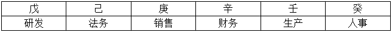
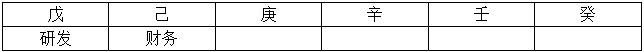

# 分析推理-排列组合（楼栋顺序匹配，代入排除法）

考点：[[20-考点/判断推理/逻辑判断/分析推理-排列组合（楼栋顺序匹配，代入排除法）|逻辑判断 / 分析推理-排列组合（楼栋顺序匹配，代入排除法）]]

**问法模型**：题干给出多条'前后/紧邻'位置约束并附加确定前提'研发部在戊字楼'，问'哪项可能为真'→采用代入排除法，将每个选项叠加到前提下逐项检验是否与全部条件相容，无矛盾者即为答案

## 推理链
1. 第1步：由'研发部在戊字楼'及楼栋顺序戊→己→庚→辛→壬→癸可知研发居首，研发之前无法务的位置，故条件(3)'紧挨法务之后的是研发或销售'中紧挨法务之后的只能是销售，即'法务、销售'必须相邻且销售在后
2. 第2步：采用代入法，将各选项代入'研发在戊'这一前提，再用条件(1)'销售在财务和生产之前'、条件(2)'人事紧挨研发或生产之后'检验是否无矛盾
3. 第3步：代入A'法务部在辛字楼'→销售必在壬字楼，生产须在销售之后只能占癸字楼，财务只能排己或庚，均位于销售之前，违反条件(1)，排除
4. 第4步：代入B'人事部在癸字楼'→人事不在己字楼，不能紧挨研发，由条件(2)只能是紧挨生产之后，即生产在壬、人事在癸；剩余己庚辛由条件(3)定为法务在己、销售在庚、财务在辛，此时销售（庚）在财务（辛）和生产（壬）之前，满足条件(1)，全部条件无矛盾
5. 第5步：代入C'财务部在己字楼'→条件(1)要求销售在财务之前，销售只能占戊字楼，与前提'研发在戊字楼'直接冲突，排除
6. 第6步：代入D'生产部在庚字楼'→由条件(1)销售只能排己字楼；条件(3)要求紧挨法务之后是研发或销售，研发在戊居首前面无法务，销售在己而其前一位戊已是研发，法务无处安放，违反条件(3)，排除
7. 第7步：仅B项可构造出满足全部条件的完整排布（己法务、庚销售、辛财务、壬生产、癸人事），故B可能为真，当选

**最快解法**：⚡ 代入排除法：先抓两个硬约束——研发居首（戊）⇒法务后必为销售、销售须在财务和生产之前；优先验证B：人事在癸⇒由条件(2)生产必在壬，己法务/庚销售/辛财务一步成局且销售在财务、生产之前，全条件满足直接锁定B，其余选项代入均与条件(1)或(3)冲突

## 易错点
- ⚠ 方向看反：把条件(3)'紧挨法务之后的是研发或销售'误读为'法务在研发或销售之后'，导致对A、D的排除判断出错
- ⚠ 忽略隐含信息：研发在戊字楼即居首，其之前不可能再排法务，漏掉这一点会误以为法务之后可以是研发，无法排除A、D
- ⚠ 代入不彻底：验证B时只由条件(2)推出'生产在壬'，未继续联动条件(3)(1)补齐法务、销售、财务的位置，可能误判为无解或多解

## 母题抽象
> 🧩 当题干出现'多个对象分配到固定顺序位置+多条前后/紧邻约束'且附加某个确定前提问'哪项可能为真'时，用代入排除法：先由确定信息（某对象居首/居末）推出唯一紧邻关系，再逐项代入叠加其余条件，能构造出无矛盾排布的即为答案

**同类特征**：六部门对应六栋楼（戊己庚辛壬癸有固定先后顺序）、条件均为'之前/紧挨之后'类相对位置约束、附加确定性前提'研发在戊字楼'、问法为'哪项可能为真'（只需构造一个无矛盾排布而非唯一解）、研发居首⇒紧挨法务之后的只能是销售、适合代入排除法逐项验证

## 相关题
（暂无）

---

### 题干
如果研发部在戊字楼，那么下列哪项可能为真？

### 选项
- A. 法务部在辛字楼
- B. 人事部在癸字楼　✅
- C. 财务部在己字楼
- D. 生产部在庚字楼

### 官方解析

第一步：整理题干条件。

（1）销售在财务和生产之前；

（2）人事紧挨研发或生产之后；

（3）紧挨法务之后的是研发或销售；

（4）研发在戊字楼；

第二步：根据题干条件分析选项。

问的可能为真，可以考虑代入法：列表如下：

当研发部在戊字楼时，结合条件（3）可知，在紧挨着法务部后面的，只能是销售部。

再结合条件（1）可知，销售部在财务和生产之前。

A项代入：法务部在辛字楼，如下：

此时，销售不可能在财务和生产之前，与条件（1）不符，排除；

B项代入：人事部在癸字楼， 

此时，根据条件（2），人事部不可能紧挨着研发，只能是紧挨着生产之后；即壬字楼为生产部；结合条件（3），此时紧挨着法务部之后的只能是销售，而销售又在财务和生产之前，即：

满足题干所有条件，可能为真，当选；

C项代入：财务在己字楼：如下：

此时，销售不可能在财务和生产之前，与条件（1）不符，排除；

D项代入：生产部在庚字楼，如下：

结合条件（1），销售只能在己字楼；此时紧挨着法务之后的不可能是研发或者销售，与条件（3）不符，排除；

故正确答案为B。

### 给定材料

某集团公司有生产、销售、研发、人事、财务、法务6个部门，现有从前到后的6栋办公楼：戊字楼、己字楼、庚字楼、辛字楼、壬字楼和癸字楼，每部门各一栋楼，并且各部门安排符合如下要求：

（1）销售部在财务部和生产部之前；

（2）人事部紧接在研发部或者生产部的后面；

（3）紧接在法务部后面的是研发部或者销售部。

