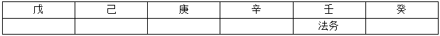

# 分析推理-排列组合（位置排序约束+容量排除）

考点：[[20-考点/判断推理/逻辑判断/分析推理-排列组合（位置排序约束+容量排除）|逻辑判断 / 分析推理-排列组合（位置排序约束+容量排除）]]

**问法模型**：'如果某部门固定在某楼栋，求另一部门位置'的假设代入型排序题→将假设代入条件链正向推演，按'某位置之后须容纳n个部门'的容量要求逐项排除选项

## 推理链
1. 第1步：法务部固定在壬字楼（第9栋），由条件（3）'紧挨法务之后的是研发或销售'，其后的癸字楼（第10栋、最后一栋）只能是研发部或销售部
2. 第2步：反证：若癸字楼为销售部，则销售部位于末位，无法满足条件（1）'销售在财务和生产之前'，矛盾；故癸字楼只能为研发部
3. 第3步：由条件（2）'人事紧挨研发或生产之后'，研发部已占最后一栋癸、其后无楼，故人事部只能紧挨在生产部之后，'生产—人事'捆绑占两栋连续楼
4. 第4步：由条件（1），财务部、生产部都要排在销售部之后，加上紧随生产的 Had人事部，销售部之后在壬字楼之前必须能容纳财务、生产、人事共3个部门
5. 第5步：壬（法务）、癸（研发）已占死，销售部只能在甲至辛之间，且其后须留出至少3栋楼，故销售部最晚位于第5栋戊字楼（其后己、庚、辛正好安排财务、生产、人事）
6. 第6步：对照选项排除：辛（其后无楼）、庚（其后仅辛1栋）、己（其后仅庚、辛2栋）都无法在销售之后放下3个部门，均违反条件（1）（2）的组合要求，只有戊字楼可行，故选C

**最快解法**：⚡ 排除法（位置容量法）：法务壬→紧挨其后必为研发癸；'生产+人事'捆绑占连续两栋；销售之后到壬之前必须容得下财务、生产、人事3个部门→逐一验选项：己/庚/辛之后剩余楼数不足3，全排除，唯一剩戊字楼

## 易错点
- ⚠ 误以为'紧挨法务之后'可以填销售部，忽略销售在末位癸与条件（1）'销售在财务和生产之前'矛盾
- ⚠ 漏算人事部'紧挨生产之后'额外占用一栋楼，把销售之后所需容量算成2栋而误选己字楼
- ⚠ 忽略壬、癸已被法务、研发占死，误把销售之后的可用范围延伸到癸，导致容量判断出错

## 母题抽象
> 🧩 当题干出现'如果某元素固定在某位置，求另一元素位置'的排序条件题时，先代入固定元素锁定端点，用'紧挨'条件捆扎相邻对，再按'某元素之后必须容纳n个元素'做容量排除，唯一不违规的选项即答案

**同类特征**：假设代入型问法（如果…那么…）、十栋楼按天干甲—癸线性排列、'紧挨'相邻条件、'…在…之前'的前后序约束、部门—楼栋匹配分析推理、选项位置靠后可按剩余容量快速排除

## 相关题
（暂无）

---

### 题干
如果法务部在壬字楼，那么销售部在：

### 选项
- A. 庚字楼
- B. 辛字楼
- C. 戊字楼　✅
- D. 己字楼

### 官方解析

第一步：整理题干条件。

（1）销售在财务和生产之前；

（2）人事紧挨研发或生产之后；

（3）紧挨法务之后的是研发或销售；

（4）法务部在壬字楼。

第二步：根据题干条件分析选项。

列表如下：

结合条件（3），如果法务部后面紧挨着是销售部，即癸字楼为销售部，此时会发现：销售不可能在财务和生产之前，与条件（1）不符，即：销售部不可能在癸字楼，紧挨着法务部后面是只能是研发部，研发部在癸字楼；

此时再结合条件（2）可知，人事部只能紧挨在生产部之后；再根据条件（1）可知，销售部后面有财务部和生产部，以及人事部，那么销售部只能在戊字楼。

故正确答案为C。

### 给定材料

某集团公司有生产、销售、研发、人事、财务、法务6个部门，现有从前到后的6栋办公楼：戊字楼、己字楼、庚字楼、辛字楼、壬字楼和癸字楼，每部门各一栋楼，并且各部门安排符合如下要求：

（1）销售部在财务部和生产部之前；

（2）人事部紧接在研发部或者生产部的后面；

（3）紧接在法务部后面的是研发部或者销售部。

> [!warning] 疑点（官方解析可能有误，待人工复核）
> 官方解析由'销售部后面有财务、生产、人事'直接断言'只能在戊字楼'，严格说所列四个条件只能推出'销售部不晚于戊字楼'（销售排在甲至丁的某些方案并不违反这四条），唯一性实际依赖选项设置（己/庚/辛之后楼数不足被排除）或材料中未引出的其他条件；答案C经选项排除法仍然成立，不改判。
