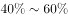

# 削弱论证-否定论点（比较型论点'不亚于'）

考点：[[20-考点/判断推理/逻辑判断/削弱论证-否定论点（比较型论点'不亚于'）|逻辑判断 / 削弱论证-否定论点（比较型论点'不亚于'）]]

**问法模型**：问'最能削弱上述观点'且论点含程度比较词→锁定比较关系，用统计数据/事实否定'不亚于'这一比较结论

## 推理链
1. 第1步：提取论点'它们（明火、煤炉和烧烤炉）给人们带来的危害不亚于香烟'，这是一个'危害程度比较'型论点
2. 第2步：提取论据'烟雾中含有大量的致癌物质、一氧化碳'和'经常烧烤或烹饪会使患肺炎、哮喘等可能性增加'，论据只证明'有危害'，未证明'危害≥香烟'
3. 第3步：论点论据话题一致（都在说明火等的危害），按削弱优先级应直接否定论点，即举事实证明香烟危害更大、'不亚于'不成立
4. 第4步：A项'致癌人员中经常接触明火、木炭的人数远小于吸烟人数'，用患病人数对比证明实际危害香烟远大于明火炭火，直接推翻比较结论
5. 第5步：对照其余选项：B项消防队员血中致癌物浓度高，说明明火有危害，方向为加强；C项香烟生产环节降低危害，未涉及明火危害与香烟的比较；D项仅说明使用木材煤炭的家庭比例，未比较危害大小，均不能削弱
6. 第6步：A项直接否定论点，力度最强，当选

**最快解法**：⚡ 否定论点法：抓论点比较词'不亚于'，找'证明香烟危害更大（或明火危害更小）'的选项，A项用致癌人数对比直接打脸比较结论，秒选A

## 易错点
- ⚠ 削弱对象错位：论点论据话题一致时误去攻击论据（质疑'含致癌物'的真假），而正确思路是优先否定论点
- ⚠ 误选B：B项只证明明火'有危害'，与论点'危害不亚于香烟'的比较方向一致，实为加强项
- ⚠ 误选C：把'香烟危害降低'误当成削弱，但题干比较的是两者危害的相当性，C项未触及明火一方的危害比较，属无关项

## 母题抽象
> 🧩 当论点出现'不亚于/不低于/不比…差'等比较词，而论据只证明'有危害/有影响'时，用列举统计数据证明'比较结论不成立'（即对方危害更大）来直接否定论点

**同类特征**：最能削弱上述观点、不亚于香烟、危害程度比较型论点、烟雾含致癌物质、论点论据话题一致、削弱优先否定论点

## 相关题
- [[10-真题/判断推理/逻辑判断/5510045 削弱论证-举反例削弱论据|5510045]]（江西 2023，相关度2）
- [[10-真题/判断推理/逻辑判断/5911256 削弱论证-削弱论点（否定核心前提）及削弱力度比较|5911256]]（浙江 2024，相关度2）
- [[10-真题/判断推理/逻辑判断/12536473 论证评价-加强论证（选非题，补充论据型）|12536473]]（四川 2024，相关度1）
- [[10-真题/判断推理/逻辑判断/13504381 加强论证-补充论据（反面-对照论据）|13504381]]（云南 2025，相关度1）
- [[10-真题/判断推理/逻辑判断/13504386 加强论证-补充论据（安全有效性论证）|13504386]]（云南 2025，相关度1）

---

### 题干

一项研究表明，明火、煤炉和烧烤炉的烟雾中含有大量的致癌物质、一氧化碳等有害物质。在明火或炭上经常烧烤或烹饪食物会使患肺炎、哮喘和其他肺部疾病的可能性增加。据此有人认为，它们给人们带来的危害不亚于香烟。

以下哪项如果为真，最能削弱上述观点？

### 选项
- A. 
调查发现，致癌人员中经常接触明火、木炭的人数远小于吸烟人数
　✅
- B. 
与火灾经常接触的消防队员，其血液中的致癌物浓度远高于普通人

- C. 
近年来，香烟生产商在生产环节已经逐步降低了香烟对人的危害性

- D. 
据统计，目前我国近的家庭仍在使用木材和煤炭来做饭和取暖

### 官方解析

第一步：找出论点和论据。

论点：明火、煤炉和烧烤炉的烟雾给人们带来的危害不亚于香烟。

论据：明火、煤炉和烧烤炉的烟雾中含有大量的致癌物质、一氧化碳等有害物质。在明火或炭上经常烧烤或烹饪食物会使患肺炎、哮喘和其他肺部疾病的可能性增加。

论点论据都在讨论明火、煤炉和烧烤炉会给人带来危害，论点论据话题一致，因此削弱优先考虑否定论点。

第二步：逐一分析选项。

A项：致癌人员中经常接触明火、木炭的人数远小于吸烟人数，说明明火、煤炉和烧烤炉对人们的危害没有吸烟大，直接削弱论点，当选；

B项：与火灾经常接触的消防队员，其血液中的致癌物浓度远高于普通人，说明明火对人体有一定危害，有加强作用，无法削弱，排除； 

C项：香烟生产商在生产环节已经逐步降低了香烟对人的危害性，与明火、煤炉和烧烤炉的危害无关，无法削弱，排除； 

D项：目前我国近的家庭仍在使用木材和煤炭来做饭和取暖，但木材和煤炭对人体的危害如何不知道，无法削弱，排除。

故正确答案为A。

### 给定材料
（无）
