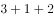

# 集合推理（直言命题）——“有的”与“所有”的连锁推理及逆否规则

考点：[[20-考点/判断推理/逻辑判断/集合推理（直言命题）——“有的”与“所有”的连锁推理及逆否规则|逻辑判断 / 集合推理（直言命题）——“有的”与“所有”的连锁推理及逆否规则]]

**问法模型**：题干给出“大多数A是B”“所有C是D”及“二选一”条件，问哪些断定“必然为真”→先把全部条件译成箭头命题，再用连锁+逆否推出确定结论，推不出的逐项排除

## 推理链
1. 第1步：翻译条件——“1”由考生在物理、历史2门学科中选择1门”意味着物理与历史不可兼得，即“选物理→不选历史”；“选了政治的同学都选了历史”即“选政治→选历史”；“选了化学的同学大多数都选了物理”即“有的选化学→选物理”（大多数至少隐含“有的”）
2. 第2步：对“选政治→选历史”取逆否得“不选历史→不选政治”，与“选物理→不选历史”串联，得“选物理→不选历史→不选政治”
3. 第3步：把“有的选化学→选物理”接入上链，得“有的选化学→选物理→不选历史→不选政治”，即“有的同学选了化学却没有选政治”，断定III必然为真
4. 第4步：核对I“有的同学选了化学和政治”——由“有的选化学选物理”推不出这批选化学者是否选政治，“有的”命题之间无必然联系，I排除
5. 第5步：核对II“选了化学的同学都没有选政治”——只能保证选化学且选物理的那部分人不选政治，“有的”推不出“所有”，II排除
6. 第6步：核对IV“有的同学选了政治却没有选化学”——“有的选化学选物理”不能逆否，从“选政治→选历史”出发对选化学者无任何确定信息，IV排除；只有III必然为真，选C

**最快解法**：⚡ 连锁推理+逆否规则：由“物理历史选1门”得“选物理→不选历史”，由“选政治→选历史”逆否得“不选历史→不选政治”，再接上“有的选化学选物理”，三环串成“有的选化学→不选政治”直接锁定III；其余三项用“有的推不出所有、有的命题不能逆否”秒排，答案C

## 易错点
- ⚠ 忽略“物理、历史2门学科中选择1门”隐含的互斥前提“选物理→不选历史”，导致条件链无法串联
- ⚠ 把“大多数”当“所有”去支持II，或不知道“大多数”至少隐含“有的”而漏掉必然为真的III
- ⚠ 对“有的选化学选物理”做逆否运算去推IV——“有的”命题不能逆否

## 母题抽象
> 🧩 当题干同时出现“大多数/有的A是B”“所有C是D”“B与D二选一”三类条件时，将“所有”命题逆否、“二选一”译成互斥，再与“有的”命题连锁，即可确定“有的A不是C”类结论；牢记“有的”推不出“所有”、不能逆否

**同类特征**：“大多数……都选了……”（隐含“有的”）、“……的同学都选了……”（全称命题可逆否）、“2门学科中选择1门”（互斥隐含条件）、问“必然为真”且断定分为I~IV多项、选科组合搭配情境、需借助逆否规则串联条件

## 相关题
（暂无）

---

### 题干

某省开展了新高考改革，考试科目按“”模式设置，“3”为全国统一高考的语文、数学、外语，“1”由考生在物理、历史2门学科中选择1门，“2”由考生在政治、地理、化学、生物学4门学科中选择2门。某校选了化学的同学大多数都选了物理，选了政治的同学都选了历史。

如果以上描述为真，则下列关于该校的断定必然为真的是：

I.有的同学选了化学和政治

II.选了化学的同学都没有选政治

III.有的同学选了化学却没有选政治

IV.有的同学选了政治却没有选化学

### 选项
- A. I和II
- B. III和IV
- C. 只有III　✅
- D. I和III

### 官方解析

第一步：翻译题干。

①语文、数学、外语必选

②要么物理，要么历史

③政治、地理、化学、生物四选二

④有的选化学选物理

⑤选政治选历史

②⑤串联可以推出：⑥选政治选历史选物理

②④⑤串联可以推出：⑦有的选化学选物理选历史选政治

第二步：逐一分析选项。

I翻译为：有的选化学且选政治，与翻译结果⑦不一致，“有的不是”不能推出“有的是”，因此无法得出有的选化学的是否也选了政治，无法推出，排除；

II翻译为：选化学选政治，与翻译结果⑦不一致，“有的”不能推出“所有”，无法推出，排除；

III翻译为：有的选化学选政治，与翻译结果⑦一致，可以推出，当选；

IV翻译为：有的选政治选化学，根据翻译结果⑥可知，选政治选历史选物理，已知④为有的选化学选物理，但④为集合推理，不能逆否，故无法推出确定结论有的选政治的没有选化学，无法推出，排除。

故正确答案为C。

### 给定材料
（无）

> [!warning] 疑点（官方解析可能有误，待人工复核）
> 官方解析中⑥“选政治→选历史→选物理”、⑦“有的选化学→选物理→选历史→选政治”及III的翻译文字均脱漏否定词，若按字面理解会与题干“物理、历史只能选1门”矛盾；其本意应为⑥“选政治→选历史→不选物理”、⑦“有的选化学→选物理→不选历史→不选政治”，修正后才与III一致并支撑答案；此为解析符号排版问题，正确答案C本身无误

<!-- CODEX-ANSWER-REVIEW:BEGIN -->
### 本次独立复核

**复核状态：** `confirmed`（独立复算确认答案）

**计分答案：** C（可计分）

**复核解析：**

物理和历史恰选一门，因此政治→历史时必有政治→¬物理。化学专业“大多数”选物理，至少存在化学且选物理者，且这些人不可能是政治专业，所以III“有些选化学但不选政治”成立。I、II、IV都需要额外的专业交叉人数信息，不能必然推出。答案C。

**相关信息：**

直言命题；互斥选科与存在推论。

**题源依据：** [固定版本原题](https://github.com/Mentat-Uran/kaogongzhentizhengliu/blob/84ab93d4b64b61d897bece8a1c0a5bab06b4feb2/10-%E7%9C%9F%E9%A2%98/%E5%88%A4%E6%96%AD%E6%8E%A8%E7%90%86/%E9%80%BB%E8%BE%91%E5%88%A4%E6%96%AD/2606188%20%E9%9B%86%E5%90%88%E6%8E%A8%E7%90%86%EF%BC%88%E7%9B%B4%E8%A8%80%E5%91%BD%E9%A2%98%EF%BC%89%E2%80%94%E2%80%94%E2%80%9C%E6%9C%89%E7%9A%84%E2%80%9D%E4%B8%8E%E2%80%9C%E6%89%80%E6%9C%89%E2%80%9D%E7%9A%84%E8%BF%9E%E9%94%81%E6%8E%A8%E7%90%86%E5%8F%8A%E9%80%86%E5%90%A6%E8%A7%84%E5%88%99.md)；固定内容 commit `84ab93d4b64b61d897bece8a1c0a5bab06b4feb2`，Markdown blob `b8178b4cb19c63687f36e571f93d37a85abe28af`。
<!-- CODEX-ANSWER-REVIEW:END -->
