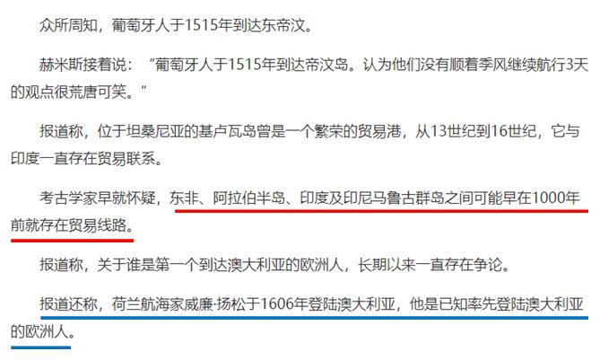

# 加强论证-补充论据（搭桥建立论据与论点联系）

考点：[[20-考点/判断推理/逻辑判断/加强论证-补充论据（搭桥建立论据与论点联系）|逻辑判断 / 加强论证-补充论据（搭桥建立论据与论点联系）]]

**问法模型**：'以下各项如果为真，最能支持上述观点的是'→论点论据话题一致，优先选补充论据/在'物证—人群—地点—时间'间建立联系的加强项

## 推理链
1. 第1步：提取论点：'东非人到达澳大利亚的时间可能要比第一批欧洲探险者早数百年'；提取论据：在澳大利亚埃尔科岛发现一枚来自基卢瓦（今属坦桑尼亚）的硬币
2. 第2步：判断论证结构：论据（硬币发现）与论点（东非人更早到达）话题一致，加强优先考虑补充论据，即在'基卢瓦硬币出现'与'东非人更早到达澳大利亚'之间建立联系
3. 第3步：A项'硬币重量尺寸与常见基卢瓦硬币存在差异'→暗示硬币可能并非东非人带来，属削弱项，排除
4. 第4步：B项'基卢瓦岛从13世纪开始与印度存在贸易联系'→话题指向印度而非澳大利亚，与论点无关，排除
5. 第5步：C项'东非与大洋洲在11世纪到16世纪间商贸往来十分频繁'→澳大利亚是大洋洲组成部分，说明东非人很可能经商贸早于欧洲人到达澳大利亚，补充论据，当选
6. 第6步：D项'1505年葡萄牙人袭击基卢瓦和埃尔科岛并留下这枚硬币'→硬币来源换成葡萄牙人而非东非人，直接削弱论据，排除

**最快解法**：⚡ 话题排除法：紧扣论点核心'东非人—澳大利亚—更早'，A、D均说明硬币另有来源（尺寸异常/葡萄牙人所留）即拆论据，B话题跑偏到印度，唯有C建立'东非—大洋洲'联系且时间（11-16世纪）指向欧洲人之前，直接锁定C

## 易错点
- ⚠ 对C项犹豫：商贸往来频繁≠东非人一定到达，误认为只是'可能性加强'力度不足而漏选，实则其余选项均为削弱或无关，C是唯一加强项
- ⚠ 被D项'1505年'迷惑：看似时间早可支持'早数百年'，实则硬币是葡萄牙人留下的，恰恰说明硬币与东非人无关，是削弱而非加强
- ⚠ 忽略地理包含关系：澳大利亚∈大洋洲，C项谈'大洋洲'仍与澳大利亚相关，误判C项话题不一致而排除

## 母题抽象
> 🧩 当加强题的论据是'某地出土某物（文物/遗迹）'、论点是'某人群更早到达/影响该地'时，用补充论据法：优先选能同时联系'该物—该人群—该地'且时间早于对照人群的选项；凡说明该物另有来源或话题跑偏到第三地的选项一律排除

**同类特征**：'学界一直认为…但…'转折引出新观点、考古发现（硬币）作论据、'可能比…早数百年'可能性结论、'最能支持'选加强项、论点论据话题一致优先补充论据、利用地理包含关系（澳大利亚属大洋洲）建立联系

## 相关题
- [[10-真题/判断推理/逻辑判断/2187637 加强论证-补充论据（话题一致性判断）|2187637]]（选调 2018，相关度1）

---

### 题干
学界一直认为第一个到达澳大利亚的是欧洲人。但有研究指出，来自今天的坦桑尼亚的东非人率先到达了澳大利亚，考古学家在澳大利亚的埃尔科岛上发现了一枚来自非洲中部的贸易城市基卢瓦（今属坦桑尼亚）的硬币。因此，有人提出，东非人到达澳大利亚的时间可能要比第一批欧洲探险者早数百年。
以下各项如果为真，最能支持上述观点的是：

### 选项
- A. 该硬币的重量尺寸与常见的基卢瓦硬币存在差异
- B. 基卢瓦岛从13世纪开始与印度一直存在贸易联系
- C. 东非与大洋洲在11世纪到16世纪间商贸往来十分频繁　✅
- D. 葡萄牙人于1505年先后袭击了基卢瓦和埃尔科岛并留下了这枚硬币

### 官方解析

第一步：找出论点和论据。

论点：东非人到达澳大利亚的时间可能要比第一批欧洲探险者早数百年。

论据：来自今天的坦桑尼亚的东非人率先到达了澳大利亚，考古学家在澳大利亚的埃尔科岛上发现了一枚来自非洲中部的贸易城市基卢瓦（今属坦桑尼亚）的硬币。

本题论点是东非人到达澳大利亚的时间可能要比第一批欧洲探险者要早，论据是通过在澳大利亚的埃尔科岛上发现的一枚来自非洲中部的贸易城市基卢瓦（今属坦桑尼亚）的硬币确定来自今天的坦桑尼亚的东非人率先到达了澳大利亚。二者话题一致，加强优先考虑补充论据。

第二步：逐一分析选项。

A项：选项说该硬币的重量尺寸与常见的基卢瓦硬币存在差异，硬币的尺寸存在差异，说明发现的硬币不一定是东非人带来的，具有削弱作用，无法加强，排除；

B项：选项说基卢瓦岛从13世纪开始与印度一直存在贸易联系，题干论点与论据均与印度的贸易联系无关，话题不一致，无法加强，排除；

C项：选项说东非与大洋洲在11世纪到16世纪间商贸往来十分频繁，澳大利亚是大洋洲的主要组成部分，证明东非与澳大利亚之间很有可能早在11世纪到16世纪间就存在频繁的商贸往来，有利于论点的成立，补充论据，当选；

D项：选项说葡萄牙人于1505年先后袭击了基卢瓦和埃尔科岛并留下了这枚硬币，说明是葡萄牙人留下的这枚硬币，而不是东非人，具有削弱作用，排除。

故正确答案为C。

注：由于题目中完全没有涉及到欧洲人到达澳大利亚的具体时间，也没有涉及到东非人到达澳大利亚的具体时间，因此选项中的时间无法准确判断早晚，因此C项虽然只是一种可能性的加强，但其他选项无任何加强作用，故答案确定为C。而根据原文（如下图中最后一句）可知，已知确定的率先到达澳大利亚的欧洲人时间在1606年（17世纪），而C项中东非与大洋洲的贸易时间在11世纪到16世纪，早于1606年，因此根据原文C项具有加强作用。

 

### 给定材料
（无）
