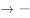

# 翻译推理-'且'关系作前件的假言命题与'可能'表述推论

考点：[[20-考点/判断推理/逻辑判断/翻译推理-'且'关系作前件的假言命题与'可能'表述推论|逻辑判断 / 翻译推理-'且'关系作前件的假言命题与'可能'表述推论]]

**问法模型**：题干给出'如果不……也不……就一定……'的论断并问'如果以上论断为真，下列说法正确的是' → 翻译为（¬A且¬B）→C，用'且'关系部分真假不能确定整体＋否前不必然的规则逐项判断，'可能'类表述与题干相容即可推出

## 推理链
1. 第1步：提取题干前提——市场竞争激烈时，'不激流勇进，创造出富有竞争力的产品'且'不适时撤退、主动割爱，放弃没有前景的市场'→'一定陷入危机'，即（¬A∧¬B）→C
2. 第2步：明确规则——'且'关系前件只有一部分被肯定或被否定时，无法确定整个前件真假；同时逆否等价为¬C→（A∨B），即'不陷入危机'时至少要做出产品或放弃市场之一
3. 第3步：A项只说'未能创造出富有竞争力的产品'，是对'且'前件一部分的肯定，整体前件真假未知，'一定惨遭淘汰'过于绝对，排除
4. 第4步：B项'急流勇退、转向其它市场'即'适时撤退、主动割爱'，是对'且'前件一部分的否定，属否前，得不出'一定避免危机'的确定性结论，排除
5. 第5步：C项'放弃已显颓势的产业'同样是对'且'前件一部分的否定，推不出确定性结论，但选项只说'可能不会被淘汰'，是与题干相容的可能性表述，可以推出，当选
6. 第6步：D项'研发出了富有竞争力的产品'是对'且'前件一部分的否定，否前得不出'一定不会陷入危机'，排除

**最快解法**：⚡ 排除法＋可能性口诀：题干为（¬A且¬B）→C，A、B、D三项均只触及'且'关系的一部分却给出'一定'类确定性结论，全部否前/证据不足，直接排除；剩余C项'可能不会被淘汰'为可能性表述，与题干相容，秒选C

## 易错点
- ⚠ 误把对'且'前件一部分的肯定当成肯定前件（如A项），推出'一定淘汰'的绝对化结论
- ⚠ 误以为否定了前件的一部分（做出产品或撤退之一）就'一定'避免危机（如B、D项），忽略否前只能得'可能'不能得'必然'
- ⚠ 忽略'可能'与'一定'的表述差异：否前后'一定不行、可能可以'，C项正是用'可能'设置的正确答案

## 母题抽象
> 🧩 当题干出现'如果不做A也不做B，就一定C'这类以'且'关系作前件的假言命题时，翻译为（¬A∧¬B）→C；选项只肯定或否定A、B之一时，凡给'一定'结论必错，给与题干相容的'可能'结论可推出

**同类特征**：不……也不……→一定……、'且'关系作假言命题前件、陷入危机、激流勇进/适时撤退、主动割爱、问法：如果以上论断为真，下列说法正确的是、选项中'一定'与'可能'表述对照

## 相关题
（暂无）

---

### 题干
在市场竞争十分激烈的时候，一个企业要是不激流勇进，创造出富有竞争力的产品，也不适时撤退、主动割爱，放弃没有前景的市场，那么这个企业最后一定会陷入危机之中。
如果以上论断为真，下列说法正确的是（    ）。

### 选项
- A. 某企业未能创造出富有竞争力的产品，最后一定会惨遭淘汰
- B. 某企业紧要关头急流勇退，转向其它市场，就可以避免危机
- C. 某企业放弃已显颓势的产业，转向新产品的开发，它可能不会被淘汰　✅
- D. 某企业研发出了富有竞争力的产品，它最后一定不会陷入危机之中

### 官方解析

第一步：翻译题干。

-（激流勇进，创造出富有竞争力的产品）且-（适时撤退，主动割爱，放弃没有前景的市场）→陷入危机

第二步：逐一分析选项。

A项：翻译为-创造出有市场竞争力的产品→淘汰，“-创造出有市场竞争力的产品”是对题干翻译前件“且”关系一部分的肯定，据此无法判断整个“且”关系的真假，进而无法得出确定性结论，不能推出，排除；

B项：翻译为“急流勇退，转向其他市场陷入危机”，“急流勇退，转向其他市场”即“适时撤退、主动割爱，放弃没有前景的市场”，是对题干翻译前件“且”关系的一部分的否定，否前不能得到确定性结论，不能推出，排除；

C项：翻译为放弃已显颓势的产业→可能不会被淘汰，放弃已显颓势的产业是否定题干翻译前件“且关系”的一部分，否前不能得到确定性结论，但是C选项后面说的是可能不会被淘汰，是一种可能性的表述，可以推出，当选；

D项：翻译为富有竞争力的产品→-陷入危机，是否定题干翻译前件“且关系”的一部分，否前不能得到确定性结论，不能推出，排除。

故正确答案为C。

### 给定材料
（无）
