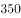

# 结论推断-集合关系（欧拉图）与可能性判断（必然-可能）

考点：[[20-考点/判断推理/逻辑判断/结论推断-集合关系（欧拉图）与可能性判断（必然-可能）|逻辑判断 / 结论推断-集合关系（欧拉图）与可能性判断（必然/可能）]]

**问法模型**：『如果上述断定都是真的，下列哪项断定一定是真的』→ 结论推断题：画出『350名惯犯』与『作案者』『吸毒者』三集合的关系图，逐一检验选项强度，注意『可能』型断定只要题干不排除即为真

## 推理链
1. 第1步：前提一——近三年严重刑事犯罪案件『都为已记录在案的350名惯犯所为』，只能保证每起案件有惯犯参与；若存在共同犯罪，作案者总人数可以超过350人
2. 第2步：前提二——『严重刑事犯罪案件的作案者半数以上是吸毒者』，『过半』针对的是『作案者』集合，而作案者人数题干并未给出
3. 第3步：所用方法——极端构造反例检验：设每起案件由1名不吸毒的惯犯伙同9名吸毒的非惯犯共同实施，则作案者中吸毒者占90%（过半成立），而350名惯犯中吸毒者为0，题干两个断定均未被违反
4. 第4步：该反例说明『惯犯中有吸毒者』并非必然，而『惯犯中没有吸毒者』与题干完全相容，故或然断定『可能没有吸毒者』为真
5. 第5步：逐项对照——A『一定有吸毒者』被反例直接否定；B『大多数是吸毒者』在反例中比例为0；D『吸毒者大多数在350名惯犯中』把『作案者中的吸毒者过半』偷换为『吸毒者总体大多在惯犯中』，方向颠倒且无据
6. 第6步：结论——只有C『可能没有吸毒者』是题干不排除、且其余三项均无法保证的断定，故选C

**最快解法**：⚡ 极端反例法：假设350名惯犯全部不吸毒，吸毒者都是与他们共同作案的圈外人（作案者总数因此超过350人）——题干两个断定依然全部成立，故『可能没有吸毒者』必真，直接锁定C；凡含『一定』『大多数』的A、B、D，均因作案者人数未知而被一并排除

## 易错点
- ⚠ 把『案件都为350名惯犯所为』误解为『作案者只有这350人』，从而误选A——忽略共同犯罪可使作案者集合超出350名惯犯
- ⚠ 混淆基数：『作案者中吸毒者过半』的分母是作案者总数，不是350名惯犯，二者不能互换
- ⚠ 不掌握『可能』型断定的判定标准：只要前提不排除该情形即为真，无需正面证据支持

## 母题抽象
> 🧩 当题干出现『某类案件全由某固定人群所为＋该类案件作案者中某特征过半』并问『一定真』时，先警惕两集合未必是包含关系（共同犯罪可使作案者超出固定人群），再用极端反例排除『一定/大多数』项，剩下的『可能』项即为答案

**同类特征**：问法『哪项断定一定是真的』、『都为350名惯犯所为』的全称断定、『作案者半数以上是吸毒者』的过半表述、作案者人数与案件数量均未知、选项呈『一定—大多数—可能』的强度梯度、惯犯与吸毒者的交集不确定

## 相关题
（暂无）

---

### 题干

调查报告显示，某市近三年来的严重刑事犯罪案件都为已记录在案的350名惯犯所为。报告同时揭示，严重刑事犯罪案件的作案者半数以上是吸毒者。

如果上述断定都是真的，那么，下列哪项断定一定是真的？

### 选项
- A. 350名惯犯中一定有吸毒者
- B. 350名惯犯中大多数是吸毒者
- C. 350名惯犯中可能没有吸毒者　✅
- D. 吸毒者大多数在350名惯犯中

### 官方解析

题干第二句话“严重刑事犯罪案件的作案者半数以上是吸毒者”等价于“严重刑事犯罪案件的作案者以上是吸毒者”。

整理题干信息：

（1）“严重刑事犯罪案件中都为已记录在案的350名惯犯所为”；

（2）“严重刑事犯罪案件的作案者以上是吸毒者”。

严重刑事犯罪案件数量名

严重刑事犯罪案件作案者吸毒者

因为案件数量和作案者数量无法确定，因此无法推出确定的情况和人数是否为大多数，而当350名惯犯小于严重刑事犯罪案件作案者时，350名惯犯中可能没有吸毒者，只有C项符合。

故正确答案为C。

### 给定材料
（无）

> [!warning] 疑点（官方解析可能有误，待人工复核）
> 官方解析文字有明显脱漏与语病（如『半数以上』被写作『以上』，『严重刑事犯罪案件数量名』一句残缺），且未点明关键解读前提——案件可多人共同实施、作案者总数可超过350名惯犯；但按此通行解读，C的推出逻辑成立，不影响正确答案
