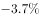

# 解释题-矛盾反常现象解释

考点：[[20-考点/判断推理/逻辑判断/解释题-矛盾反常现象解释|逻辑判断 / 解释题-矛盾反常现象解释]]

**问法模型**：问'哪项最有助于解释这些保险公司的行为'（明知亏损仍坚持经营的反常行为）→ 采用解释题'双兼容'模型：正确选项必须同时容纳矛盾双方，既承认交强险亏损的事实，又给出坚持经营的合理动机

## 推理链
1. 第1步：提取题干矛盾——交强险'总体要求是不亏不盈'，但实际'累计承保利润为-508亿元'，一些保险公司却'始终坚持不能放弃'这一亏损业务
2. 第2步：明确解释标准——选项必须兼容矛盾两面：①承认交强险本身不赚钱；②说明为何仍坚持经营（需给出隐性收益或动机）
3. 第3步：对照A项——'相信自己的公司未来会盈利'只是主观信念，无法解释当前实际亏损下为何坚持，排除
4. 第4步：对照B项——'必须承保、不能拒保'指对客户的法定义务而非强制经营该业务，且承办交强险是自愿申请（寿险公司即未承办），无法解释自愿坚持，排除
5. 第5步：对照C项——'很多车辆保险未用到赔付'是个例，总赔付是否超过总保费不明确，无法解释累计亏损，排除
6. 第6步：对照D项——车主不将交强险与商业车险分投两家公司，商业险利润丰厚，交强险成为吸引客户的'引流'业务，隐性商业险收益解释了'明知亏损仍坚持经营'，当选

**最快解法**：⚡ 解释题双兼容检验法：锁定矛盾词'非但不赚钱……却始终坚持不能放弃'，逐项检验哪个选项能同时解释'亏损'与'坚持'两面，D项以'捆绑商业险引流获利'一步解释两面，直接锁定

## 易错点
- ⚠ B项迷惑性强：易把'不能拒保'误解为'保险公司被迫经营交强险'，实际它只是不得拒绝客户投保，是否承办仍是自愿，属偷换概念
- ⚠ A项诉诸主观信念：'相信未来会盈利'不能替代对当前行为的合理解释，信念与事实无关
- ⚠ C项以偏概全：个例车辆未发生赔付不能说明整体是否盈利，无法解释'累计亏损508亿'，更未解释为何坚持

## 母题抽象
> 🧩 当题干出现'明知不利（亏损/风险）却仍坚持某行为'的反常矛盾时，用解释题双兼容法，寻找能同时承认不利事实并揭示隐藏收益/动机的选项，主观信念与不明确选项均排除

**同类特征**：多年连续亏损却坚持经营、不亏不盈的法定要求与实际亏损矛盾、解释保险公司行为的问法、捆绑销售/引流获利、隐性收益弥补显性亏损、第一项法定强制险种

## 相关题
（暂无）

---

### 题干

我国的交强险于2006年7月正式实行，于2007年7月开始普遍推行。作为第一项法定强制险种，交强险经营的总体要求是不亏不盈。而事实上，自2007年开办以来，除了2008年实现盈利7.6亿元外，其余年份均为亏损，交强险累计承保利润为-508亿元，承保利润率为，直到2018年才扭转了12年半的亏损局面。但在66家经营交强险的公司中，40家盈利，仍有26家亏损。对一些保险公司来说，交强险是一种非但不赚钱，还多年连续亏损，却始终坚持不能放弃的业务。

以下哪项如果为真，最有助于解释这些保险公司的行为？

### 选项
- A. 现在多数公司都已盈利，相信自己的公司未来在这个险种上也会盈利
- B. 交强险具有公益性、广泛性、强制性，保险公司必须承保，不能拒保
- C. 虽有很多车辆在交强险的赔付中赔付的数额远超过车主缴纳交强险时缴纳的金额，但也有很多车辆保险未用到赔付
- D. 通常车主为避免日后不必要的麻烦，不会将交强险和商业车险分开投保两家公司，而商业险的利润非常丰厚　✅

### 官方解析
第一步：找出题干矛盾。
对一些保险公司来说，交强险是一种非但不赚钱，还多年连续亏损，却始终坚持不能放弃的业务。
第二步：逐一分析选项。
A项：相信自己公司未来会在这个险种上盈利和实际是否盈利无关，不能解释题干矛盾，排除；
B项：“保险公司不能拒保”是对经营交强险的公司做的法律规定，指经营交强险的公司不能拒绝客户购买交强险的要求，但是题干中讨论的是保险公司坚持承办交强险业务，而且并不是所有保险公司都必须承办交强险业务，比如寿险公司，因此如果是保险公司自愿申请承办交强险业务的话，B项便不能解释为什么保险公司“始终坚持不放弃交强险”，因此不明确，不能解释题干矛盾，排除；
C项：很多车辆保险未用到赔付，但具体总的赔付金额有没有超过所有车主缴纳交强险的金额不明确，不能解释题干矛盾，排除；
D项：交强险和商业车险捆绑，且商业险的利润非常丰厚，说明保险公司为了得到商业保险的利润也要经营交强险，可以解释为什么保险公司“始终坚持不放弃交强险”，可以解释题干矛盾，当选。
故正确答案为D。

### 给定材料
（无）
