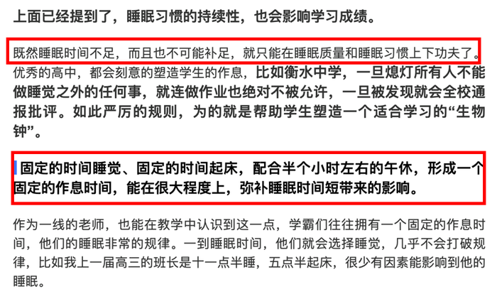

# 论证推理-加强论证（选非题：逻辑推论排除）

考点：[[20-考点/判断推理/逻辑判断/论证推理-加强论证（选非题：逻辑推论排除）|逻辑判断 / 论证推理-加强论证（选非题：逻辑推论排除）]]

**问法模型**：'以下除哪项外都是上述断定的逻辑推论'→按'加强与题干一致性检验'处理：三个选项须能由断定推出且落在'学习成绩'话题上，锁定推不出来的那一项

## 推理链
1. 第1步：提取论据'睡眠质量、时间以及睡眠习惯的持续性与学习成绩成正相关'，论点'充足的睡眠对学生的学习更加有利'，论点与论据话题一致（睡眠要素↔学习成绩）
2. 第2步：本题为选非题，检验标准为：选项须能从'睡眠三要素与成绩正相关'推出（或为其举例加强），且须落到'学习/成绩'这一结果话题上
3. 第3步：A项'睡眠充足、早起早睡、作息规律的学生普遍都拥有较好的成绩'是正相关断定的直接复述与举例，可推出，排除
4. 第4步：B项由'充足睡眠对学习有利'推出睡眠不足的高中生在课间、体育课'补觉'，是断定的实践推论，可推出，排除
5. 第5步：D项'固定时间睡觉起床、固定作息（即睡眠习惯的持续性）能弥补睡眠时间短带来的影响'，把睡眠习惯与学习影响挂钩，与'睡眠习惯的持续性与学习成绩正相关'一致，可推出，排除
6. 第6步：C项只谈'时间不足且不可能补足时，可在睡眠质量和睡眠习惯上下功夫'，全项未出现'学习成绩/学习'，是否影响成绩不确定，且'不可能补足'是题干没有的新前提，无法由断定推出，当选
7. 第7步：综上，除C外均为上述断定的逻辑推论，正确答案为C

**最快解法**：⚡ 话题对照法：拿关键词'学习成绩'逐项扫选项——A、B、D最终都落在'成绩/学习影响'上，唯有C通篇不提成绩，还私加'不可能补足'这一新前提，秒选C

## 易错点
- ⚠ 把'生活上合理'误当'逻辑推论'：C是建议性对策，未与'学习成绩'建立联系，且新增题干没有的前提，属偷换话题+无中生有
- ⚠ C与D二级辨析缺位：二者都谈作息习惯，但D明说'弥补睡眠时间短带来的影响'（有学习落点），C没有任何结果落点
- ⚠ 误杀B：B虽引入'绝大多数高中生睡眠不足'的新事实，但其结论'补觉'由'充足睡眠对学习有利'推出，新事实不妨碍其成为推论

## 母题抽象
> 🧩 当题干给出一组'多因素与某结果正相关'的断定并问'除哪项外都是逻辑推论'时，用话题对照法：能推出的选项必须落在结果话题（如'成绩'）上且不私加新前提；既不提结果话题又引入新前提的选项即为答案

**同类特征**：睡眠质量/时间/睡眠习惯持续性与成绩正相关、充足的睡眠对学生的学习更加有利、除哪项外都是逻辑推论（选非）、论点论据话题一致、睡眠-成绩关系、举例加强型选项

## 相关题
- [[10-真题/判断推理/逻辑判断/12536473 论证评价-加强论证（选非题，补充论据型）|12536473]]（四川 2024，相关度1）
- [[10-真题/判断推理/逻辑判断/13504381 加强论证-补充论据（反面-对照论据）|13504381]]（云南 2025，相关度1）
- [[10-真题/判断推理/逻辑判断/13504386 加强论证-补充论据（安全有效性论证）|13504386]]（云南 2025，相关度1）
- [[10-真题/判断推理/逻辑判断/13504459 论证加强-前提假设（必要条件-否定代入）|13504459]]（新疆 2025，相关度1）
- [[10-真题/判断推理/逻辑判断/13504503 削弱论证-削弱论点（否定功能实现的前提条件）|13504503]]（河北 2025，相关度1）

---

### 题干
最近一项研究证明了学习和睡眠的关系，研究人员在《自然》的合作刊物《学习科学》上，发表了相关的研究成果，指出睡眠质量、时间以及睡眠习惯的持续性与学习成绩成正相关。充足的睡眠对学生的学习更加有利。
以下除哪项外都是上述断定的逻辑推论？

### 选项
- A. 睡眠充足、早起早睡、作息规律的学生普遍都拥有较好的成绩
- B. 绝大多数高中生都面临着睡眠不足的困扰，为了学习，他们很多人会选择课间或体育课的时间进行“补觉”
- C. 睡眠时间不足，而且也不可能补足，可以在睡眠质量和睡眠习惯上下功夫　✅
- D. 固定的时间睡觉、起床，形成固定的作息时间，能在很大程度上弥补睡眠时间短带来的影响

### 官方解析

第一步：找出论点和论据。

论点：充足的睡眠对学生的学习更加有利。

论据：睡眠质量、时间以及睡眠习惯的持续性与学习成绩成正相关。

论点和论据讨论话题一致，考虑补充论据进行加强。

第二步：逐一分析选项。

A项：睡眠充足、早起早睡、作息规律的学生普遍都拥有较好的成绩，举例说明充足睡眠对成绩的影响，可以加强，排除；

B项：睡眠不足的高中生需要“补觉”来补充睡眠，从而有利学习，举例说明充足睡眠对成绩的影响，可以加强，排除；

C项：说的是睡眠时间与睡眠质量、睡眠习惯之间的关系，是否会影响到学习成绩不确定，因此无法加强，当选；

D项：固定的作息时间，能弥补睡眠时间短带来的影响，固定的作息时间指的是睡眠习惯，说明睡眠习惯也能给成绩带来影响，可以加强，排除。

本题为选非题，故正确答案为C。

补充：原文中C项和D项均为“睡眠习惯的持续性，也会影响学习成绩”的论证内容，但C项解释的是为什么要塑造学生的生物钟即睡眠习惯，因为睡眠时间不足，未提到与学习成绩的关系。而D项通过后面学霸的事例可以说明，固定作息可以提升成绩。

### 给定材料
（无）

> [!note] 复核版本状态
> 原题不可计分（source_prompt_incomplete；来源记录的答案键/竞争项：C）；仅当前明确标注的编辑版按答案A计分。
> 详细原题疑点、修订题面、解析和证据见下方独立复核记录。

<!-- CODEX-ANSWER-REVIEW:BEGIN -->
### 本次独立复核

**复核结论：** `resolved`（答案与解析已核定）

**原题计分状态：** 不计分（`source_prompt_incomplete`：原题题干或选项不完整）。来源中记录的答案键/竞争项：C；这些记录不代表原题已核准答案。

**原题疑点与处理：**

新疆 2020 〔20-考点/判断推理/逻辑判断/论证推理-加强论证（选非题：逻辑推论排除）〕 — 官方解析补充称'D项通过后面学霸的事例可以说明固定作息可以提升成绩'，但所给题干中并无学霸事例，疑为题目由原文删改所致；且单看'质量、习惯与成绩正相关'的断定，…

**当前计分版本：** 明确标注的编辑版；未列出的题干、材料或选项沿用固定题源。答案不回填为原题答案。

**计分答案：** A（可计分）

**复核解析：**

题源所附文章截图明确写出应在“睡眠质量和睡眠习惯”上下功夫，故A直接对应原句。原题“以下除哪项外都是上述断定的逻辑推论”存在材料不全、C/D解释冲突；本记录不裁定原题答案，只把截图中可核对的句子改写为直接定位题。

**修订题干：**

【编者改写版，非原题复原】根据材料，睡眠时间不足且无法补足时，原文明确建议在哪两个方面下功夫？

**修订材料：**

【编者改写材料，依据题源解析附图原文】“既然睡眠时间不足，而且也不可能补足，就只能在睡眠质量和睡眠习惯上下功夫了。”

**修订/采用选项：**

A. 睡眠质量和睡眠习惯
B. 仅延长睡眠时长
C. 只增加课间补觉，不调整睡眠质量或睡眠习惯
D. 只保持固定作息，不考虑睡眠质量或睡眠习惯

**相关信息：**

阅读理解—依据材料定位明确表述。答案A只适用于编者改写版，不是对2020年新疆原题C/D争议的裁定。

**核对依据与来源边界：**

- 固定题源：[原题文件](https://github.com/Mentat-Uran/kaogongzhentizhengliu/blob/84ab93d4b64b61d897bece8a1c0a5bab06b4feb2/10-%E7%9C%9F%E9%A2%98/%E5%88%A4%E6%96%AD%E6%8E%A8%E7%90%86/%E9%80%BB%E8%BE%91%E5%88%A4%E6%96%AD/2663908%20%E8%AE%BA%E8%AF%81%E6%8E%A8%E7%90%86-%E5%8A%A0%E5%BC%BA%E8%AE%BA%E8%AF%81%EF%BC%88%E9%80%89%E9%9D%9E%E9%A2%98%EF%BC%9A%E9%80%BB%E8%BE%91%E6%8E%A8%E8%AE%BA%E6%8E%92%E9%99%A4%EF%BC%89.md)；内容版本 `84ab93d4b64b61d897bece8a1c0a5bab06b4feb2`，源 Markdown blob `ac90afe071b965005bb93d896a655ef612226221`.
- 固定题图/公式图：`90-图片/题目图/1751d1e25cfb88e.png`.

<!-- CODEX-ANSWER-REVIEW:END -->
