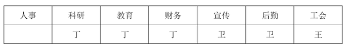

# 分析推理-人员与部门匹配（代入排除法·选非题）

考点：[[20-考点/判断推理/逻辑判断/分析推理-人员与部门匹配（代入排除法·选非题）|逻辑判断 / 分析推理-人员与部门匹配（代入排除法·选非题）]]

**问法模型**：问'财务和哪个部门不可能由同一人分管'（选非）→ 采用代入法，将各选项与条件(1)合并构造可行分配，能成立者排除，出现矛盾者当选

## 推理链
1. 第1步：整理题干条件：(1)教育和财务同一人分管；(2)宣传和后勤同一人分管；(3)丁分管的部门数＞卫；(4)教育、工会中的一个（恰一个）由王分管；(5)工会、后勤中的一个（恰一个）由卫分管
2. 第2步：因问'不可能'，采用代入法：逐项假设'财务与该选项部门同一人分管'，结合条件(1)合并绑定，再联动(2)(4)(5)分配其余部门，并用(3)清点人数验证
3. 第3步：A项代入：财务+人事并管，设丁兼管教育、财务、人事，由(4)王管工会、由(5)卫管后勤且(2)卫兼管宣传，科研给王，丁3个＞卫2个，成立，排除
4. 第4步：B项代入：财务+科研并管，设丁兼管教育、财务、科研，由(4)王管工会、由(5)(2)卫管后勤和宣传，人事给王，丁3个＞卫2个，成立，排除
5. 第5步：C项代入：财务+宣传并管，设王兼管教育、财务、宣传、后勤（满足(4)），由(5)卫管工会，丁管人事和科研，丁2个＞卫1个，成立，排除
6. 第6步：D项代入：财务+工会并管，结合(1)得教育、财务、工会由同一人分管，即'教育和工会由同一人分管'，与条件(4)'教育、工会中的一个部门由王分管'（恰一个归王）直接矛盾，故D不可能，当选

**最快解法**：⚡ 代入排除法+矛盾秒杀：D项代入后，'教育=财务'与'财务=工会'叠加，把条件(4)的二选一两边并到同一人，直接矛盾，无需构造分配即可选D；A/B/C仅需按'丁多卫少'各凑出一组分配即可排除

## 易错点
- ⚠ 把条件(4)(5)的'一个部门由某人分管'误读为'至少一个'或'指定某个'，则D项的矛盾推不出来（实为'二者恰取其一'）
- ⚠ 验证A/B/C时忽略条件(3)是数量比较（丁＞卫），漏清点各部门归属会误判无解
- ⚠ 本题为选非题，易误选'可能为真'的A/B/C项

## 母题抽象
> 🧩 当题干出现'两组部门绑定同一人＋两条二选一限定条件＋数量比较'的匹配特征且问'不可能'时，用代入法：优先检验使'二选一'条件两端并到同一主体的选项，能直接制造矛盾者即答案

**同类特征**：同一人分管、教育和财务由同一人分管、教育、工会中的一个部门由王分管、丁分管的部门比卫多、不可能由同一人分管（选非）、代入法构造分配方案

## 相关题
- [[10-真题/判断推理/逻辑判断/2719415 分析推理-排除法（条件匹配）|2719415]]（国考 2021，相关度1）
- [[10-真题/判断推理/逻辑判断/2719416 分析推理-数量分配匹配（部门分管+数量排序）|2719416]]（国考 2021，相关度1）

---

### 题干
财务和以下哪个部门不可能由同一人分管？

### 选项
- A. 人事
- B. 科研
- C. 宣传
- D. 工会　✅

### 官方解析

第一步：整理题干条件。

（1）教育和财务由同一人分管；

（2）宣传和后勤由同一人分管；

（3）丁分管的部门比卫多；

（4）教育、工会中的一个部门由王分管；

（5）工会、后勤中的一个部门由卫分管。

第二步：根据题干条件分析选项。

A项代入，结合条件（1）可知，教育、财务和人事要同时由一人分管，若此人为丁，则根据条件（2）、（4）、（5）可得：

若科研由王分管，满足题干所有条件，可能为真，排除；

B项代入，结合条件（1）可知，教育、财务和科研要同时由一人分管，若此人为丁，则根据条件（2）、（4）、（5）可得：

若人事由王分管，可满足题干所有条件，可能为真，排除；

C项代入，结合条件（1）可知，教育、财务和宣传要同时由一人分管，若此人为王，则根据条件（2）、（4）、（5）可知，卫分管工会，此时若丁分管人事和科研，可得：

满足题干所有条件，可能为真，排除；

D项代入，结合条件（1）可知，教育、财务和工会要由同一个人分管，此时，教育和工会由同一个人分管，不符合条件（4），教育、工会中的一个部门由王分管，因此该项不可能为真，当选。

本题为选非题，故正确答案为D。

### 给定材料

某单位的人事、科研、教育、财务、宣传、后勤和工会7个部门各由王、卫和丁3位副主任中的1人分管，已知：

（1）教育和财务由同一人分管；

（2）宣传和后勤由同一人分管；

（3）丁分管的部门比卫多；

（4）教育、工会中的一个部门由王分管；

（5）工会、后勤中的一个部门由卫分管。

