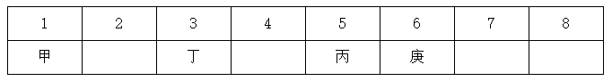
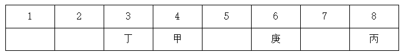

# 分析推理-线性位置排列（选项代入+间隔枚举）

考点：[[20-考点/判断推理/逻辑判断/分析推理-线性位置排列（选项代入+间隔枚举）|逻辑判断 / 分析推理-线性位置排列（选项代入+间隔枚举）]]

**问法模型**：选非题问'哪项是不可能的'→ 优先选项代入：能构造出一组满足全部条件的排列即为'可能'并排除，穷尽后仍无法满足的即为'不可能'当选

## 推理链
1. 第1步：提取条件③'丁在庚的左边，中间隔着2人'，即丁与庚位置相差3，代入选项即可先锁定庚的位置
2. 第2步：本题问'不可能'，采用代入法，对'可能'选项只需给出一种同时满足①②③④的完整排列即可排除
3. 第3步：A项代入：丁1→庚4；可排成乙2、甲3、己5、辛6、丙7、戊8，四条件均满足，丁可在1号，排除
4. 第4步：B项代入：丁2→庚5；可排成乙1、甲3、己4、辛6、丙7、戊8，四条件均满足，排除
5. 第5步：C项代入：丁3→庚6；由①甲丙隔3人（位置差4），扣除已占的3、6号，甲丙只能是1、5或4、8两种落位
6. 第6步：若甲丙占1、5，由②乙己隔2人只能占4、7，剩2、8号给辛戊，无法满足④隔1人；若甲丙占4、8，乙己只能占2、5，剩1、7号，④同样无法满足
7. 第7步：两种情况穷尽后均无解，故丁不可能在3号房，C当选
8. 第8步：D项代入：丁4→庚7；可排成辛1、甲2、戊3、乙5、丙6、己8，四条件均满足，排除

**最快解法**：⚡ 选项代入法：先按'间隔n人=位置差n+1'由条件③锁定各选项对应的庚位；A、B、D各拼出一组全满足的排列即可排除；C项代入后甲丙仅剩(1,5)与(4,8)两种落位，逐一检验发现乙己被迫占(4,7)或(2,5)，剩余两位置相隔超1人，辛戊无法满足，故C不可能

## 易错点
- ⚠ 把'中间隔着n人'误算成位置差n（实为n+1），导致庚位与甲丙落位全错
- ⚠ 问'不可能'却按'可能'思路找唯一确定排列，方向反了浪费时间
- ⚠ C项代入后漏枚举甲丙的某种落位组合，或漏掉乙己在剩余位置中的间隔配对，误以为C也有解

## 母题抽象
> 🧩 当题干出现多组'两人中间隔着固定人数'的一排位置条件且问'可能/不可能'时，用选项代入法：先由固定关系锁定配对位置，再枚举剩余配对的落位组合，验证能否同时安置全部人物

**同类特征**：8人一排相邻房间全排列、选非题（问'哪项是不可能的'）、多对人物固定间隔（隔3人/隔2人/隔1人）、丁在庚的左边（单向固定关系）、间隔人数=位置差减1、代入构造一例即可判'可能'

## 相关题
（暂无）

---

### 题干
单位安排甲、乙、丙、丁、戊、己、庚、辛8人出差，他们恰好被安排在宾馆同一排左右相邻的8个房间。已知：
①甲和丙中间隔着3人；
②乙和己中间隔着2人；
③丁在庚的左边，他们中间隔着2人；
④辛和戊中间隔着1人。
根据以上信息，按照从左到右的顺序，下列哪项是不可能的？

### 选项
- A. 丁在第一个房间
- B. 丁在第二个房间
- C. 丁在第三个房间　✅
- D. 丁在第四个房间

### 官方解析

第一步：分析题干。

①甲和丙中间隔着3人；

②乙和己中间隔着2人；

③丁在庚的左边，他们中间隔着2人；

④辛和戊中间隔着1人；

提问方式为“不可能”，优先考虑选项代入。

第二步：逐一代入选项。

A项：假设丁在第一个房间，根据条件③丁在庚的左边，他们中间隔着2人可知庚在4号房，因为本题问“不可能”，所以只需要在满足题干所有条件的情况下，任意给出一种排序方式即为可能，如下图所示，丁可以在1号房，且题干所有条件均满足，排除；

B项：假设丁在第二个房间，根据条件③丁在庚的左边，他们中间隔着2人可知庚在5号房，因为本题问“不可能”，所以只需要在满足题干所有条件的情况下，任意给出一种排序方式即为可能，如下图所示，丁可以在2号房，且题干所有条件均满足，排除；

C项：当丁在3号房，根据条件③丁在庚的左边，他们中间隔着2人可知，庚在6号房，根据条件①甲和丙中间隔着3人，只能是以下两种情况：

对于第一种情况，根据②乙和己中间隔着2人，只能是在4号房和7号房，剩余的2号房和8号房，无法满足④辛和戊中间隔着1人；对于第二种情况，根据②乙和己中间隔着2人，只能是在2号房和5号房，剩余的1号房和7号房，无法满足④辛和戊中间隔着1人。因此，没有任何排序方式可以使题干所有条件同时成立，故丁不可能在3号房，当选；

D项：假设丁在第四个房间，根据条件③丁在庚的左边，他们中间隔着2人可知庚在7号房，因为本题问“不可能”，所以只需要在满足题干所有条件的情况下，任意给出一种排序方式即为可能，如下图所示，丁可以在4号房，且题干所有条件均满足，排除。

本题为选非题，故正确答案为C。

### 给定材料
（无）
