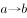
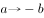

# 翻译推理-串联推理与逆否（换位）规则

考点：[[20-考点/判断推理/逻辑判断/翻译推理-串联推理与逆否（换位）规则|逻辑判断 / 翻译推理-串联推理与逆否（换位）规则]]

**问法模型**：题干给出一组“有的A是B、所有B→C、所有D→C”型量化命题，问“由此可知”→先将命题全部翻译成箭头，用逆否+串联锁定必然真结论，再用“有的不能推所有、否定命题不能换位”逐项排除

## 推理链
1. 第1步：翻译题干三句话：①有的环保主义者→热爱旅游；②环保企业代表→支持减少开发；③热爱旅游→反对减少开发
2. 第2步：对③作逆否（反对与支持减少开发为不相容关系）：支持减少开发（＝不反对）→不热爱旅游
3. 第3步：将②与③的逆否串联：环保企业代表→支持减少开发→不热爱旅游，直接得到B项“所有的环保企业代表都不热爱旅游”
4. 第4步：将①与③串联：有的环保主义者→热爱旅游→反对减少开发，即④有的环保主义者反对减少开发
5. 第5步：验证A项“所有环保主义者都反对减少开发”：④只提供“有的”，“有的”不能推“所有”，排除
6. 第6步：验证C项“有的热爱旅游的人支持加大开发”：由④换位只能得“有的热爱旅游的人反对减少开发”，且“不支持减少开发”≠“支持加大开发”，排除
7. 第7步：验证D项“有的环保主义者支持减少开发”：④只能得“有的环保主义者反对减少开发”，否定性命题不能换位反推“有的支持”，排除

**最快解法**：⚡ 串联+逆否法：先写“环保企业代表→支持减少开发”（②）与③的逆否“支持减少开发→不热爱旅游”，两箭头首尾同项直接串联，秒得B；再用三句口诀快速排他——“有的推不了所有”（排A）、“反对≠支持加大”（排C）、“否定命题换不出反向的有的”（排D）

## 易错点
- ⚠ 看不出②与③需通过“支持减少开发＝不反对减少开发”这一不相容关系作逆否衔接，误以为两句话接不上而乱选
- ⚠ 把“不支持减少风景区开发”偷换成“支持加大风景区开发”（上反对关系误当矛盾关系），误选C
- ⚠ 违反量词规则：由“有的环保主义者反对”跳到“所有都反对”（A），或由否定命题反向换出“有的支持”（D）

## 母题抽象
> 🧩 当题干同时出现“有的A是B、所有B→C、所有D→C”型混合量化命题且问“由此可知”时，先把每句译成箭头；选项两端不能直接串联的，优先用“所有”命题的逆否作桥；最后用“有的→所有不可、否定命题不可换位反推、不支持A≠支持非A”三条规则逐项验证

**同类特征**：题干为三句量化命题：“一些环保主义者是热爱旅游的人”“所有环保企业代表都支持减少开发”“所有热爱旅游的人都反对减少开发”、链条中存在“支持减少开发/反对减少开发”这类互斥对，需逆否搭桥、问法为“由此可知”的必然性推理、正确选项需跨越两句“所有”命题作逆否串联、选项集中布满“所有—有的”“反对—支持加大”等量词与对立概念陷阱

## 相关题
（暂无）

---

### 题干
一些环保主义者是热爱旅游的人，所有的环保企业代表都支持减少风景区开发，所有热爱旅游的人都反对减少风景区开发。
由此可知：

### 选项
- A. 所有环保主义者都反对减少风景区开发
- B. 所有的环保企业代表都不热爱旅游　✅
- C. 一些热爱旅游的人支持加大风景区开发
- D. 一些环保主义者支持减少风景区开发

### 官方解析

第一步：翻译题干。

①有的环保主义者热爱旅游；

②环保企业代表支持减少风景区开发；

③热爱旅游支持减少风景区开发。

①③串联可得：④有的环保主义者热爱旅游支持减少风景区开发。

第二步：逐一分析选项。

A项：翻译为“环保主义者支持减少风景区开发”，根据条件④只能得到“有的环保主义者支持减少风景区开发”，“有的”不能推出“所有”，排除；

B项：翻译为“环保企业代表热爱旅游”，将条件②与条件③的逆否串联可得“环保企业代表支持减少风景区开发热爱旅游”，可以推出，当选；

C项：翻译为“有的热爱旅游支持加大风景区开发”，根据条件④换位只能得到“有的热爱旅游支持减少风景区开发”，不支持减少风景区开发不代表支持加大风景区开发，无法推出，排除；

D项：翻译为“有的环保主义者支持减少风景区开发”，由条件④只能得到“有的环保主义者支持减少风景区开发”，“有的”不能推出“有的”，排除。

故正确答案为B。

### 给定材料
（无）

> [!warning] 疑点（官方解析可能有误，待人工复核）
> 官方解析存在“支持/反对”笔误：条件③应为“热爱旅游→反对减少开发”，④应为“有的环保主义者热爱旅游且反对减少开发”，解析多处误写作“支持减少开发”（A、D项分析中亦互换）；但“②＋③逆否→环保企业代表不热爱旅游”的推理路径及B项当选的结论不受影响，答案B仍然成立

<!-- CODEX-ANSWER-REVIEW:BEGIN -->
### 本次独立复核

**复核状态：** `confirmed`（独立复算确认答案）

**计分答案：** B（可计分）

**复核解析：**

存在某环保主义者热爱旅游，且所有热爱旅游者反对减少景区开发，所以确有环保主义者反对减少开发。A把“有些”扩大为“所有”；C把反对减少偷换成支持增加；D的支持者与该存在者未必重合。B依赖“支持减少”与“反对减少”在通常题意中互斥，故不存在同时支持减少又热爱旅游的环保企业代表，答案B。

**相关信息：**

直言命题；态度谓词对立的语义假设。

**题源依据：** [固定版本原题](https://github.com/Mentat-Uran/kaogongzhentizhengliu/blob/84ab93d4b64b61d897bece8a1c0a5bab06b4feb2/10-%E7%9C%9F%E9%A2%98/%E5%88%A4%E6%96%AD%E6%8E%A8%E7%90%86/%E9%80%BB%E8%BE%91%E5%88%A4%E6%96%AD/2730771%20%E7%BF%BB%E8%AF%91%E6%8E%A8%E7%90%86-%E4%B8%B2%E8%81%94%E6%8E%A8%E7%90%86%E4%B8%8E%E9%80%86%E5%90%A6%EF%BC%88%E6%8D%A2%E4%BD%8D%EF%BC%89%E8%A7%84%E5%88%99.md)；固定内容 commit `84ab93d4b64b61d897bece8a1c0a5bab06b4feb2`，Markdown blob `17a5f23cec56c66670acd5af36dba6e0ce141e97`。
<!-- CODEX-ANSWER-REVIEW:END -->
