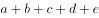
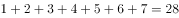

# 综合推理-赋值字母法与总和差值消元

考点：[[20-考点/判断推理/逻辑判断/综合推理-赋值字母法与总和差值消元|逻辑判断 / 综合推理-赋值字母法与总和差值消元]]

**问法模型**：问“两人都击中过几号地鼠”→将互异得分赋值为不同字母，利用“总分恒定17”与“1-7分总和28”建立两个等式做差，求出唯一公共得分

## 推理链
1. 第1步：由条件（1）“没有人击中8-10号地鼠”锁定所有得分只能取1-7分（得分与地鼠编号一一对应）
2. 第2步：由条件（3）设“敲得狠”四次得分为a、b、c、d，则“盯得准”为a、b、e、f，“出得快”为c、d、e、g，其中e即条件（4）“盯得准”和“出得快”唯一相同的得分
3. 第3步：由条件（2）“每人4次都击中不同的地鼠”和条件（4）“只有1次得分相同”，推出a、b、c、d、e、f、g两两互异，共7个不同得分，恰占满1-7，故总和=1+2+…+7=28
4. 第4步：由条件（2）总分17得a+b+c+d=17（“敲得狠”），故e+f+g=28-17=11
5. 第5步：“盯得准”+“出得快”总分=17+17=34，即(a+b+c+d)+(2e+f+g)=34，代入a+b+c+d=17得2e+f+g=17
6. 第6步：两式相减：(2e+f+g)-(e+f+g)=17-11，得e=6，即两人唯一相同得分为6分
7. 第7步：得分对应地鼠编号，故“盯得准”和“出得快”都击中过6号地鼠，选D

**最快解法**：⚡ 赋值字母法+做差消元：设7个字母两两互异且限于1-7；由“敲得狠”17分得e+f+g=11，再由“盯得准”与“出得快”合计34分得2e+f+g=17，两式相减立得e=6，直接选D

## 易错点
- ⚠ 漏推a、b、c、d、e、f、g两两互异（尤其忽视条件（4）还需排除f≠g、f≠c/d、g≠a/b），得不到总和28这一关键锚点
- ⚠ 忽略条件（1）把取值压缩到1-7，导致“总和28”无处使用，无法做差
- ⚠ 误以为“每人4次不同”只是个人内部约束而未用来排除跨人重复；或不用等式而凭空凑数，极易凑错

## 母题抽象
> 🧩 当题干出现“多人多次得分、各自总分恒定、部分得分相同且各自互异”的特征时，用字母赋值把相同项设为同一字母，先由互异+取值范围得全集总和，再与个人总分做差消元，求出公共项

**同类特征**：每人总得分恰好都为17分、每人的4次都击中不同的地鼠、有2次得分相同/只有1次得分相同、没有人击中8-10号地鼠、得分与地鼠编号一一对应、求两人共同击中的编号

## 相关题
（暂无）

---

### 题干
某款“打地鼠”游戏的规则如下：游戏开始后，界面随机出现编号为1-10的10只地鼠，玩家每次最多可击中1只地鼠，击中1号地鼠得1分，击中2号地鼠得2分，以此类推，击中10号地鼠得10分；玩家击中地鼠后，界面立即显示得分，游戏随即重新开始，游戏昵称分别为“盯得准”“出得快”“敲得狠”的3名玩家各参与4次游戏，每次都有得分，已知：
（1）没有人击中8-10号地鼠；
（2）每人总得分恰好都为17分，但每人的4次都击中了不同的地鼠；
（3）“敲得狠”有2次得分和“盯得准”相同，其余2次得分和“出得快”相同；
（4）“盯得准”和“出得快”只有1次得分相同。
由此可推知，“盯得准”和“出得快”都击中过（    ）地鼠。

### 选项
- A. 2号
- B. 3号
- C. 4号
- D. 6号　✅

### 官方解析

第一步：整理题干条件。

（1）没有人击中8-10号地鼠；

（2）每人总得分恰好都为17分，但每人的4次都击中了不同的地鼠；

（3）“敲得狠”有2次得分和“盯得准”相同，其余2次得分和“出得快”相同；

（4）“盯得准”和“出得快”只有1次得分相同。

根据条件（1）可知没有人击中8-10号地鼠，则击中的是1-7号地鼠；

根据条件（2）可知每人4次击中了不同的地鼠，且根据题干可知每次得分无法确定，所以可以用不同字母表示不同得分来梳理三个人的得分情况：

以a、b、c、d表示“敲得狠”的得分情况；又结合条件（3）“敲得狠”有2次得分和“盯得准”相同，其余2次得分和“出得快”相同，以及条件（4）“盯得准”和“出得快”只有1次得分相同，则“盯得准”得分情况可以用a、b、e、f表示，“出得快”得分情况用c、d、e、g表示。

故可将条件（2）（3）（4）信息中得分情况整理如下表：

第二步：根据题干条件进行推理。

根据“盯得准”和“出得快”得分情况可知，重复的地鼠为e，“盯得准”和“出得快”加和可知：，又由条件（1）可知击中的是1-7号地鼠，则，则“盯得准”和“出得快”重复的分数也就是击中的地鼠，故可以得知“盯得准”和“出得快”都击中了6号地鼠。

故正确答案为D。

### 给定材料
（无）

> [!warning] 疑点（官方解析可能有误，待人工复核）
> 官方解析文字中两处公式缺失（“加和可知：”与“则”之后为空），严格推理需补上“7个字母两两互异、总和为28”这一步方可得出e=6；该缺失不影响结论，答案D无误

<!-- CODEX-ANSWER-REVIEW:BEGIN -->
### 本次独立复核

**复核状态：** `resolved`（答案与解析已核定）

**计分答案：** D（可计分）

**复核解析：**

设7只不同编号为a至g。由表格得“敲得狠”总分a+b+c+d=17，“盯得准”总分a+b+e+f=17，“出得快”总分c+d+e+g=17；a至g互不相同且均为1—7，和为28。由第三式可得e+f+g=11；由前两式之和减去重复部分得2e+f+g=17；相减得e=6。e是“盯得准”和“出得快”唯一共同击中的地鼠，故为6号，对应D。

**相关信息：**

逻辑推理—集合重叠与总和消元；先将重复成绩以字母标记，再利用1—7互异数总和28求重合值。

**题源依据：** [固定版本原题](https://github.com/Mentat-Uran/kaogongzhentizhengliu/blob/84ab93d4b64b61d897bece8a1c0a5bab06b4feb2/10-%E7%9C%9F%E9%A2%98/%E5%88%A4%E6%96%AD%E6%8E%A8%E7%90%86/%E9%80%BB%E8%BE%91%E5%88%A4%E6%96%AD/2730908%20%E7%BB%BC%E5%90%88%E6%8E%A8%E7%90%86-%E8%B5%8B%E5%80%BC%E5%AD%97%E6%AF%8D%E6%B3%95%E4%B8%8E%E6%80%BB%E5%92%8C%E5%B7%AE%E5%80%BC%E6%B6%88%E5%85%83.md)；固定内容 commit `84ab93d4b64b61d897bece8a1c0a5bab06b4feb2`，Markdown blob `b88e81f3a28a41e5f1f572ff62c6343cdfb615dc`。
<!-- CODEX-ANSWER-REVIEW:END -->
