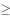
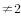

# 翻译推理-全假供词取矛盾命题+进出场顺序排序

考点：[[20-考点/判断推理/逻辑判断/翻译推理-全假供词取矛盾命题+进出场顺序排序|逻辑判断 / 翻译推理-全假供词取矛盾命题+进出场顺序排序]]

**问法模型**：题干给出'每句供词都是虚假供述'→先逐句写出各供词的矛盾命题（均为真），再将'到时/离开时死活状态'转译为'在凶手之前/之后'的顺序约束，排序后用假设排除法锁定凶手

## 推理链
1. 第1步：由'每句供词都是虚假供述'取各句矛盾为真：赵一→'四人中有人杀害他，且赵一离开时他已死'；王二→'王二不是第二个进，且王二到时他还活着'；张三→'张三不是第三个进，且张三离开时他已死'；李四→'凶手比李四晚进他家，且李四到时他还活着'
2. 第2步：将矛盾命题翻译为顺序约束：李四到时还活着→李四在凶手之前（凶手李四不可能，排除D）；赵一离开时已死→凶手在赵一之前或赵一本人是凶手；张三离开时已死→凶手在张三之前或张三本人是凶手，且张三≠第三；王二到时还活着→王二在凶手之前或王二本人是凶手，且王二≠第二
3. 第3步：综合约束得框架：李四＜凶手≤赵一，王二≤凶手，凶手≤张三，即李四必在凶手之前，赵一、张三在凶手之后或本人是凶手
4. 第4步：假设王二是凶手：李四在王二之前，赵一、张三都须在王二之后，则王二只能排第二，与矛盾命题'王二不是第二个进'矛盾，排除B
5. 第5步：假设张三是凶手：李四、王二都在张三之前，赵一在张三之后，则张三只能排第三，与矛盾命题'张三不是第三个进'矛盾，排除C
6. 第6步：李四已由第2步排除，唯一剩余的赵一为凶手，排出顺序'李四、王二、赵一（凶手）、张三'代入验证：王二非第二、到时活着，张三非第三、离开时已死，李四到时活着、凶手更晚进，全部条件无矛盾，故选A

**最快解法**：⚡ 矛盾命题法+假设排除法：先把四句供词逐句取矛盾，提炼出'李四在凶手前、王二≤凶手、凶手≤赵一/张三'的先后约束，直接排除李四；再假设王二、张三为凶手，分别推出'王二必排第二''张三必排第三'与'非第二''非第三'矛盾而排除，剩余唯一即为赵一

## 易错点
- ⚠ 只否定每句的前半句，漏掉'我到/离开时他已死（还活着）'后半句所承载的先后顺序信息，导致约束不足排不出顺序
- ⚠ 负命题写错：'凶手进他家不比我晚'的矛盾应是'凶手比李四晚进'，误写成'凶手不比李四晚'会误留李四
- ⚠ 忽视'王二不是第二个进、张三不是第三个进'这两个隐藏位置限制，无法通过假设法排除B、C而错选

## 母题抽象
> 🧩 当题干出现'所作每句话都是虚假供述/全假供词'特征时，先逐句写出矛盾命题，再把'到场/离开时死活状态'转成'在凶手之前还是之后'的位置约束，最后用假设法逐一验证排除，锁定唯一解

**同类特征**：每句供词都是虚假供述、四人先后单独进出一次且不同时、到时/离开时死者的死活状态、第二个/第三个进他家、凶手不比我晚、假设排除唯一锁定

## 相关题
（暂无）

---

### 题干
某公司总经理郑某在家中被杀，警方确切掌握的是，案发当天，其下属赵一、王二、张三、李四都进出过一次郑某家中，且排除同时出现的可能性，被警方传讯前，四人秘密约定，向警方所作的每句供词都是虚假供述，供词如下：
赵一：“我们四人都没杀害他，我离开他家时，他还活着。”
王二：“我是第二个进他家的，我到他家时，他已经死了。”
张三：“我是第三个进他家的，我离开他家时，他还活着。”
李四：“凶手进他家不比我晚，我到他家时，他已经死了。”
由此可知推知，凶手是：

### 选项
- A. 赵一　✅
- B. 王二
- C. 张三
- D. 李四

### 官方解析

第一步：分析题干。

根据四人向警方所作的每句供词都是虚假供述，得知每人每句话的矛盾为真，即：

（1）赵一的矛盾：四人中有人杀害他，赵一离开他家时，他已经死了；

（2）王二的矛盾：王二不是第二个进他家的，王二到他家时，他还活着；

（3）张三的矛盾：张三不是第三个进他家的，张三离开他家时，他已经死了；

（4）李四的矛盾：凶手比我晚进他家，我到他家时，他还活着；

第二步：逐一分析选项。

根据条件（1）可知，赵一可能是凶手或在凶手之后进入郑某家中，即到来顺序：赵一凶手；根据条件（2）可知，王二可能是凶手或在凶手之前进入郑某家中，即到来顺序：凶手王二，且王二；根据条件（3）可知，张三可能是凶手或在凶手之后进入郑某家中，即到来顺序：张三凶手，且张三；根据条件（4）可知，凶手比李四晚进郑某家，即凶手李四，李四不可能是凶手，排除D项；

综合上述分析，得到四人进入郑某家中的顺序为：李四凶手赵一、王二凶手张三；假设王二是凶手，则王二第二个进入郑某家，与条件（2）矛盾，则王二不是凶手，排除B项；假设张三是凶手，则张三第三个进入郑某家，与条件（3）矛盾，则张三不是凶手，排除C项；则凶手只能是赵一，A项当选。

故正确答案为A。

### 给定材料
（无）
