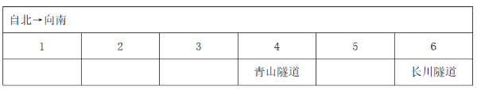
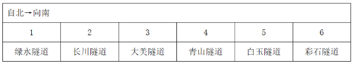
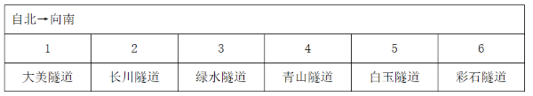

# 分析推理-位置排列（代入排除法）

考点：[[20-考点/判断推理/逻辑判断/分析推理-位置排列（代入排除法）|逻辑判断 / 分析推理-位置排列（代入排除法）]]

**问法模型**：题干给出6条隧道自北向南的线性排列条件，问'以下哪项是不可能的'（选非题）→ 优先代入法，将选项假设定为既成事实，逐层安置受强约束对象，出现无处可放即矛盾

## 推理链
1. 第1步：从题干提取条件①白玉在彩石北边且相邻、且白玉在大美南边但不相邻（即大美在白玉北侧且至少隔1位）；条件②长川与青山之间隔一条隧道（位置差2）
2. 第2步：共6条隧道占1~6号位（1最北），选非题用代入法逐项验证
3. 第3步：代入A项，长川在第6位（最南），由条件②位置差2得青山只能在第4位
4. 第4步：此时空位仅剩1、2、3、5，白玉+彩石需相邻且白玉在北，只能占(1,2)或(2,3)
5. 第5步：检验大美——若白玉=1，其北侧无空位放大美；若白玉=2，大美只能放1位，但1位与2位相邻，违反'不相邻'条件，矛盾
6. 第6步：A项任何排法均违反条件①，不可能成立，当选；B、C、D代入后均可构造出满足全部条件的排列（如B项：绿水1-长川2-大美3-青山4-白玉5-彩石6），排除

**最快解法**：⚡ 代入法+端点定位：代'长川=最南第6位'，先锁定与之强绑定的青山=第4位，再排唯一相邻组合白玉/彩石至(1,2)或(2,3)，最后验证大美无合法位置即秒选A

## 易错点
- ⚠ 漏读'不相邻'双重约束：只验证白玉与彩石相邻、大美在白玉北边，忽略大美与白玉必须隔位，导致A项误判为可能
- ⚠ 选非题惯性错选：把验证成功的'可能'项（B/C/D）当成答案，忘记题目选'不可能'项
- ⚠ '隔一条隧道'理解错位：误当成相邻或隔两条，导致长川与青山的位置差算错（应为位置差2）

## 母题抽象
> 🧩 当题干出现'多个对象线性排列+相邻/间隔等位置约束+问法为不可能/无法推出'的特征时，用代入法，优先代入锁定端点或强绑定对象，逐层安置约束最强的元素，出现无处可放即为矛盾项

**同类特征**：六条隧道自北向南线性排列、相邻与不相邻双重方位约束、隔一条隧道（位置差2）、选非题问'不可能'、代入排除法求解、强绑定对象先定位

## 相关题
（暂无）

---

### 题干
根据上述信息，以下哪项是不可能的？

### 选项
- A. 长川隧道在最南边　✅
- B. 绿水隧道在最北边
- C. 彩石隧道与青山隧道隔一条隧道
- D. 白玉隧道与大美隧道隔一条隧道

### 官方解析

第一步：分析题干条件。

（1）白玉隧道在彩石隧道的北边并与之相邻，在大美隧道的南边但与之不相邻；

（2）长川隧道与青山隧道之间隔一条隧道。

第二步：根据题干条件进行推理。

提问方式为“不可能”，优先使用代入法。

代入A项：已知长川隧道在最南边（即第6位），根据条件（2）可知，青山隧道在第4位，又根据条件（1）可知，白玉隧道在彩石隧道的北边且相邻，故白玉隧道和彩石隧道只能在第1位和第2位，或在第2位和第3位，又已知白玉隧道在大美隧道的南边但不相邻，此时与前面矛盾，不满足题干条件，该项不可能成立，当选；

代入B项：已知绿水隧道在最北边，假设大美隧道在第2位，根据条件（1），白玉隧道和彩石隧道可以在第4位和第5位，或第5位和第6位，但这两种情况都不符合条件（2）。再次假设大美隧道在第3位，此时白玉隧道和彩石隧道只能在第5位和第6位，此时长川隧道和青山隧道可以分别在第2位和第4位，可进行如下安排，满足题干条件，该项可能成立，排除；

代入C项：已知彩石隧道与青山隧道隔一条隧道，假设大美隧道在第1位，根据条件（1）和（2），此时白玉隧道和彩石隧道只能在第5位和第6位，可知青山隧道在第4位，长川隧道在第2位，继续推理可知，绿水隧道在第3位，可进行如下安排，满足题干条件，该项可能成立，排除；

代入D项：已知白玉隧道与大美隧道隔一条隧道，假设大美隧道在第1位，可知白玉隧道在第3位，根据条件（1），彩石隧道在第4位，此时不满足条件（2）。再次假设大美隧道在第2位，可知白玉隧道和彩石隧道分别在第4位和第5位，此时长川隧道和青山隧道可以分别在第1位和第3位，继续推理可知，绿水隧道在第6位，可进行如下安排，满足题干条件，该项可能成立，排除。

本题为选非题，故正确答案为A。

### 给定材料

一条新开通的南北向高速公路，中间有6条隧道：长川隧道、大美隧道、青山隧道、绿水隧道、彩石隧道、白玉隧道。已知：

（1）白玉隧道在彩石隧道的北边并与之相邻，在大美隧道的南边但与之不相邻；

（2）长川隧道与青山隧道之间隔一条隧道。

