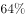

# 论证结构-前提假设（必要前提，选非题）

考点：[[20-考点/判断推理/逻辑判断/论证结构-前提假设（必要前提，选非题）|逻辑判断 / 论证结构-前提假设（必要前提，选非题）]]

**问法模型**：“以下各项如果为真，不属于上述结论必要前提的是”→ 选非型前提假设题，对每项做“否定代入”（无此条件结论是否崩塌），崩塌者为必要前提，不崩塌者为答案

## 推理链
1. 第1步：提取论点“该计算模型有助于更快、更准确地预测恶劣天气”；论据为模型利用计算机视觉和机器学习自动识别卫星图像中的逗点状云系，及时发现恶劣天气“端倪”，论点论据话题一致
2. 第2步：采用否定代入法验证必要条件——若否定某选项后论点无法成立，则该项为必要前提；本题选非，找否定后论点仍成立的项
3. 第3步：A项否定：模型检测不出逗点状云系或准确率低，则无法据云系发现“端倪”预测恶劣天气，论点崩塌，是必要前提，排除
4. 第4步：B项否定：逗点状云系与气旋形成无关，则识别逗点状云系对预测恶劣天气毫无价值，论点崩塌，是必要前提，排除
5. 第5步：D项否定：气旋形成不导致冰雹雷暴、大风、暴风雨等恶劣天气，则通过云系（联系气旋）找端倪的思路失效，论点崩塌，是必要前提，排除
6. 第6步：C项主体是“该计算模型如与其他天气预报模型相结合”后的联合效果，否定C（不与其他模型结合）时“该计算模型本身有助于预测恶劣天气”的论点仍可成立，故非必要前提，当选

**最快解法**：⚡ 否定代入法+主体核对：A/B/D分别否定后论点均崩塌（模型识别失效/云系与气旋脱钩/气旋与恶劣天气脱钩）；C项把主体偷换成“与其他天气预报模型相结合”，脱离论点中“该计算模型（自身）有助于预测”的范围，直接锁定C

## 易错点
- ⚠ 忽略“选非”问法，误把必要前提A/B/D当成答案
- ⚠ 被C项“有效预测出一定比例的恶劣天气事件”与论点表述高度相似迷惑，未察觉其前提是“与其他天气预报模型相结合”，主体已变
- ⚠ 未理清“逗点状云系→气旋→恶劣天气”的隐含论证链条，误把B、D当作无关背景信息

## 母题抽象
> 🧩 当题干问“不属于必要前提的是”且论点论据话题一致时，用否定代入法逐项验证：否定后结论崩塌的是必要前提，仍成立的是答案；尤其警惕把“与外部手段结合后才能实现的效果”误当作本体的必要条件

**同类特征**：选非问法（不属于必要前提）、论点论据话题一致（计算模型—预测恶劣天气）、逗点状云系作为识别与预测的线索、人工智能/计算机视觉/机器学习技术、隐含链条：云系—气旋—恶劣天气、干扰项引入“与其他模型相结合”偷换主体

## 相关题
- [[10-真题/判断推理/逻辑判断/2188104 前提假设-必要前提辨析（选非题）|2188104]]（选调 2018，相关度1）

---

### 题干
气象研究团队开发出一种基于人工智能的计算模型，用以检测云的旋转运动。研究人员鉴定并标记了逗点状云系的形态和运动，并利用计算机视觉和机器学习技术，“教会”计算机自动识别和检测卫星图像中的逗点状云系，以帮助人们更高效地在海量天气数据中及时发现恶劣天气的“端倪”。该计算模型有助于更快、更准确地预测恶劣天气。
以下各项如果为真，不属于上述结论必要前提的是：

### 选项
- A. 
该计算模型能检测出逗点状云系，准确率达，甚至在其完全形成前就能检测到

- B. 
从卫星图像中看，逗点状云系因其外形类似于逗号而得名，与气旋的形成密切相关

- C. 
该计算模型如与其他天气预报模型相结合，将能有效地预测出的恶劣天气事件
　✅
- D. 
气象学认为气旋的形成可导致冰雹雷暴、大风和暴风雨等各种恶劣天气事件发生

### 官方解析

第一步：找出论点和论据。

论点：基于人工智能的计算模型有助于更快、更准确地预测恶劣天气。

论据：研究人员鉴定并标记了逗点状云系的形态和运动，并利用计算机视觉和机器学习技术，“教会”计算机自动识别和检测卫星图像中的逗点状云系，以帮助人们更高效地在海量天气数据中及时发现恶劣天气的“端倪”。

本题论点和论据都在讨论该计算模型有助于发现、预测恶劣天气，二者话题一致，必要前提优先考虑必要条件。本题为选非题，找出结论成立的必要条件排除即可。

第二步：逐一分析选项。

A项：选项说明该计算模型准确率达，甚至在其完全形成前就能检测到，若该计算模型准确率低或者不能检测出逗点状云系，则该计算模型就无法预测恶劣天气，是上述结论的必要前提，排除；

B项：选项说明逗点状云系与气旋形成密切相关，若逗点状云系与气旋形成无关，则不能根据逗点状云系预测恶劣天气，是上述结论的必要前提，排除；

C项：选项说明该计算模型如果与其他天气预报模型结合，能有效预测出的恶劣天气事件，但是有效地预测情况是否为该计算模型的作用，不能确定，不是上述结论的必要前提，当选；

D项：论点是通过检测气旋的形成来预测恶劣天气的，选项说气旋的形成可导致恶劣天气，是上述结论的必要前提，排除。

本题为选非题，故正确答案为C。

### 给定材料
（无）

> [!warning] 疑点（官方解析可能有误，待人工复核）
> 官方解析对D项的表述“论点是通过检测气旋的形成来预测恶劣天气”与题干“检测逗点状云系/云的旋转运动”略有出入——题干未直接言明逗点状云系即气旋，该关联需借助B项建立；此为解析措辞不严谨，但不影响结论成立链条与答案判定，正确答案C无误
