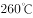
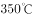
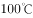
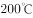

# 日常结论-程度偷换与剂量偷换（选非题）

考点：[[20-考点/判断推理/逻辑判断/日常结论-程度偷换与剂量偷换（选非题）|逻辑判断 / 日常结论-程度偷换与剂量偷换（选非题）]]

**问法模型**：问'由此无法推出的是'→选非题，将每个选项逐一与题干信息比对，找出无中生有或偷换概念/程度的一项

## 推理链
1. 第1步：题干限定'全氟辛酸铵是特氟龙生产过程中使用的含量极微的一种加工助剂'，即日常涂层中该物质剂量极低
2. 第2步：题干危害表述为'高剂量的全氟辛酸铵有可能导致胆固醇水平升高'，含'高剂量'与'有可能'双重限定
3. 第3步：题干温度链条——特氟龙常温常态稳定，超过一定温度逐渐不稳定、更高温度才分解；正常烹调（水的沸点、爆炒约、油炸油温）均不超过该阈值，而'把锅烧干、烧红后再加油'则'容易超过'
4. 第4步：比对A、D——正常烹调温度不超限→涂层不分解→烧开水煮粥、无需担心有害物质均可推出
5. 第5步：比对C——烧干烧红易超温致涂层不稳定→应避免此做法可推出
6. 第6步：比对B——把'高剂量全氟辛酸铵有可能导致胆固醇升高'偷换成'涂层分解会导致胆固醇升高'：一是主体偷换（分解物≠全氟辛酸铵），二是剂量偷换（忽略'含量极微'），三是程度偷换（'有可能'≠'会导致'），无法推出
7. 第7步：选非题，锁定B为正确答案

**最快解法**：⚡ 关键词对比法：抓题干'高剂量+有可能+含量极微'三处限定，与B项'分解会导致'比对，主体、剂量、程度三重偷换，直接锁定；A/C/D与题干温度信息一一对应可排除

## 易错点
- ⚠ 忽略'含量极微'的剂量限定，误以为涂层分解必然与胆固醇升高挂钩
- ⚠ 把'有可能导致'当成'会导致'，程度加重偷换未察觉
- ⚠ 选非题看错问法，误选可推出的A/C/D

## 母题抽象
> 🧩 当题干出现'某物质高剂量/特定条件下有可能导致某危害，而日常使用中剂量极微或条件不满足'的特征时，选项若表述为'日常使用会导致该危害'即属偷换概念/程度，是无法推出的正确答案

**同类特征**：含量极微的加工助剂、高剂量…有可能导致、常温常态理化性质稳定、正常烹调温度不超过阈值、烧干烧红后再加油容易超温、由此无法推出（选非）

## 相关题
（暂无）

---

### 题干

不粘锅常见的不粘涂层为特氟龙涂层。全氟辛酸铵是特氟龙生产过程中使用的含量极微的一种加工助剂。数据表明，高剂量的全氟辛酸铵有可能导致胆固醇水平升高、甲状腺疾病及不育。特氟龙在常温及常态下具有非常稳定的理化性质，使用特氟龙不粘涂层的炊具在常温至的温度范围内都不会发生任何变化，但是当温度超过时，涂层逐渐向不稳定状态转变，当温度超过时会发生分解。正常烹调时，水的沸点是，温度较高的爆炒通常也只是左右，即使采用油炸的方式，油温也不会超过。然而，如果在炒菜时喜欢把锅烧干、烧红后再加油，锅内温度就容易超过。

由此无法推出的是：

### 选项
- A. 日常生活中，可以用不粘锅来烧开水和煮粥
- B. 烹饪时不粘涂层分解会导致胆固醇水平升高　✅
- C. 炒菜时应避免把不粘锅烧干、烧红后再加油
- D. 正常烹调通常无需担心不粘锅释放有害物质

### 官方解析

日常结论题，根据题干信息逐一分析选项。

A项：根据题干“正常烹调时，水的沸点是，温度较高的爆炒通常也只是左右，即使采用油炸的方式，油温也不会超过”，可知烧水等正常烹调不会超过，说明特氟龙不粘涂层不会发生分解，可以推出可以用不粘锅来烧开水和煮粥，排除；

B项：题干中指出高剂量的全氟辛酸铵有可能导致胆固醇水平升高、甲状腺疾病及不育，但是题干中也指出“全氟辛酸铵是特氟龙生产过程中使用的含量极微的一种加工助剂”，因此涂层中的全氟辛酸铵剂量是否达到了能够导致胆固醇水平升高的剂量不明确，同时“高剂量的全氟辛酸铵有可能导致胆固醇水平升高”，也不是一定会导致胆固醇水平升高，无法推出，当选；

C项：根据题干“如果在炒菜时喜欢把锅烧干、烧红后再加油，锅内温度就容易超过”，可知炒菜时把不粘锅烧干、烧红后再加油会导致锅内温度超过，此时特氟龙不粘涂层会向不稳定状态转变，因此应避免此做法，可以推出炒菜时应避免把不粘锅烧干、烧红后再加油，排除；

D项：根据题干“正常烹调时，水的沸点是，温度较高的爆炒通常也只是左右，即使采用油炸的方式，油温也不会超过”，可知正常烹调不会超过，说明特氟龙不粘涂层不会发生分解，可以推出正常烹调通常无需担心不粘锅释放有害物质，排除。

本题为选非题，故正确答案为B。

### 给定材料
（无）
