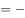

# 翻译推理-假言命题矛盾关系（肯前必肯后-否前无必然结论）

考点：[[20-考点/判断推理/逻辑判断/翻译推理-假言命题矛盾关系（肯前必肯后-否前无必然结论）|逻辑判断 / 翻译推理-假言命题矛盾关系（肯前必肯后/否前无必然结论）]]

**问法模型**：题干给古语条件句、问'以下哪项是不可能的'（选非）→ 先将古语翻成假言命题P→Q，再找必然为假的矛盾式'P且¬Q'

## 推理链
1. 第1步：古语'留得五湖明月在，不愁无处下金钩'中，'不愁无处下金钩'等于'有去处下金钩'，故翻译为：留得五湖明月在 → 有去处下金钩
2. 第2步：套用假言规则：肯前必肯后；否前、否后均无必然结论；P→Q的矛盾命题是'P且¬Q'
3. 第3步：A项'如果留得五湖明月，定有去处可下金钩'是肯前形式，必真；B项'五湖明月俱在，但已无处可下金钩'即'明月在且无处下钩'＝P且¬Q，与题干条件关系矛盾，必假
4. 第4步：C项'没有留得明月，也有去处下钩'是否前（¬P且Q），D项'没有留得明月，可能会无处下钩'也是否前（¬P且可能¬Q），均无必然结论、可能为真
5. 第5步：题干问'不可能'，只有B项必然为假，当选

**最快解法**：⚡ 矛盾法：记住P→Q的矛盾是'P且¬Q'；B项正是'明月俱在（P）且无处下金钩（¬Q）'，直接锁定，无需逐项细推

## 易错点
- ⚠ 后件翻译错向：把'不愁无处下金钩'误读成'无处下金钩'，导致整个推理方向反了
- ⚠ 选非题误当选是题：问'不可能'却去找'可能/必然为真'的选项，易误选A
- ⚠ 误把'否前'当成必然结论：C、D是否前推不出必然，只代表'可能'，不等于必然假

## 母题抽象
> 🧩 当题干出现'如果…就…/留得…不愁…'式条件古语且问'不可能'时，先统一翻译为P→Q（注意否定词归属），再用'矛盾式P且¬Q'直接找答案，'否前/肯后'选项均为可能项予以排除

**同类特征**：古语假言条件句、选非题-问不可能、肯前必肯后、否前无必然结论、矛盾命题P且非Q、不愁无处=有去处需转换

## 相关题
- [[10-真题/判断推理/逻辑判断/12019761 翻译推理-逆否规则（肯前必肯后-否前肯后无必然）|12019761]]（浙江 2026，相关度1）
- [[10-真题/判断推理/逻辑判断/1789574 翻译推理-假言命题翻译与肯前必肯后（逆否规则）|1789574]]（江苏 2016，相关度1）
- [[10-真题/判断推理/逻辑判断/2367831 翻译推理-逆否等价与联言前件部分肯定陷阱|2367831]]（江苏 2019，相关度1）
- [[10-真题/判断推理/逻辑判断/2453207 平行结构（论证结构相似）-选非题·肯前必肯后|2453207]]（北京 2020，相关度1）
- [[10-真题/判断推理/逻辑判断/2660465 翻译推理-相容选言作前件的假言推理（肯前必肯后）|2660465]]（选调 2018，相关度1）

---

### 题干
中国有句古语：“留得五湖明月在，不愁无处下金钩。”
据此，以下哪项是不可能的？

### 选项
- A. 如果留得五湖明月，定有去处可下金钩
- B. 虽然五湖明月俱在，但已无处可下金钩　✅
- C. 没有留得五湖明月，也有去处可下金钩
- D. 没有留得五湖明月，可能会无处下金钩

### 官方解析

第一步：翻译题干。

题干翻译为：留得五湖明月在有去处下金钩（无处下金钩）。

第二步：逐一分析选项。

A项：翻译为：留得五湖明月有去处下金钩，是对题干条件关系的肯前，肯前必肯后，一定为真，排除；

B项：翻译为：五湖明月俱在 且 无处可下金钩，与题干的条件关系相矛盾，不可能为真，当选；

C项：翻译为：留得五湖明月 且 有去处下金钩，“留得五湖明月”是对题干条件关系的否前，否前无必然结论，因此可能为真，排除；

D项：前半句“留得五湖明月”是对题干条件关系的否前，否前无必然结论，因此可能无处下金钩，排除。

本题为选非题，故正确答案为B。

### 给定材料
（无）
