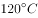

# 削弱论证-削弱论点（话题一致性排除）

考点：[[20-考点/判断推理/逻辑判断/削弱论证-削弱论点（话题一致性排除）|逻辑判断 / 削弱论证-削弱论点（话题一致性排除）]]

**问法模型**：问'哪项最能削弱上述观点'→ 先锁定论点及其程度词，优先选直接否定论点的选项，话题不一致项一律排除

## 推理链
1. 第1步：提取论点——'焦谷氨酸钠会致癌，所以高温烹饪时使用味精会大大增加人体罹患癌症的风险'，核心断言是'大大增加罹癌风险'。
2. 第2步：提取论据——'在（某温度）以上的高温中使用味精，谷氨酸钠会转变为焦谷氨酸钠'；论据只说明转变会发生，与论点话题一致，故削弱应指向论点本身。
3. 第3步：排除话题不一致项——A项只说孕妇婴幼儿'最好不要吃'含味精食物，未说明与致癌的关系；B项说味精原料是大米玉米、属绿色食品，未涉及高温烹饪是否致癌；C项说如何用口感辨别假味精（硫酸铵），与致癌无关。
4. 第4步：D项给出实验事实——'在不同温度（含高温）的实验条件下，人均每天仅食用50克左右味精，不会对人体产生危害'，即在正常食用量下即使高温使用味精也无健康危害。
5. 第5步：对照结论——D项直接否定'大大增加人体罹患癌症的风险'这一论点（不危害人体即谈不上大大增癌），是唯一针对论点的削弱，当选D。

**最快解法**：⚡ 话题一致排除法+削弱论点：先抓论点关键词'大大增加罹癌风险'，快速排除A（只讲建议、不讲原因）、B（讲来源）、C（讲辨假）三个话题不一致项，锁定D'不同温度下50克左右不会对人体产生危害'直接反驳论点。

## 易错点
- ⚠ B项'绿色食品'易被误认为与健康/安全相关，但'原料天然'≠'高温不致癌'，属偷换话题的强干扰项
- ⚠ 忽略论点中的程度词'大大'，误以为A项'最好不要吃'能间接削弱；A未建立与致癌的因果联系，力度为零
- ⚠ 纠结D项'50克左右'是否为小剂量而误判，实际上D以实验数据直接断定'不会对人体产生危害'，已足以否定'大大增加罹癌风险'

## 母题抽象
> 🧩 当削弱题的论点含'大大增加/必然/所有'等程度词或全称词时，优先找能以实验数据或反例直接否定该结论的选项；只谈原因来源、使用建议、辨别方法等与论点话题不一致的选项一律排除。

**同类特征**：最能削弱、论点含程度词'大大增加'、论据与论点话题一致（谷氨酸钠→焦谷氨酸钠→致癌）、实验显示类论据、话题不一致干扰项（建议/来源/辨假）、高温烹饪与健康风险

## 相关题
- [[10-真题/判断推理/逻辑判断/16592940 削弱论证-削弱论点（话题一致性排除）|16592940]]（青海 2024，相关度2）
- [[10-真题/判断推理/逻辑判断/10297049 削弱论证-另有他因（相关性推出因果结论的削弱）|10297049]]（天津 2025，相关度1）
- [[10-真题/判断推理/逻辑判断/12304864 削弱论证-削弱论点（无论据型）及削弱力度比较（整体削弱＞部分削弱）|12304864]]（江苏 2024，相关度1）
- [[10-真题/判断推理/逻辑判断/13504367 削弱论证-削弱论点（因果链搭桥-追溯根本原因）|13504367]]（甘肃 2025，相关度1）
- [[10-真题/判断推理/逻辑判断/13504503 削弱论证-削弱论点（否定功能实现的前提条件）|13504503]]（河北 2025，相关度1）

---

### 题干

味精让食物鲜美，其主要成分是谷氨酸钠，水解后变为谷氨酸。谷氨酸本身不会增加食物鲜味，只有被提炼出来变成游离的氨基酸盐时才能为食物增鲜。实验显示，如果在以上的高温中使用味精，谷氨酸钠会转变为焦谷氨酸钠。有人认为，焦谷氨酸钠会致癌，所以高温烹饪时使用味精会大大增加人体罹患癌症的风险。

以下哪项如果为真，最能削弱上述观点？

### 选项
- A. 专家建议，从健康的角度出发，孕妇、婴幼儿最好不要吃含味精的食物
- B. 人们用大米或玉米来生产味精，所以味精是绿色食品，不是化工合成制品
- C. 挑选味精时，将味精放进嘴里尝试，如果是苦涩的，那是混进了硫酸铵的假味精
- D. 在不同温度的实验条件下，人均每天仅食用50克左右味精，不会对人体产生危害　✅

### 官方解析

第一步：找出论点和论据。

论点：焦谷氨酸钠会致癌，所以高温烹饪时使用味精会大大增加人体罹患癌症的风险。

论据：实验显示，如果在以上的高温中使用味精，谷氨酸钠会转变为焦谷氨酸钠。

本题论点讨论的是焦谷氨酸钠会致癌，所以在高温烹饪时使用味精会增加人体罹患癌症的风险，论据讨论的是在高温条件下，味精中的谷氨酸钠会转变为焦谷氨酸钠，论据可以合理推出论点，二者话题一致，削弱优先考虑削弱论点。

第二步：逐一分析选项。

A项：专家建议孕妇、婴幼儿最好不要吃含味精的食物，但没有说明为什么不要吃，无法判断是否与致癌相关，无法削弱，排除；

B项：指出味精的原材料是大米或玉米，味精是绿色食品，但是并未说明高温烹饪时味精是否致癌，话题不一致，无法削弱，排除；

C项：选项说的是如何判断真假味精，而论点说的是高温烹饪时味精是否会致癌，话题不一致，无法削弱，排除；

D项：指出如果每天仅食用50克左右味精，在不同温度（包括以上）的实验条件下都不会对人体产生危害，证明在量一定的情况下高温烹饪时使用味精也不会“大大”增加人体罹患癌症的风险，削弱论点，当选。

故正确答案为D。

### 给定材料
（无）

> [!warning] 疑点（官方解析可能有误，待人工复核）
> 题干与官方解析中均出现'在以上的高温中''包括以上'，疑漏具体温度数值（如'120℃'），属文本缺字问题；该缺字不影响论据与论点的削弱关系判断，也不影响答案D的正确性。
