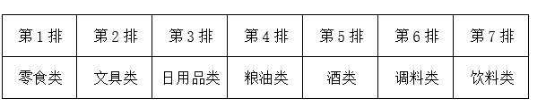
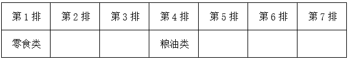

# 分析推理-位置排列（代入排除法+间隔约束）

考点：[[20-考点/判断推理/逻辑判断/分析推理-位置排列（代入排除法+间隔约束）|逻辑判断 / 分析推理-位置排列（代入排除法+间隔约束）]]

**问法模型**：问'哪两类不可能是相邻两排'（选非题）→ 采用代入排除法，逐项假设为真验证是否与条件矛盾

## 推理链
1. 第1步：由'零食类排在第1排'与条件（3）'粮油类在零食类之后，中间隔着2排'，锁定粮油类固定在第4排
2. 第2步：题干问'不可能'，属选非题，改用代入法：将每个选项假设为真，检验四条件（1）酒类在调料类之前、（2）文具与调料隔3排、（3）粮油与零食隔2排、（4）日用品紧挨文具，能否同时满足
3. 第3步：代入A，文具类与粮油类（第4排）相邻→文具类第3排→条件（2）得调料类第7排→条件（4）得日用品类第2排→条件（1）得酒类在第5或第6排，条件均满足，可能为真，排除
4. 第4步：代入B，零食类（第1排）与文具类相邻→文具类第2排→条件（2）得调料类第6排→条件（4）得日用品类第3排→条件（1）得酒类第5排→饮料类第7排，条件均满足，可能为真，排除
5. 第5步：代入C，日用品类与酒类相邻，结合条件（4）'日用品类紧挨文具类前一排或后一排'，则酒类、日用品类、文具类三排相连；因第1排为零食、第4排为粮油，此三类只能占据第5、6、7排，于是文具与调料隔3排的要求使调料类只能落在第2或第3排，而条件（1）要求酒类在调料类之前，酒类却在第5~7排，矛盾，不可能为真，当选
6. 第6步：代入D，零食类与日用品类相邻→日用品类第2排→条件（4）得文具类第3排→条件（2）得调料类第7排→条件（1）得酒类第5或第6排，条件均满足，可能为真，排除；故正确答案为C

**最快解法**：⚡ 代入排除法（选非题首选代入）：先用条件（3）把粮油类钉死在第4排，再逐项代入；核心口诀'隔N排=相差N+1排'。C项代入后，'日用品-酒-文具'被迫三连排，又挤不出靠前的调料位置满足'酒在调料前'，直接矛盾，秒选C

## 易错点
- ⚠ 把'中间隔着3排'误算为相差3排，实际相差4排（隔2排即相差3排），换算错误会导致全部位置排错
- ⚠ 选非题看反问法：A、B、D均可能为真，若按'找可能'的思路作答会误选
- ⚠ C项推理时忽略条件（4）使'酒、日用品、文具'必须三连排，漏掉'调料类被挤到第2/3排与酒类在前矛盾'这一关键冲突

## 母题抽象
> 🧩 当题干给出多对象的位置排列，含'某对象固定''隔N排''紧挨（相邻）''先后顺序'等多重约束且问'不可能'时，先用最具确定性的条件定死一个位置，再用代入法逐项验证，与任一约束冲突的选项即答案

**同类特征**：多类商品排7排的位置约束、间隔排数条件（隔着2排/3排）、紧挨/相邻条件、先后顺序条件（酒类在调料类之前）、选非题（问不可能）、适合代入法逐项验证

## 相关题
- [[10-真题/判断推理/科学推理/1796602 物理-物体的浮沉条件与阿基米德原理（漂浮-悬浮时F浮=G，沉底时F浮=ρ液gV排）|1796602]]（广东 2016，相关度1）
- [[10-真题/判断推理/逻辑判断/4637304 排列组合-位置排序推理（隔排定位）|4637304]]（国考 2022，相关度1）

---

### 题干
如果零食类排在第1排，那么下列哪项中的两类商品不可能是相邻的两排？

### 选项
- A. 文具类和粮油类
- B. 零食类和文具类
- C. 日用品类和酒类　✅
- D. 零食类和日用品类

### 官方解析

第一步：分析题干条件。

（1）酒类排在调料类之前；

（2）文具类和调料类中间隔着3排；

（3）粮油类在零食类之后，中间隔着2排；

（4）日用品类紧挨在文具类前一排或者后一排。

第二步：根据题干条件进行推理。

若零食类排在第1排，根据条件（3）可知，粮油类在第4排，如下表：

提问为“不可能”，所以考虑代入法。

代入A项，若文具类和粮油类相邻，根据条件（2）可知，文具类在第3排，调料类在第7排；根据条件（4）可知，日用品类在第2排；根据条件（1）可知，酒类在第5排或第6排，题干条件均满足，可能为真，排除；

代入B项，若零食类和文具类相邻，则文具类在第2排；根据条件（2）可知，调料类在第6排；根据条件（4）可知，日用品类在第3排；根据条件（1）可知，酒类在第5排；则饮料类在第7排，题干条件均满足，可能为真，排除；

代入C项，若日用品类和酒类相邻，根据条件（4）可知，日用品类、酒类和文具类相邻，则此三类只能占据第5、6、7排的位置，而调料类和饮料类只能在第2排或第3排，与条件（1）矛盾，不可能为真，当选；

代入D项，若零食类和日用品类相邻，则日用品类在第2排；根据条件（4）可知，文具类在第3排；根据条件（2）可知，调料类在第7排；根据条件（1）可知，酒类在第5排或第6排，题干条件均满足，可能为真，排除。

本题为选非题，故正确答案为C。

### 给定材料

某超市从前到后整齐排列着7排货架，放置着文具、零食、调料、日用品、酒、粮油和饮料7类商品，每类商品占据一排。已知：

（1）酒类排在调料类之前；

（2）文具类和调料类中间隔着3排；

（3）粮油类在零食类之后，中间隔着2排；

（4）日用品类紧挨在文具类前一排或者后一排。

